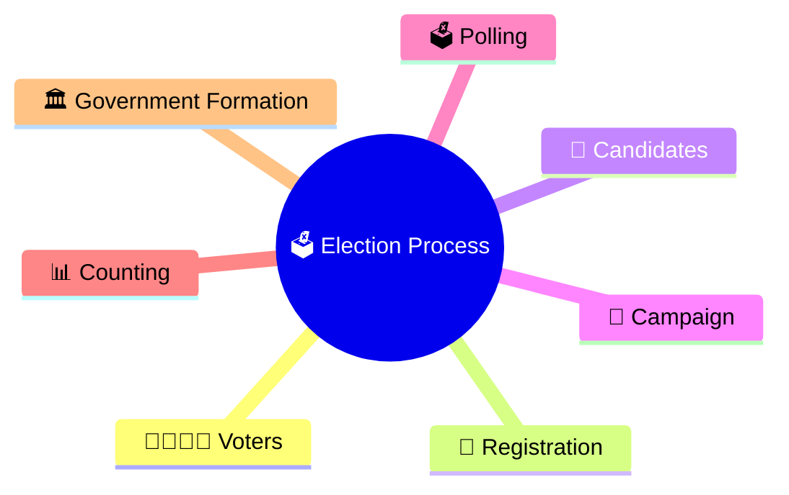
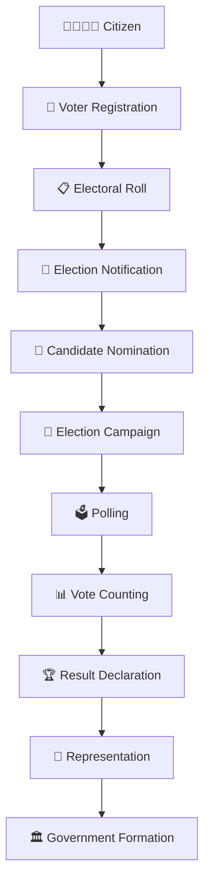
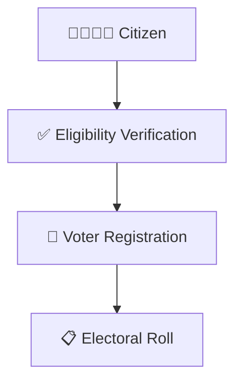
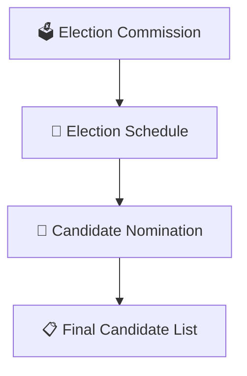
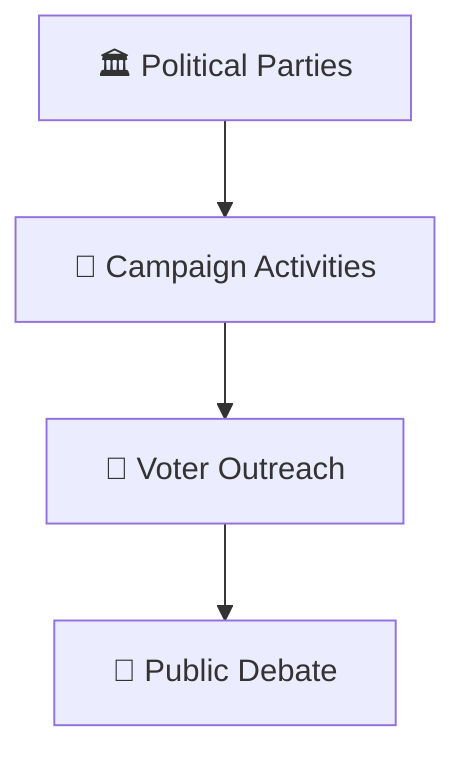
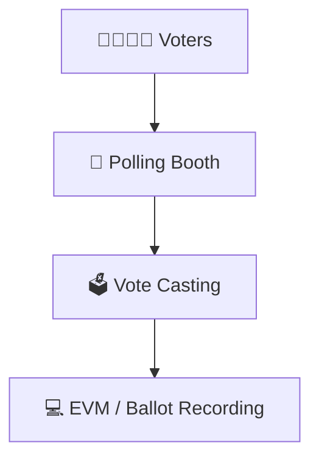
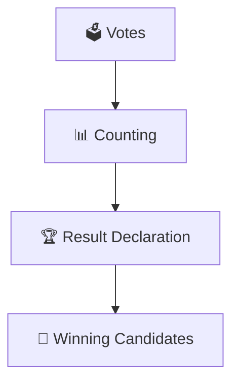
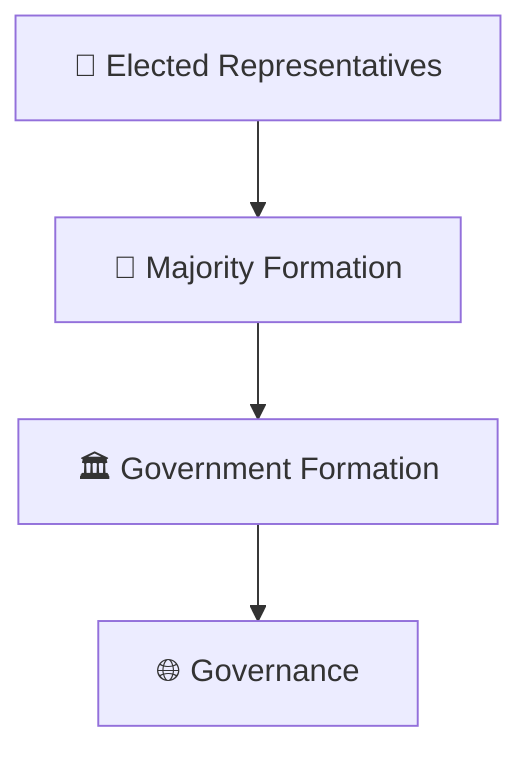
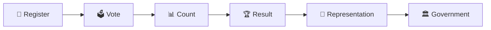

# Election Process Flow

## Overview

This diagram explains the complete election process in India from voter registration to government formation.

It provides a visual understanding of how democratic representation is created through elections.

---

## Why It Matters

Understanding the election process helps explain:

- How citizens participate in democracy
- How representatives are elected
- How governments are formed
- How electoral legitimacy is established
- How democratic accountability functions

---

---

## Complete Election Process

---

## Stage 1: Voter Registration

### Outcome

- Eligible citizen becomes a registered voter.
- Name is included in the electoral roll.

---

## Stage 2: Election Preparation

### Outcome

- Election is formally announced.
- Candidates are finalized.

---

## Stage 3: Campaign Period

### Outcome

- Voters evaluate candidates and parties.

---

## Stage 4: Polling

### Outcome

- Citizens exercise democratic choice.

---

## Stage 5: Counting & Results

### Outcome

- Representatives are elected.

---

## Stage 6: Government Formation

### Outcome

- Executive government is formed.
- Governance process begins.

---

## Quick Revision

---

## Related Topics

- voter-to-government-journey.md
- election-commission-structure.md
- government-formation-process.md
- constituency-representation-model.md
- elections-and-democracy.md
- election-terminology.md