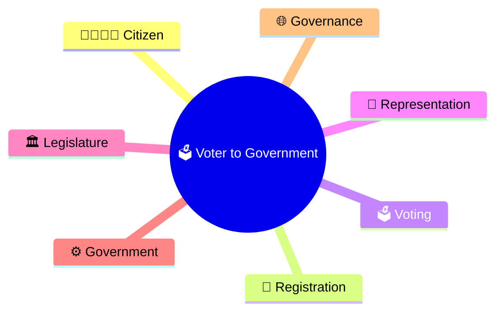
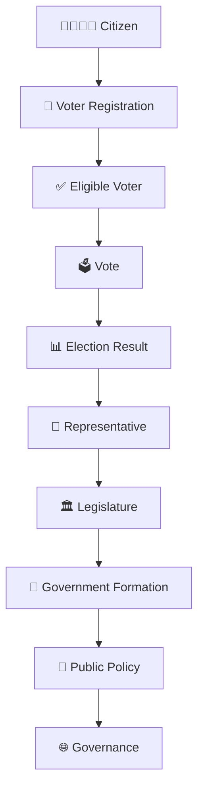
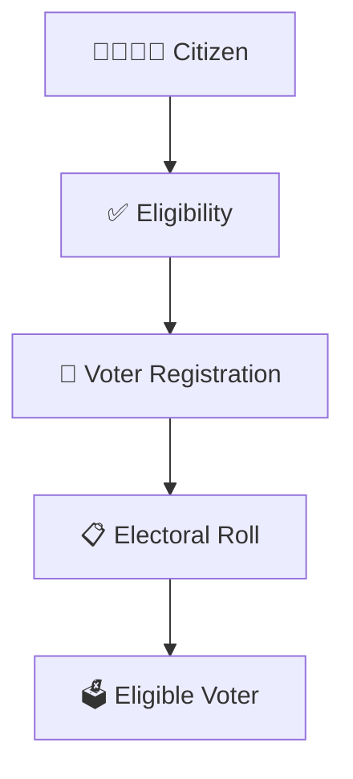
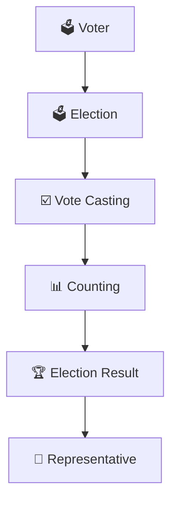
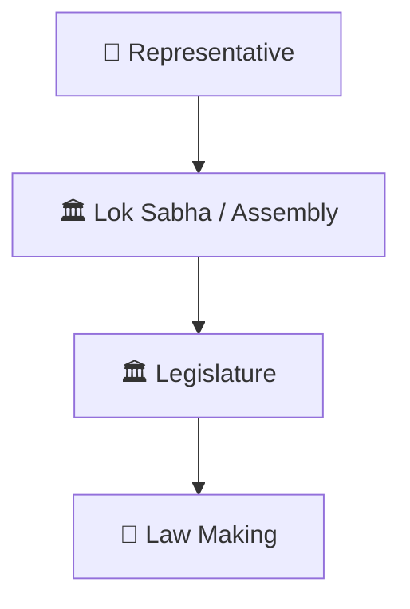
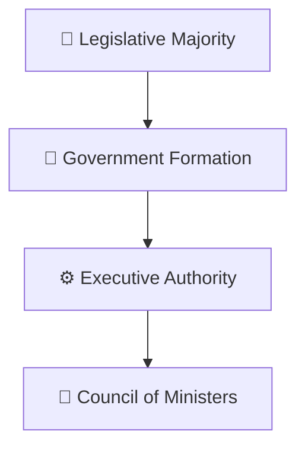
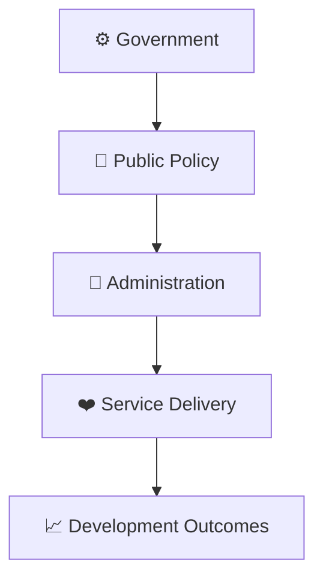
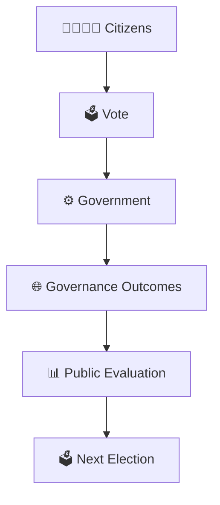
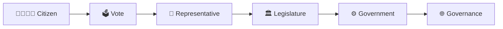

# Voter to Government Journey

## Overview

This diagram explains how an individual citizen's vote ultimately contributes to the formation of a government and the governance of the country.

It provides a complete visual journey from democratic participation to public administration.

---

## Why It Matters

Understanding this journey helps explain:

- How citizens influence governance
- How democratic representation works
- How governments derive legitimacy
- How public accountability is established
- How elections connect citizens and institutions

---

## Complete Journey

---

## Stage 1: Citizen to Voter

### Outcome

- Citizen becomes part of the democratic process.
- Voting rights can be exercised.

---

## Stage 2: Voter to Representative

### Outcome

- Citizens choose their representatives.
- Democratic mandate is created.

---

## Stage 3: Representative to Legislature

### Outcome

- Representatives participate in governance.
- Public issues enter democratic institutions.

---

## Stage 4: Legislature to Government

### Outcome

- Government is formed.
- Executive decision-making begins.

---

## Stage 5: Government to Governance

### Outcome

- Policies are implemented.
- Citizens receive public services.

---

## Accountability Loop

---

## Quick Revision

---

## Related Topics

- election-process-flow.md
- government-formation-process.md
- election-commission-structure.md
- constituency-representation-model.md
- elections-and-democracy.md
- governance-framework.md