# Public Policy Lifecycle

## Overview

This diagram explains how public policies are created, approved, implemented, monitored, evaluated, and improved within a governance system.

It helps visualize the complete journey from identifying a public problem to achieving governance outcomes.

---

## Why It Matters

Understanding the public policy lifecycle helps explain:

- How governments solve public problems
- How policy decisions are made
- How implementation occurs
- How outcomes are evaluated
- How policies evolve over time

---

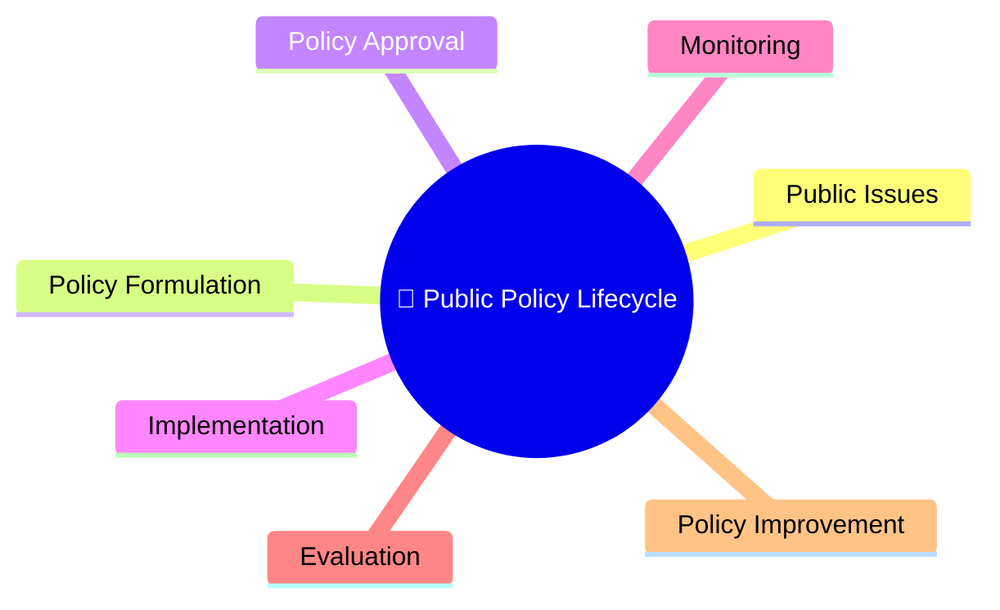

---

## Complete Public Policy Lifecycle

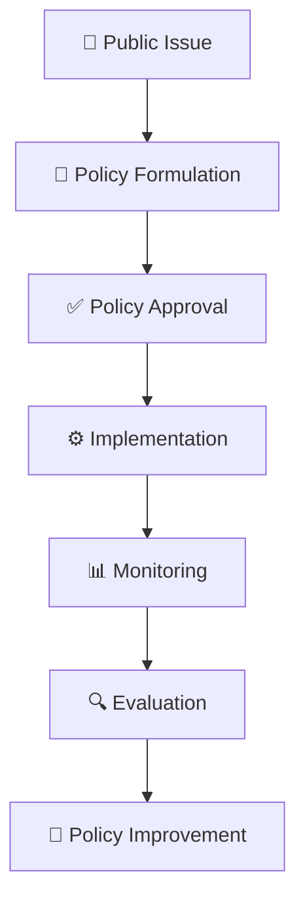

---

## Stage 1: Public Issue Identification

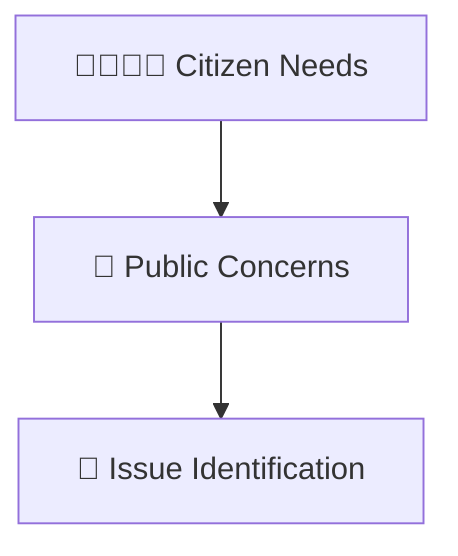

### Examples

- Healthcare
- Education
- Employment
- Infrastructure
- Public Safety

---

## Stage 2: Policy Formulation

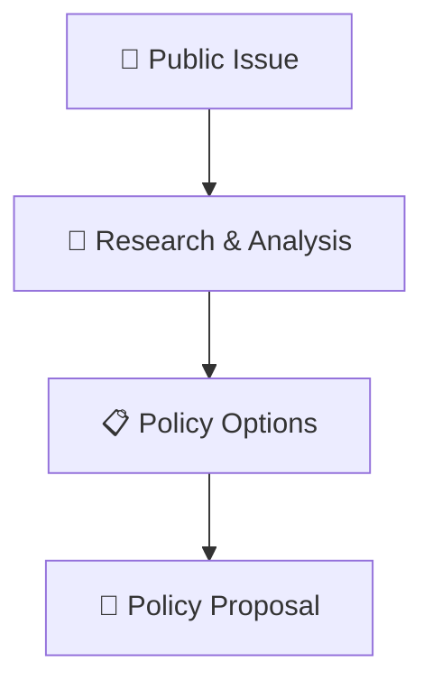

### Outcome

- Possible solutions are identified.
- Policy alternatives are evaluated.

---

## Stage 3: Policy Approval

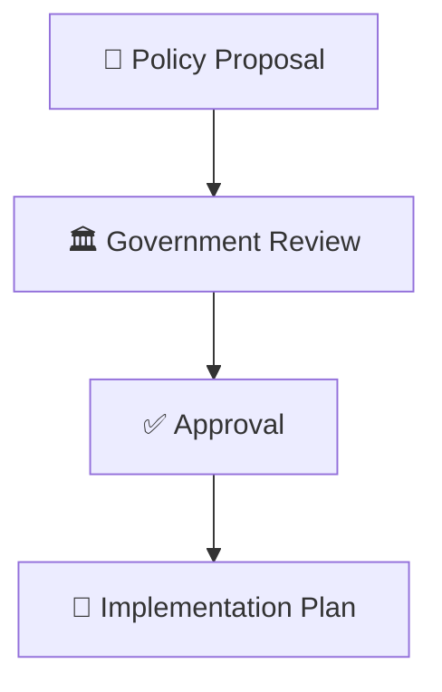

### Outcome

- Policy receives official authorization.
- Administrative preparation begins.

---

## Stage 4: Implementation

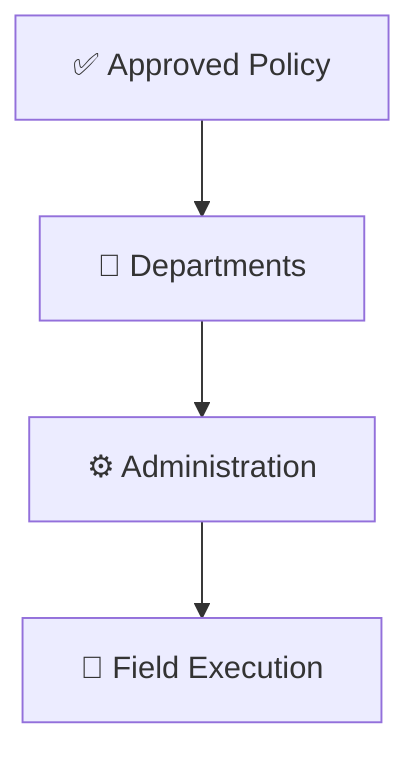

### Outcome

- Policy moves from planning to execution.

---

## Stage 5: Monitoring

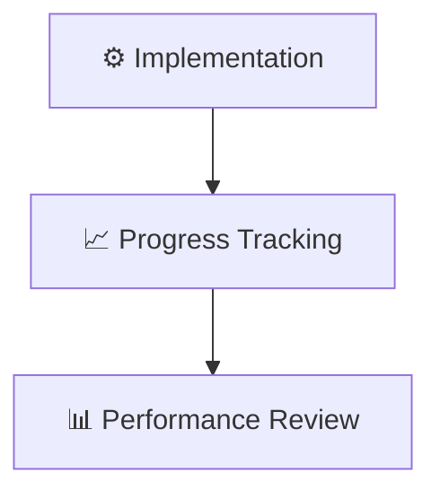

### Purpose

- Measure implementation quality.
- Identify operational issues.

---

## Stage 6: Evaluation

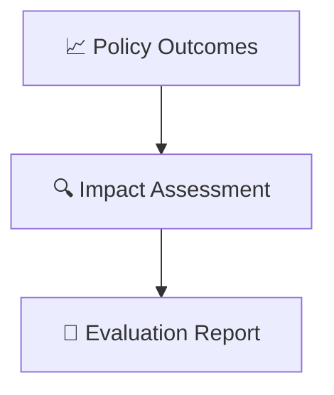

### Purpose

- Determine effectiveness.
- Measure public impact.

---

## Stage 7: Policy Improvement

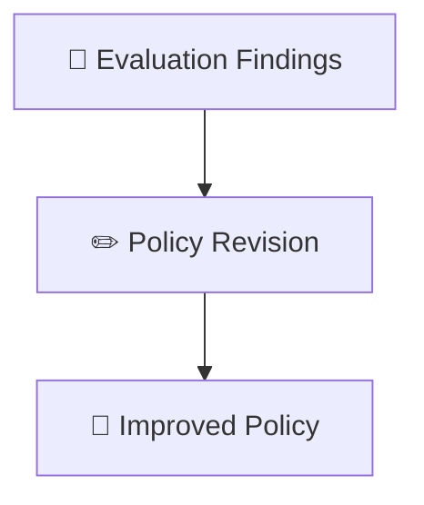

### Outcome

- Better policy design.
- Improved governance outcomes.

---

## Continuous Policy Cycle

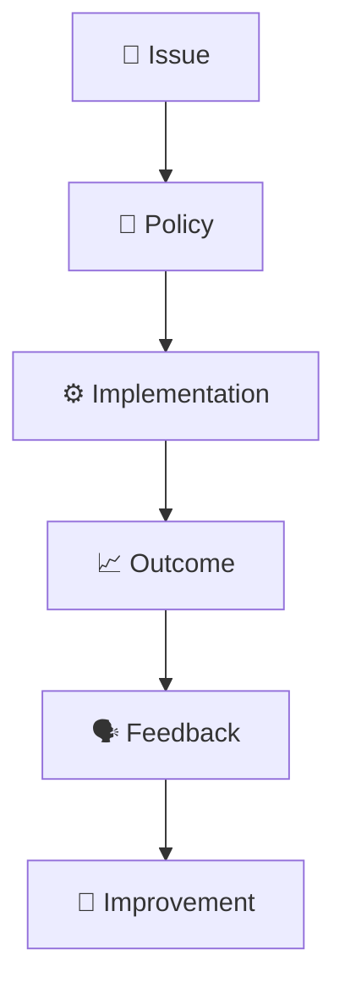

---

## Quick Revision

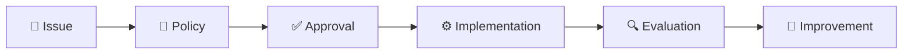

---

## Related Topics

- governance-framework.md
- citizen-to-policy-journey.md
- accountability-framework.md
- centre-state-relations-framework.md
- contemporary-public-policy.md
- governance-terminology.md