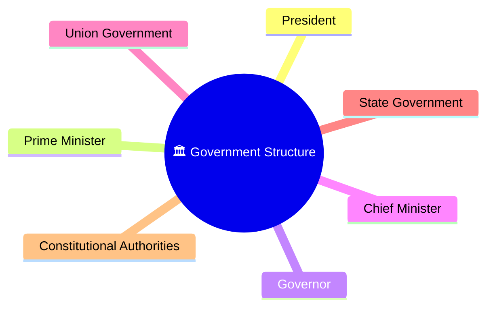
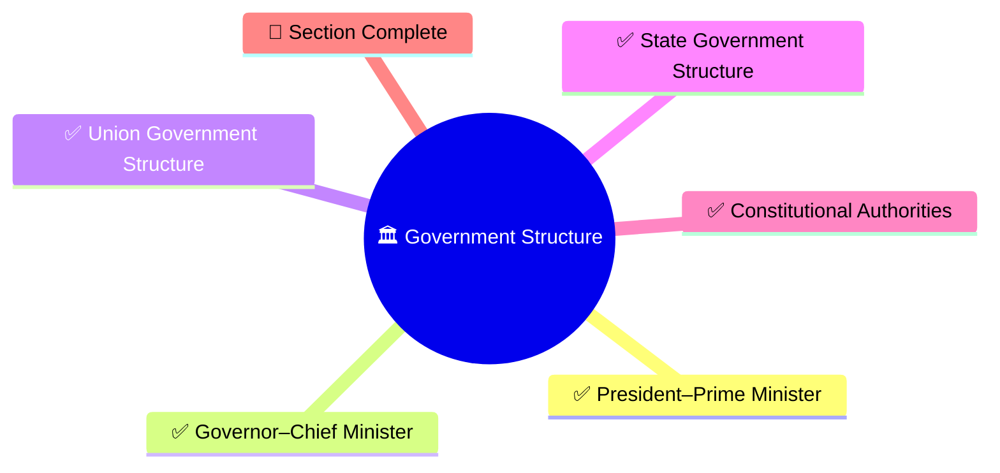
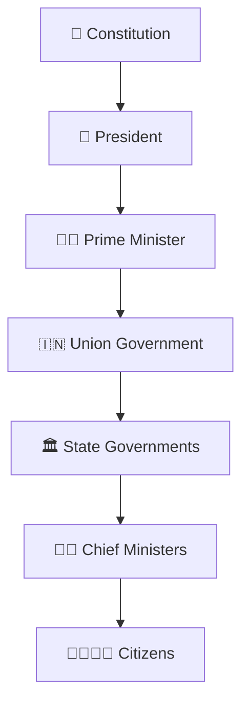

# Government Structure Diagrams

## Overview

This section contains visual diagrams explaining how governments function in India at both the Union and State levels.

The objective is to help citizens understand the roles, responsibilities, relationships, and constitutional positions of key institutions and office holders.

---

## Importance

Many citizens understand elections but are often confused about who actually governs and how institutions interact.

This section explains:

- President vs Prime Minister
- Governor vs Chief Minister
- Union vs State Government
- Constitutional authorities and oversight bodies
- Governance and accountability structures

Understanding these concepts helps explain how India functions as a constitutional parliamentary democracy.

---

## Learning Priority

### P0 (Must Know For Every Citizen)

- President–Prime Minister Relationship ✓
- Governor–Chief Minister Relationship ✓
- Union Government Structure ✓
- State Government Structure ✓

### P1 (Important)

- Constitutional Authorities Framework ✓

---

## Progress Status

---

## Citizen Learning Path

---

## Diagram Categories

### Constitutional Leadership

- President–Prime Minister relationship
- Governor–Chief Minister relationship
- Constitutional roles and responsibilities

### Government Structure

- Union Government structure
- State Government structure
- Executive governance framework

### Constitutional Institutions

- Constitutional authorities
- Independent oversight bodies
- Accountability mechanisms

### Governance & Administration

- Policy implementation
- Administrative hierarchy
- Governance delivery systems

---

## Repository Philosophy

This section focuses on practical civic understanding.

The goal is not to memorize constitutional provisions.

The goal is to understand:

- Who makes decisions
- Who implements policies
- Who provides oversight
- How institutions interact
- How governance reaches citizens

---

## Quick Revision

---

## Related Sections

- Constitution
- Parliament
- Governance
- Elections
- Judiciary
- Centre-State Relations Framework