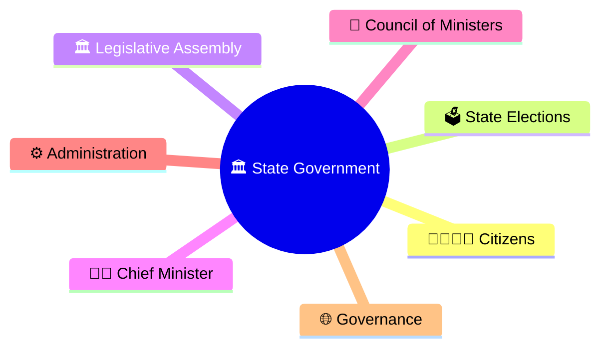
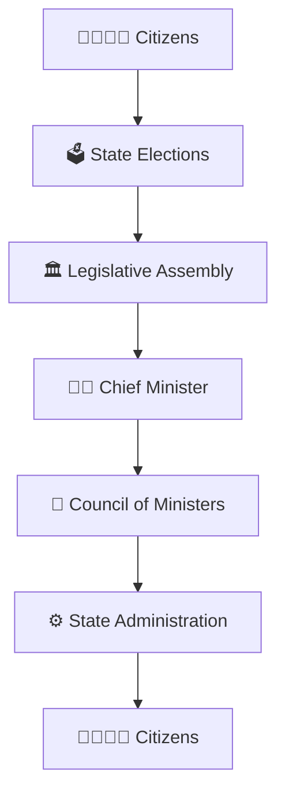
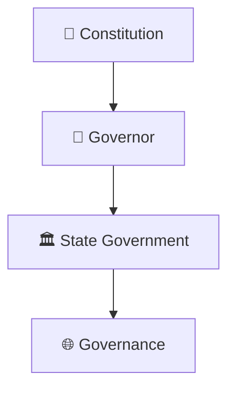
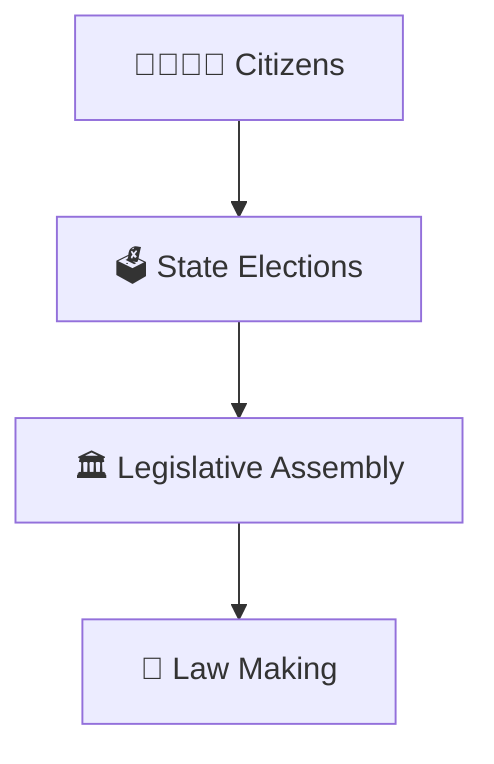
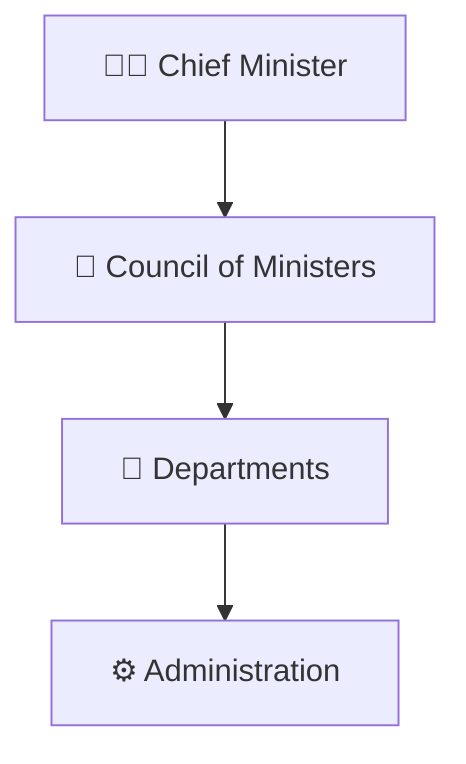
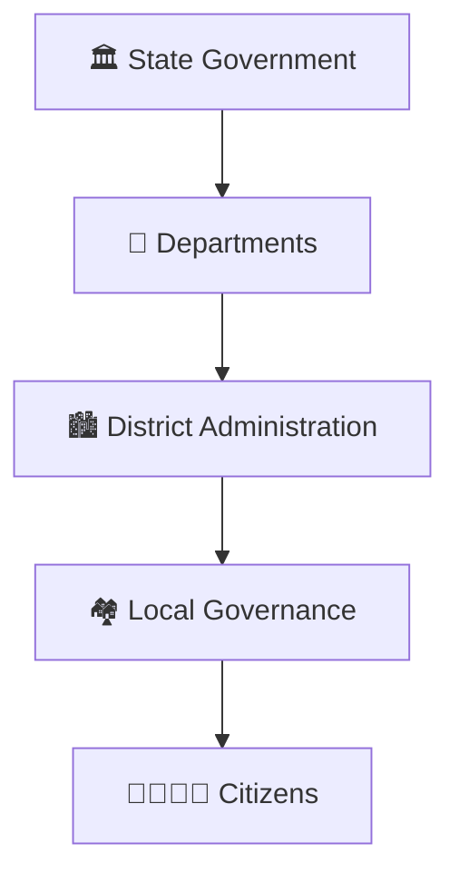
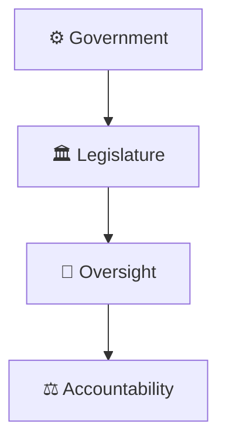
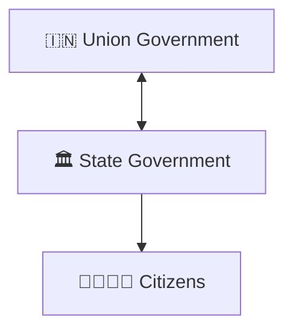

# State Government Structure

## Overview

This diagram explains the structure of a State Government in India and how constitutional institutions, elected representatives, executive leadership, and administration work together to govern a state.

It helps visualize the flow of democratic representation, executive authority, legislation, and governance at the state level.

---

## Why It Matters

Understanding the State Government structure helps explain:

- How states are governed
- How state-level laws and policies are created
- How Chief Ministers lead governments
- How state administration functions
- How governance reaches citizens

---

## State Government Structure

---

## Constitutional Framework

### Significance

- Constitutional governance
- Federal structure
- Institutional continuity

---

## Legislative Structure

### Purpose

- Democratic representation
- State legislation
- Public accountability

---

## Executive Structure

### Significance

- Policy leadership
- Executive governance
- Administrative coordination

---

## Governance Delivery Framework

### Purpose

- Deliver public services
- Implement policies
- Support development

---

## Accountability Framework

### Significance

- Democratic control
- Responsible governance
- Transparency

---

## Federal Governance Model

### Purpose

- Shared governance
- Constitutional federalism
- National and state coordination

---

## Quick Revision

---

## Related Topics

- union-government-structure.md
- governor-chief-minister-relationship.md
- president-prime-minister-relationship.md
- constitutional-authorities-framework.md
- centre-state-relations-framework.md
- constitutional-governance-model.md