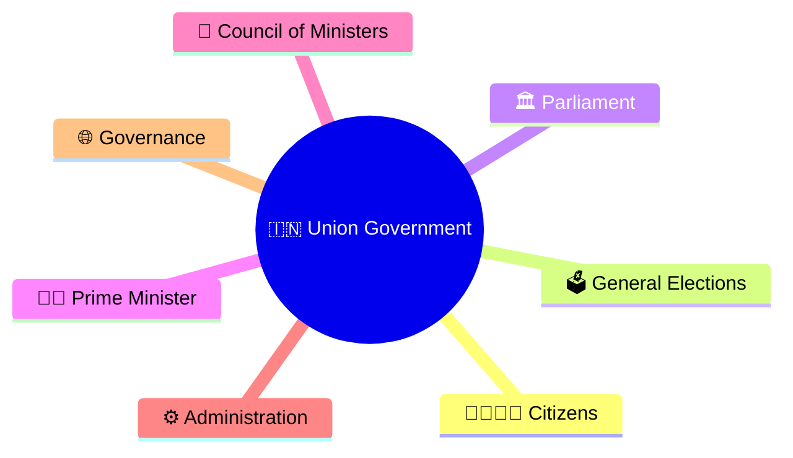
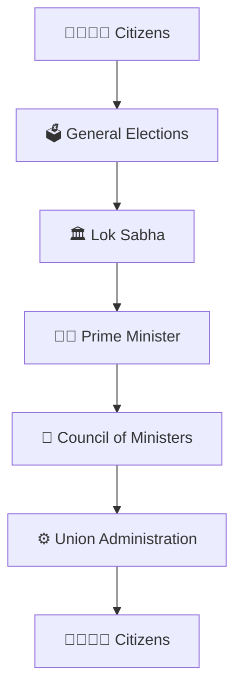
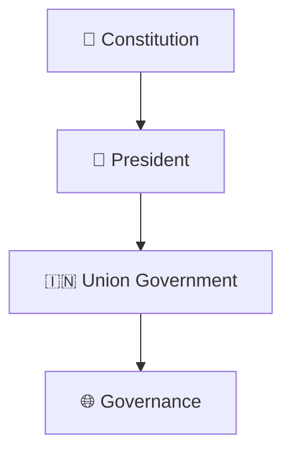
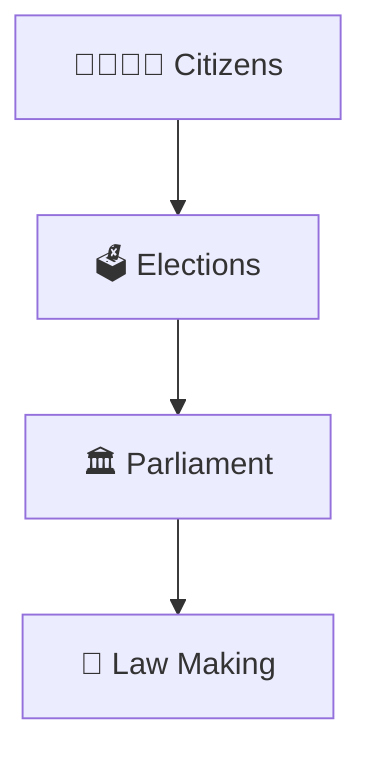
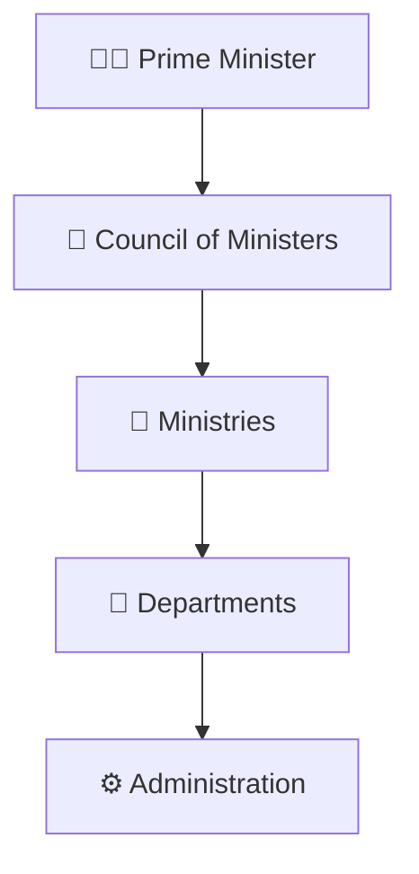
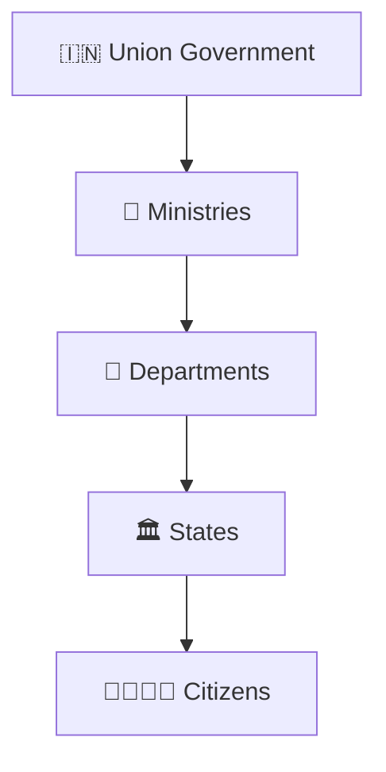
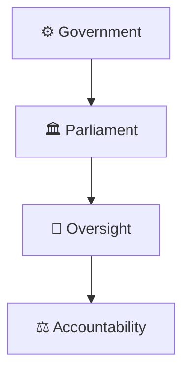
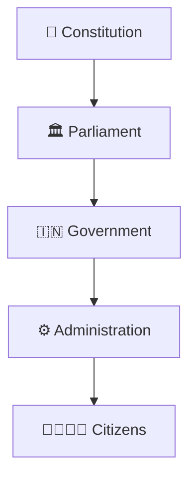

# Union Government Structure

## Overview

This diagram explains the structure of the Union Government of India and how constitutional institutions, elected representatives, executive leadership, ministries, and administration work together to govern the country.

It helps visualize the flow of democratic representation, law making, executive authority, and governance at the national level.

---

## Why It Matters

Understanding the Union Government structure helps explain:

- How India is governed at the national level
- How laws and policies are created
- How the Prime Minister leads the government
- How ministries and departments function
- How governance reaches citizens

---

## Union Government Structure

---

## Constitutional Framework

### Significance

- Constitutional authority
- Democratic legitimacy
- Institutional continuity

---

## Legislative Structure

### Purpose

- Democratic representation
- National legislation
- Public accountability

---

## Executive Structure

### Significance

- Executive leadership
- Policy implementation
- National coordination

---

## Governance Delivery Framework

### Purpose

- Implement national policies
- Deliver public programs
- Support development

---

## Accountability Framework

### Significance

- Democratic control
- Responsible governance
- Transparency and scrutiny

---

## National Governance Model

### Purpose

- National governance
- Policy coordination
- Constitutional democracy

---

## Quick Revision

---

## Related Topics

- state-government-structure.md
- president-prime-minister-relationship.md
- constitutional-authorities-framework.md
- parliament-structure.md
- constitutional-governance-model.md
- centre-state-relations-framework.md
