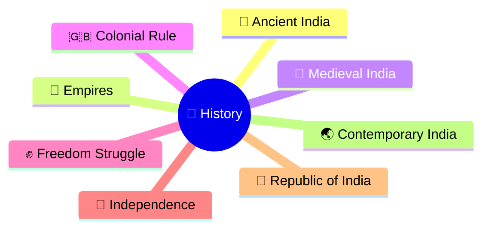
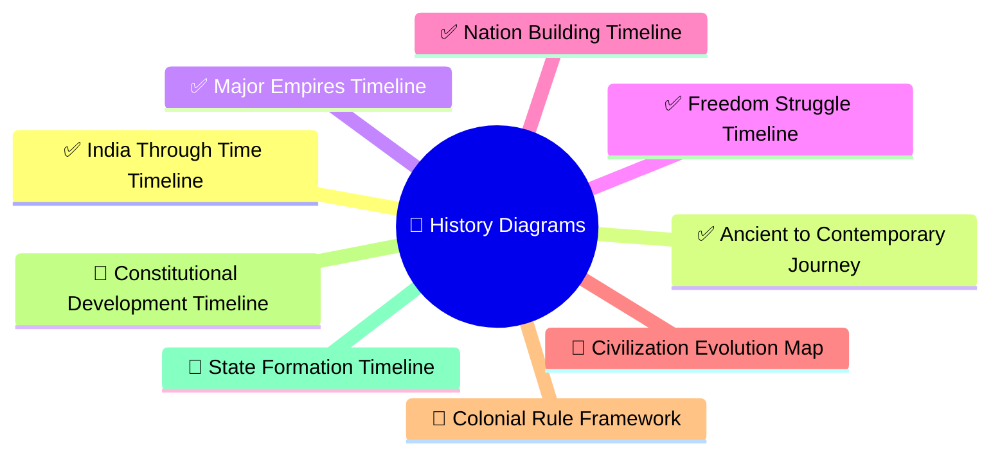
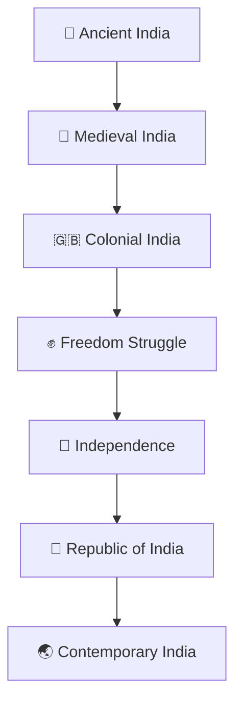

# History Diagrams

## Overview

This section contains visual diagrams explaining India's historical evolution, civilizations, kingdoms, empires, colonial rule, freedom struggle, and nation-building journey.

The goal is to simplify historical developments through timelines, flowcharts, relationship maps, and quick-revision visuals.

---

## Why Use Diagrams?

History diagrams help:

- Visualize historical timelines
- Understand cause-and-effect relationships
- Connect events across centuries
- Improve retention and revision
- Simplify complex historical transitions

---

## Learning Priority Order

### P1 (Highest ROI)

- India Through Time Timeline ✓
- Ancient to Contemporary India Journey ✓
- Major Empires Timeline ✓
- Freedom Struggle Timeline ✓
- Nation Building Timeline ✓

## Progress Status

### P2

- Civilization Evolution Map
- Colonial Rule Framework
- Constitutional Development Timeline
- State Formation Timeline

### P3

- Reform Movements Timeline
- Social Transformation Timeline
- Economic Transformation Timeline
- Leadership Timeline

---

## Recommended Diagram Structure

---

## Diagram Categories

### Civilizations & Empires

- Civilization timeline
- Kingdom evolution
- Empire comparison
- Regional power structures
- Ancient to contemporary journey
- Governance evolution timeline

### Colonial Period

- East India Company expansion
- British administration structure
- Resistance movements
- Reform movements

### Freedom Struggle

- Major movements timeline
- Leaders and organizations
- Independence journey

### Nation Building

- Constitution timeline
- State formation timeline
- Institutional development
- Nation-building journey
- Democratic institution evolution

---

## Quick Revision

---

## Related Sections

- Civilization & History
- India Through Time
- Constitution & Nation Building
- Prime Ministers & Governments
- Economic Transformations
- Contemporary India