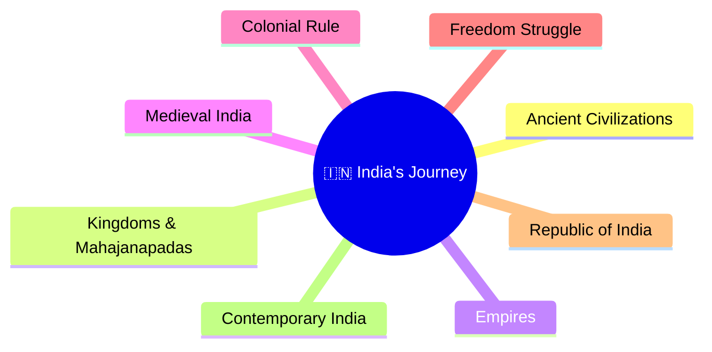
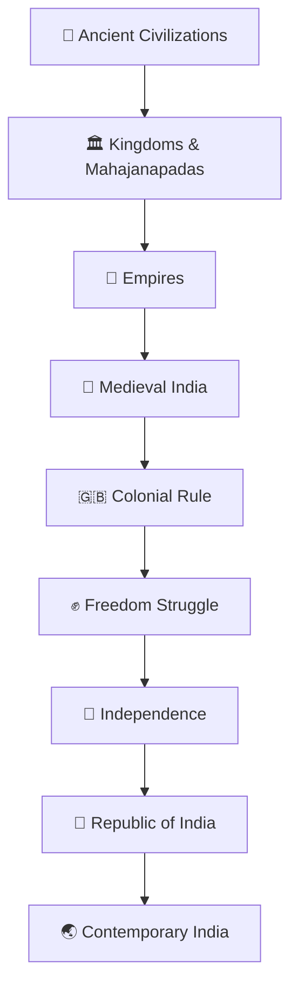
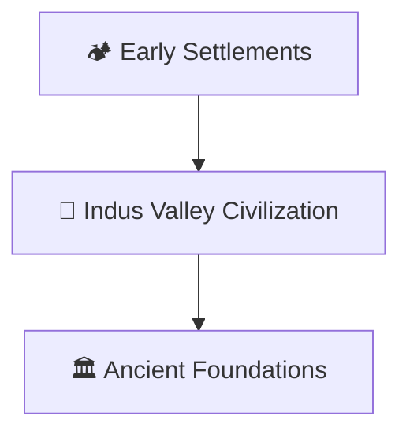
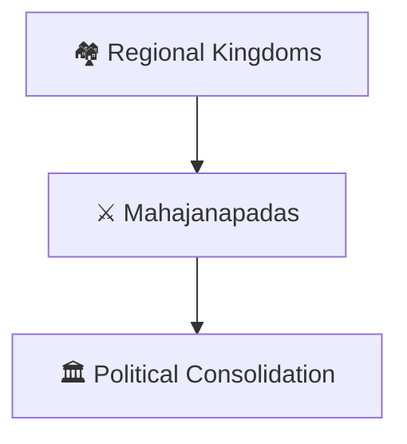
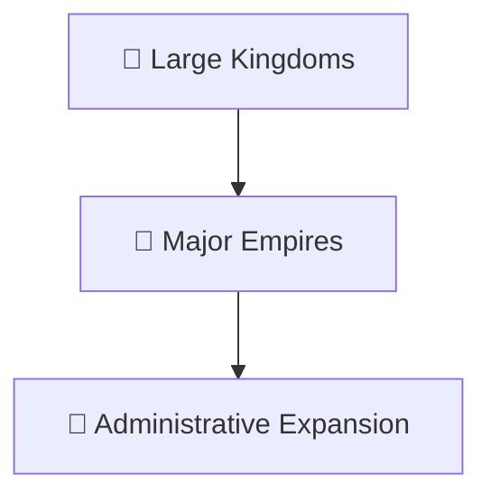
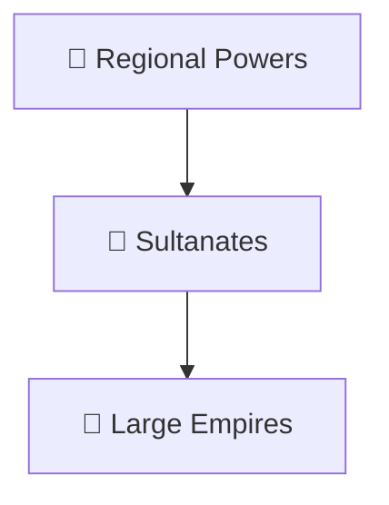
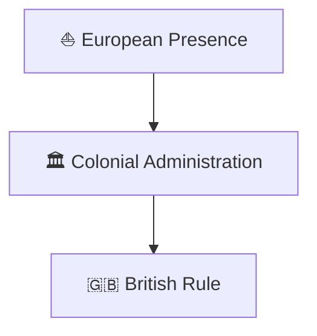
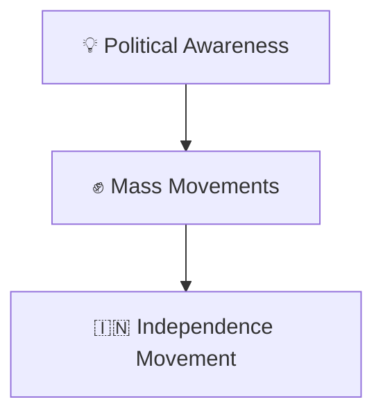
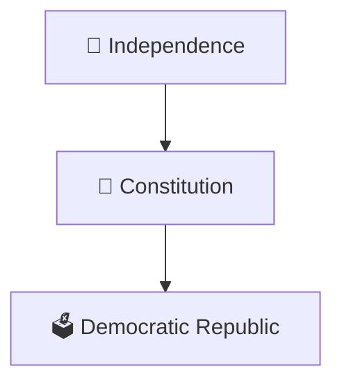
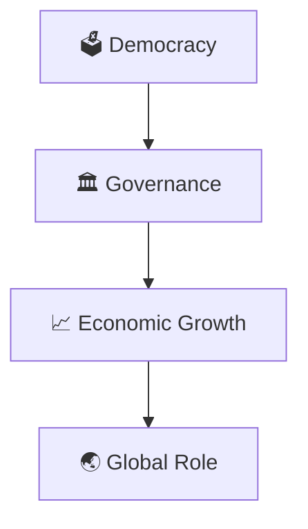

# Ancient to Contemporary India Journey

## Overview

This diagram explains India's long historical journey from ancient civilizations to contemporary India.

It provides a high-level visual framework for understanding major historical transitions, political developments, nation-building, and modern governance.

---

## Why It Matters

Understanding this journey helps explain:

- How India evolved over time
- How institutions developed
- How political systems changed
- How modern India emerged
- How historical events shaped contemporary governance

---

---

## Complete Historical Journey

---

## Stage 1: Ancient Civilizations

### Significance

- Early urban development
- Trade and administration
- Cultural foundations

---

## Stage 2: Kingdoms & Mahajanapadas

### Significance

- Growth of political institutions
- Expansion of trade and culture

---

## Stage 3: Empires

### Significance

- Centralized governance
- Administrative innovation
- Cultural integration

---

## Stage 4: Medieval India

### Significance

- Political transformation
- Cultural interaction
- Administrative evolution

---

## Stage 5: Colonial Rule

### Significance

- Institutional restructuring
- Economic transformation
- Rise of nationalism

---

## Stage 6: Freedom Struggle

### Significance

- Democratic mobilization
- National unity
- Self-governance movement

---

## Stage 7: Republic of India

### Significance

- Constitutional governance
- Democratic institutions
- Nation building

---

## Stage 8: Contemporary India

### Significance

- Modern governance systems
- Development initiatives
- International engagement

---

## Quick Revision

---

## Related Topics

- india-through-time-timeline.md
- major-empires-timeline.md
- freedom-struggle-timeline.md
- nation-building-timeline.md
- civilization-and-history.md
- contemporary-india.md