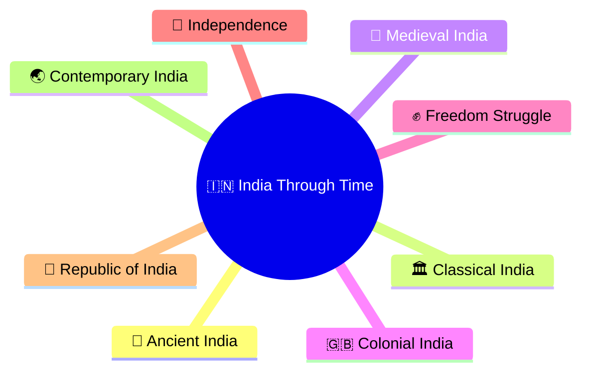
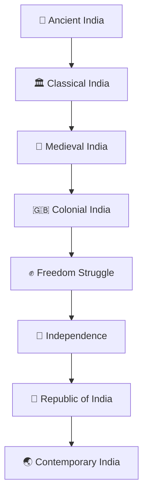
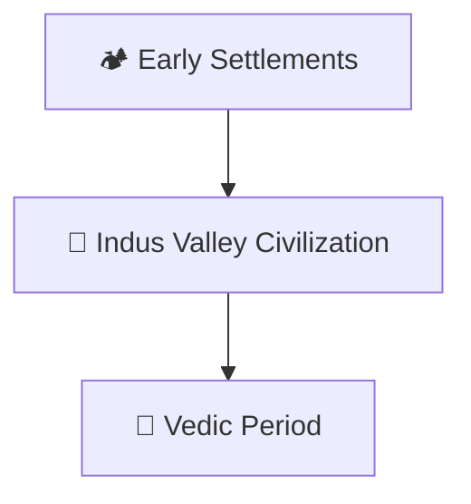
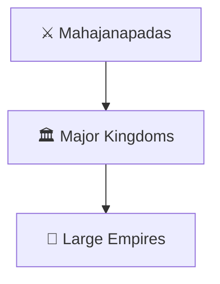
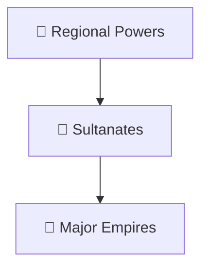
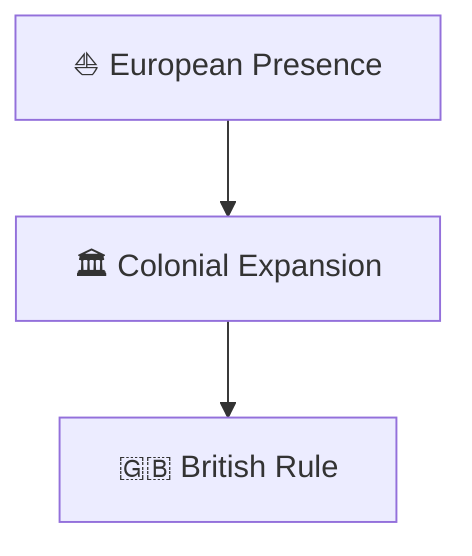
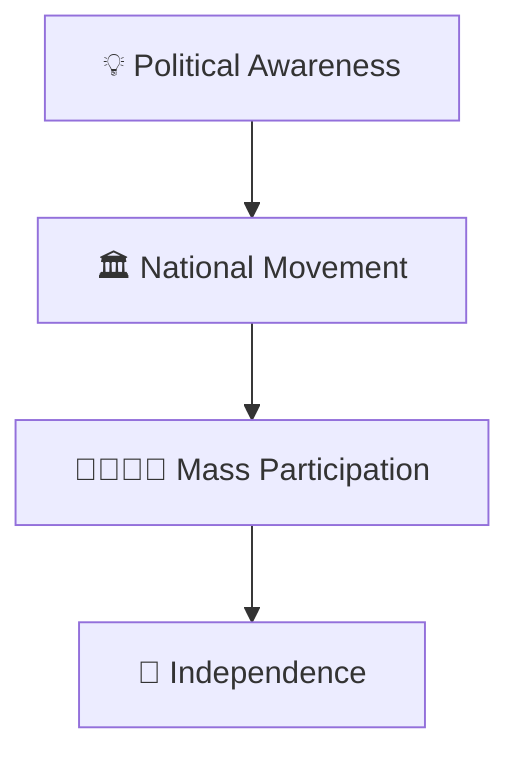
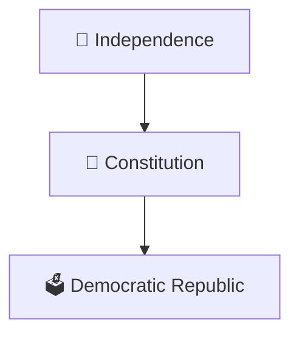
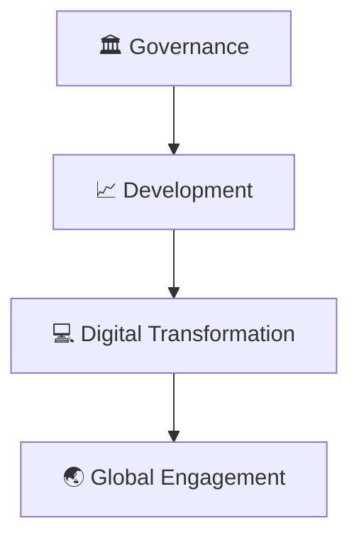

# India Through Time Timeline

## Overview

This diagram provides a high-level timeline of India's historical evolution from ancient civilizations to contemporary India.

It serves as the master timeline for the repository and connects history, governance, institutions, politics, economy, and nation-building.

---

## Why It Matters

Understanding India's timeline helps explain:

- How Indian civilization evolved
- How political systems changed over time
- How institutions developed
- How colonial rule affected India
- How modern India emerged

---

## Master Timeline

---

## Ancient India

### Key Themes

- Early civilization
- Agriculture and trade
- Cultural foundations

---

## Classical India

### Key Themes

- State formation
- Administrative growth
- Cultural development

---

## Medieval India

### Key Themes

- Political transformation
- Cultural interaction
- Administrative evolution

---

## Colonial India

### Key Themes

- Administrative restructuring
- Economic changes
- Rise of nationalism

---

## Freedom Struggle

### Key Themes

- Nationalism
- Democratic participation
- Self-governance

---

## Republic of India

### Key Themes

- Constitutional governance
- Democratic institutions
- Nation building

---

## Contemporary India

### Key Themes

- Economic growth
- Governance reforms
- Global role

---

## Quick Revision

---

## Related Topics

- ancient-to-contemporary-india-journey.md
- freedom-struggle-timeline.md
- nation-building-timeline.md
- major-empires-timeline.md
- india-through-time.md
- contemporary-india.md
