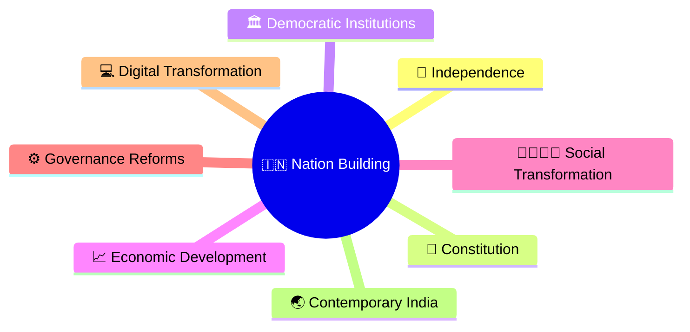
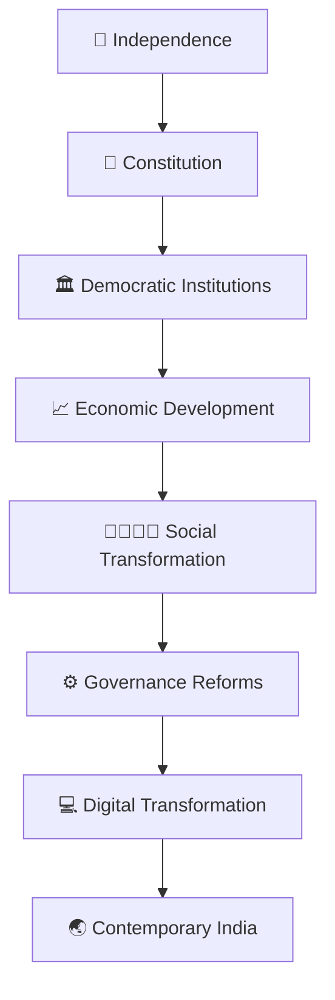
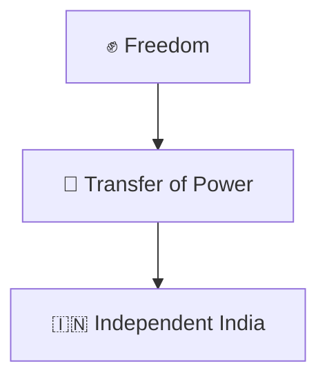
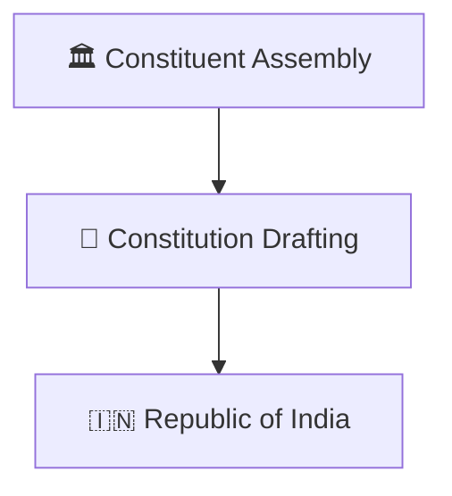
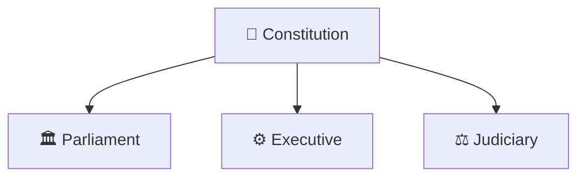
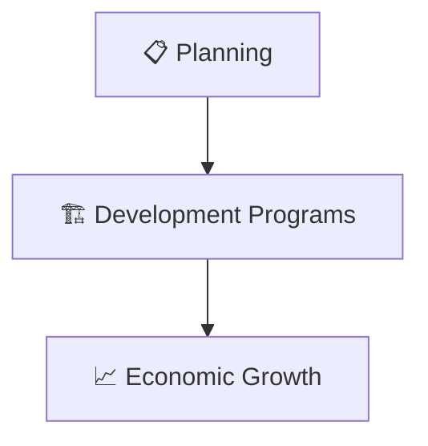
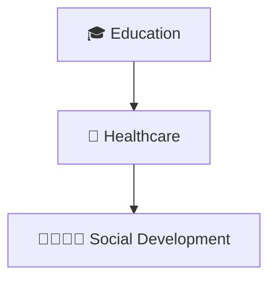
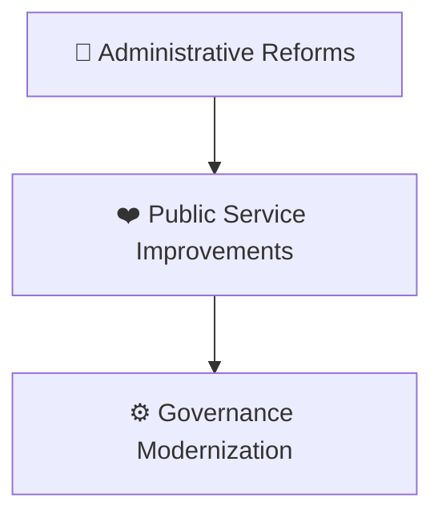
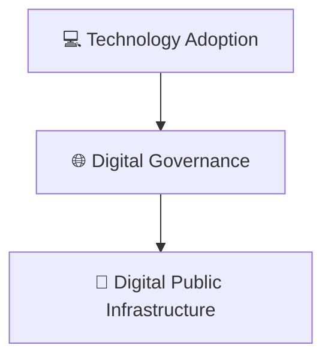

# Nation Building Timeline

## Overview

This diagram explains India's nation-building journey after independence and how democratic institutions, constitutional governance, economic development, social transformation, and public administration evolved over time.

It provides a high-level framework for understanding the creation of modern India.

---

## Why It Matters

Understanding nation building helps explain:

- How India transformed after independence
- How democratic institutions developed
- How governance structures evolved
- How economic and social reforms shaped the country
- How contemporary India emerged

---

## Nation Building Timeline

---

## Phase 1: Independence

### Significance

- End of colonial rule
- Beginning of self-governance

---

## Phase 2: Constitution

### Significance

- Constitutional democracy
- Rule of law
- Rights and institutions

---

## Phase 3: Democratic Institutions

### Significance

- Institutional stability
- Democratic governance

---

## Phase 4: Economic Development

### Significance

- Infrastructure expansion
- Industrial and agricultural growth

---

## Phase 5: Social Transformation

### Significance

- Human development improvements
- Expanded public participation

---

## Phase 6: Governance Reforms

### Significance

- Better service delivery
- Increased accountability

---

## Phase 7: Digital Transformation

### Significance

- Improved accessibility
- Faster service delivery
- Modern governance systems

---

## Quick Revision

---

## Related Topics

- india-through-time-timeline.md
- ancient-to-contemporary-india-journey.md
- freedom-struggle-timeline.md
- major-empires-timeline.md
- constitution-and-nation-building.md
- contemporary-india.md