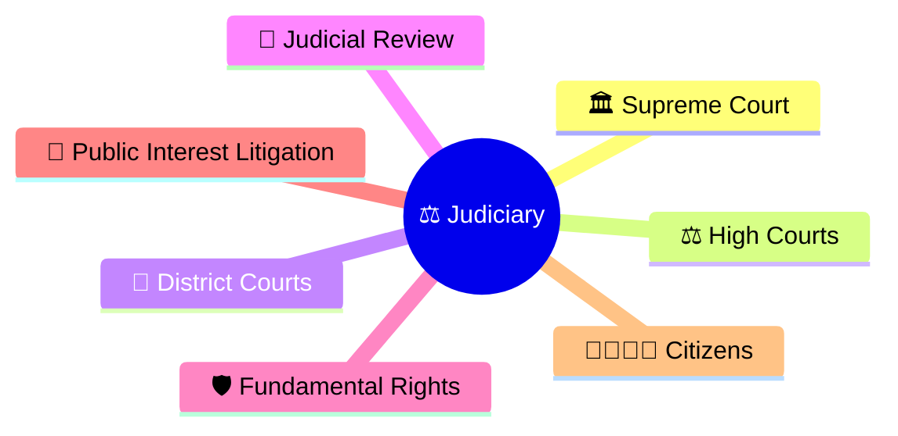
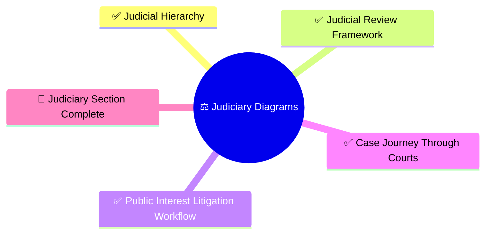
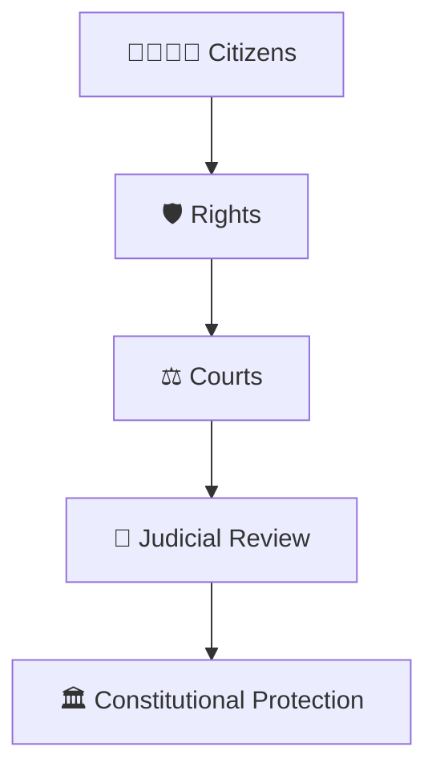

# Judiciary Diagrams

## Overview

This section contains visual diagrams explaining the structure, powers, processes, and constitutional role of the Indian judiciary.

The objective is to help citizens understand how courts protect rights, resolve disputes, review government actions, and uphold the Constitution.

---

## Importance

The judiciary is one of the most important pillars of Indian democracy.

It acts as:

- Protector of the Constitution
- Guardian of Fundamental Rights
- Independent dispute resolution system
- Check on misuse of power
- Final interpreter of law

Understanding the judiciary helps citizens understand how justice, accountability, and constitutional governance work in India.

---

## Learning Priority

### P0 (Must Know For Every Citizen)

- Judicial Hierarchy ✓
- Judicial Review Framework ✓
- Public Interest Litigation Workflow ✓

### P1 (Important)

- Case Journey Through Courts ✓

---

## Progress Status

---

## Citizen Learning Path

---

## Diagram Categories

### Court Structure

- Judicial hierarchy
- Court system organization
- Appeals framework

### Constitutional Protection

- Judicial review
- Constitutional safeguards
- Rights protection

### Access to Justice

- Public Interest Litigation
- Court access mechanisms
- Citizen remedies

### Justice Delivery

- Case journey through courts
- Appeals process
- Dispute resolution

---

## Repository Philosophy

This section focuses on practical civic understanding.

The goal is not to study legal procedure in depth.

The goal is to understand:

- How courts function
- How rights are protected
- How laws are reviewed
- How citizens seek remedies
- How constitutional governance is maintained

---

## Quick Revision

---

## Related Sections

- Constitution
- Parliament
- Government Structure
- Governance
- Elections
- Fundamental Rights Framework