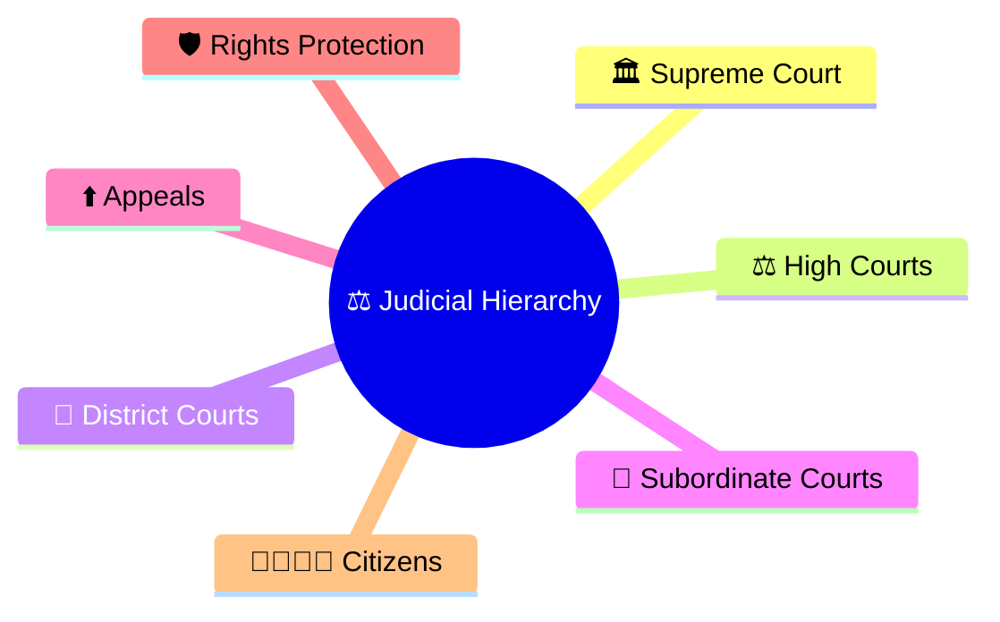
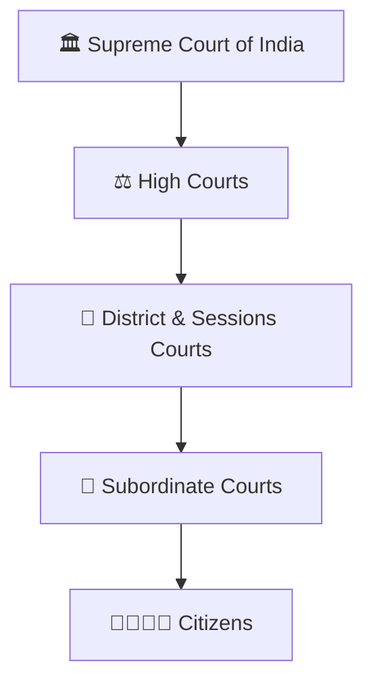
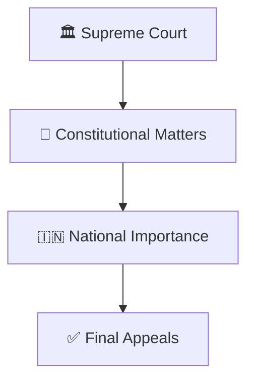
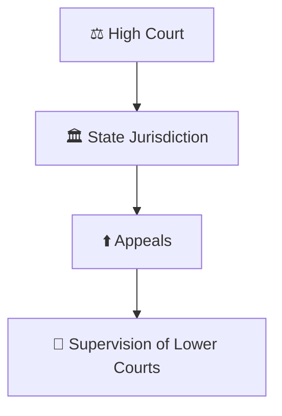
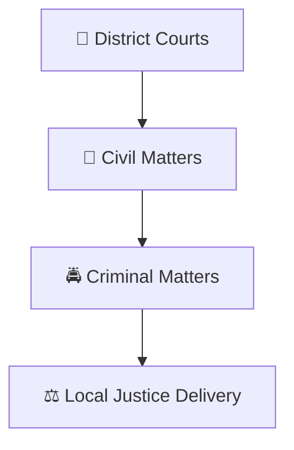
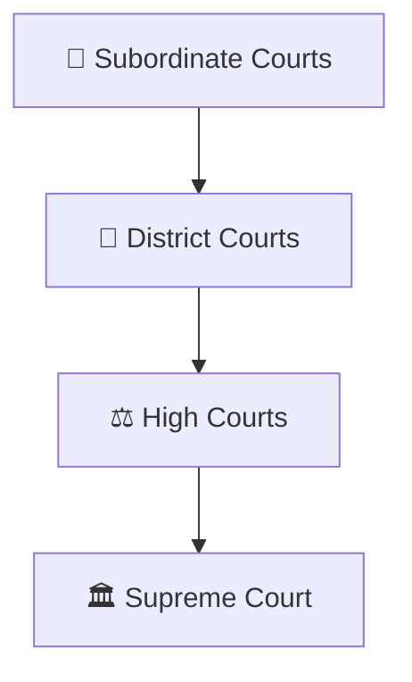
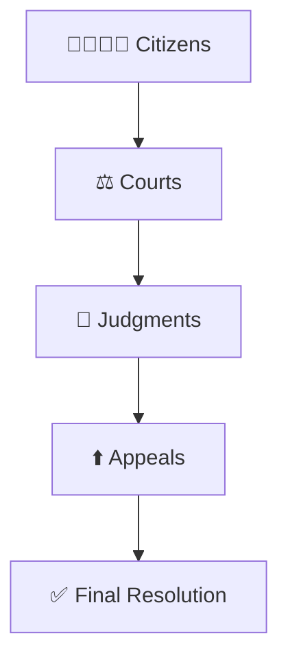

# Judicial Hierarchy

## Overview

This diagram explains the structure of the Indian judicial system and how courts are organized from the local level to the Supreme Court of India.

It helps visualize the hierarchy of courts, appellate structure, and the administration of justice.

---

## Why It Matters

Understanding the judicial hierarchy helps explain:

- How the Indian court system is organized
- Where different disputes are heard
- How appeals move through courts
- How justice is delivered across the country
- How constitutional rights are protected

---

---

## Judicial Hierarchy

---

## Supreme Court Structure

### Significance

- Highest court in India
- Final appellate authority
- Guardian of the Constitution

---

## High Court Structure

### Purpose

- Interpret law
- Hear appeals
- Protect constitutional rights

---

## District Court Structure

### Significance

- Primary trial courts
- Major dispute resolution forums
- Foundation of judicial administration

---

## Appeals Framework

### Purpose

- Correct legal errors
- Ensure fairness
- Maintain consistency in justice

---

## Citizen Justice Framework

---

## Quick Revision

---

## Related Topics

- case-journey-through-courts.md
- judicial-review-framework.md
- public-interest-litigation-workflow.md
- constitutional-governance-model.md
- fundamental-rights-framework.md
- basic-structure-doctrine.md