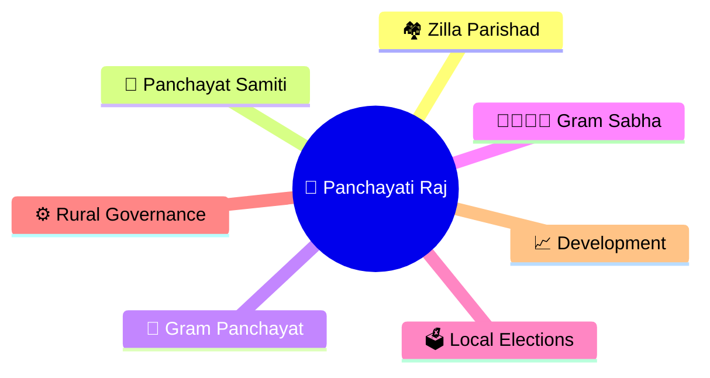
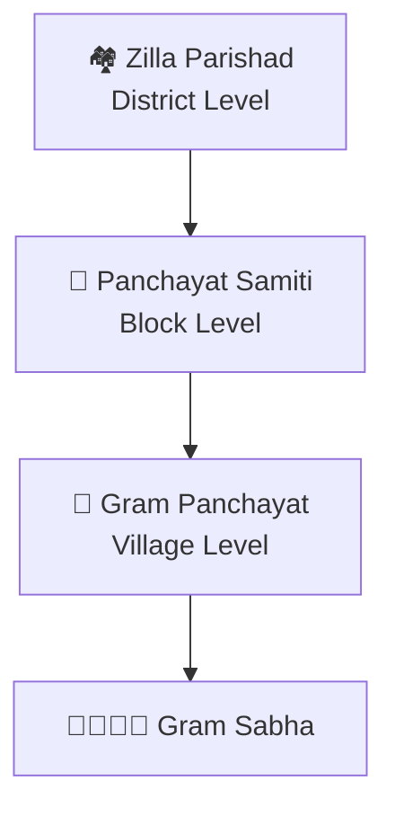
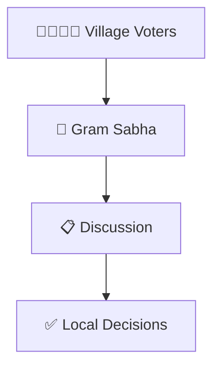
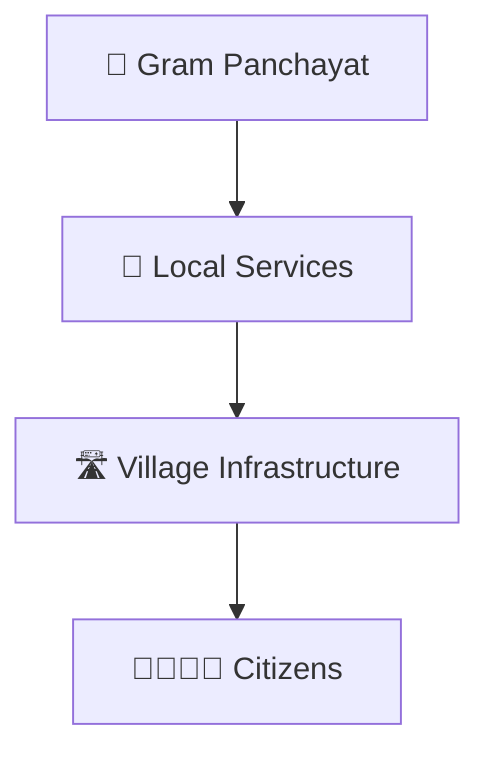
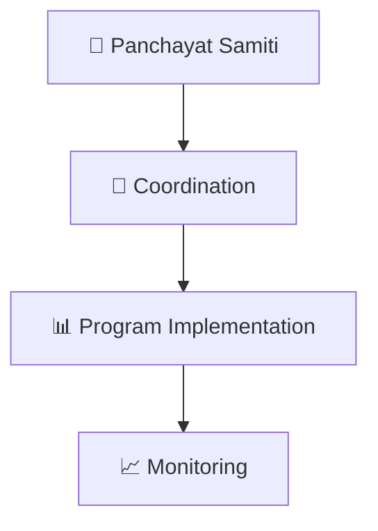
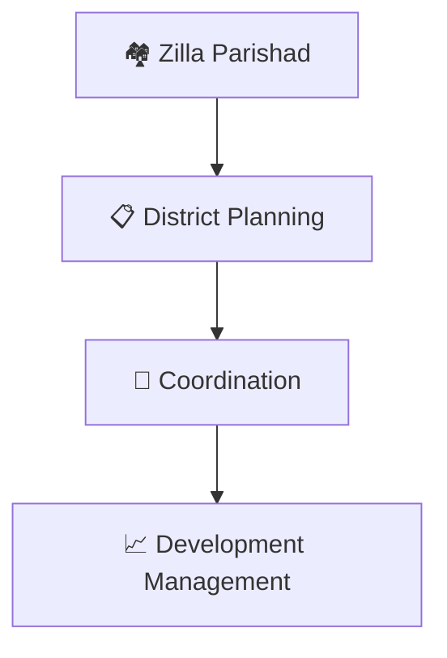
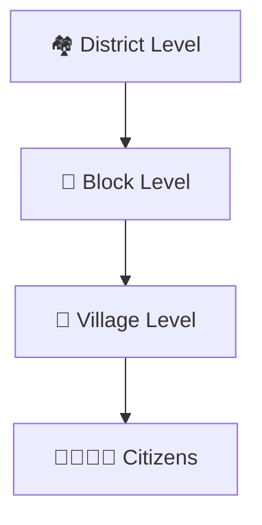
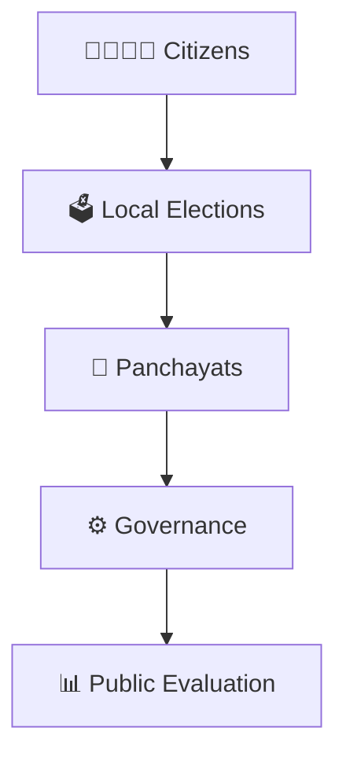

# Panchayati Raj Structure

## Why It Matters

Panchayati Raj is India's rural local self-government system. It enables democratic participation at the village level and helps deliver development programs, public services, and local governance closer to citizens.

## Visual Overview

## Panchayati Raj Structure

## Gram Sabha Framework

## Gram Panchayat Model

## Panchayat Samiti Framework

## Zilla Parishad Framework

## Rural Development Delivery Model

## Democratic Accountability Cycle

## Quick Revision

