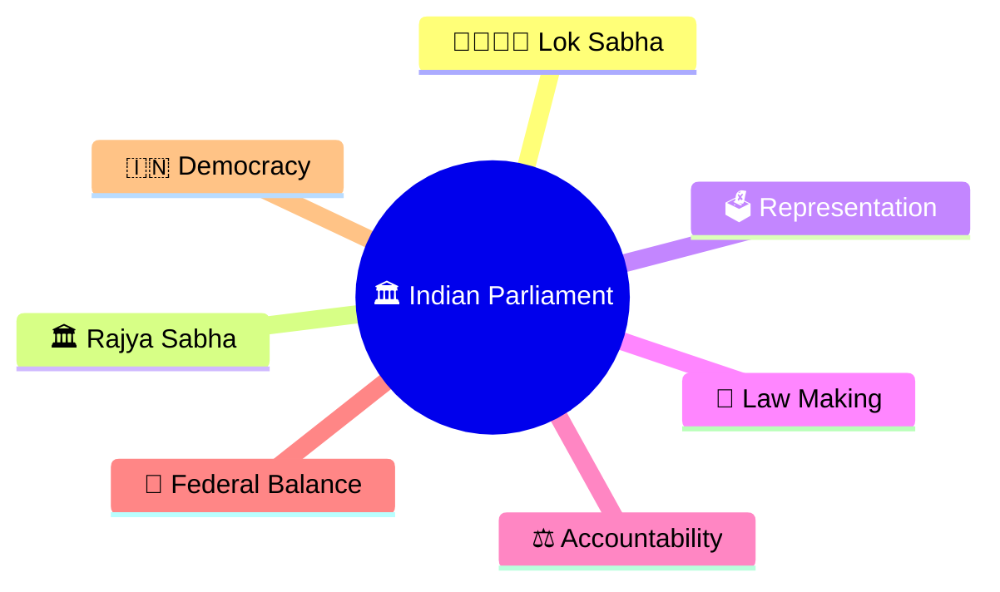
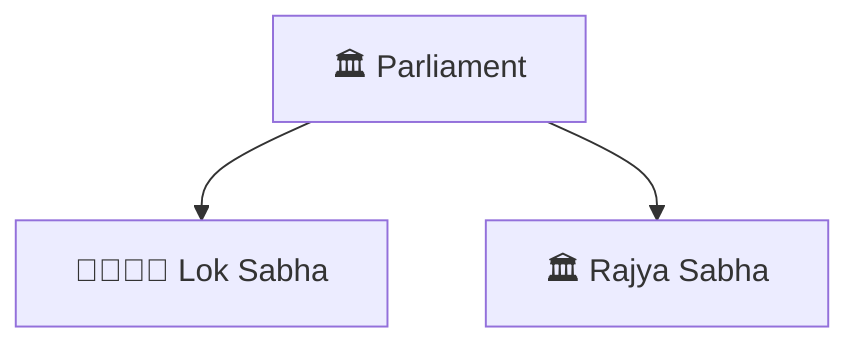
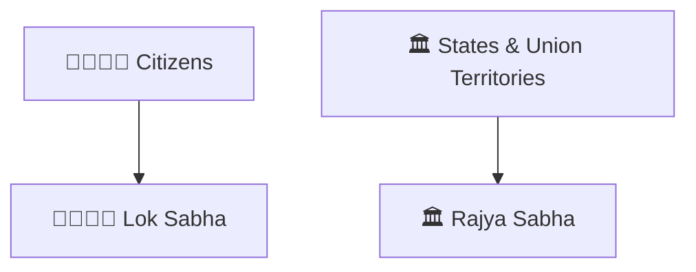
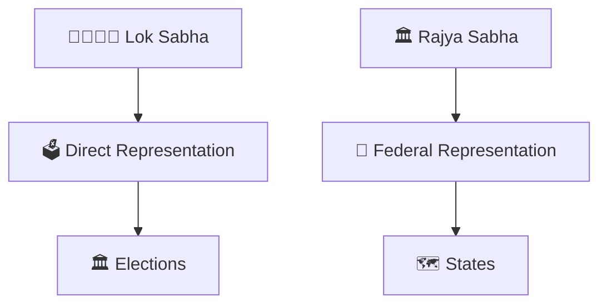
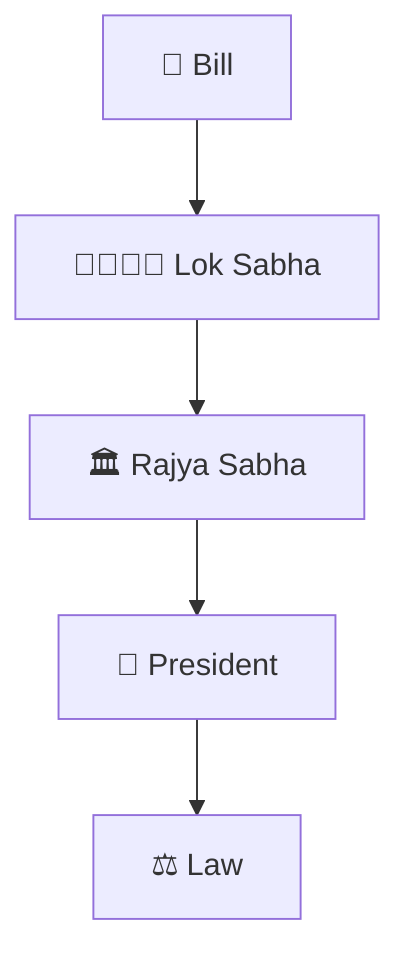
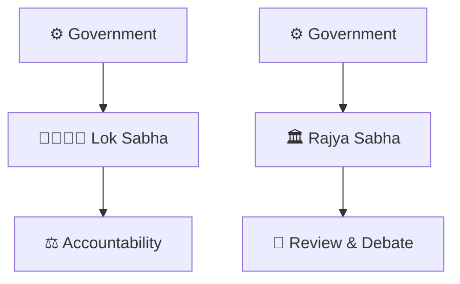
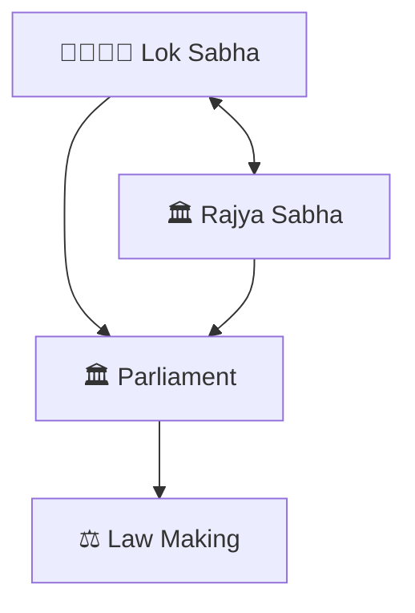
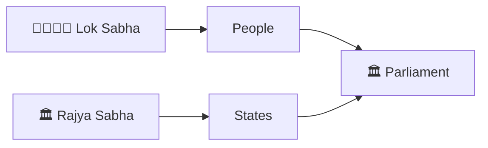

# Lok Sabha vs Rajya Sabha

## Overview

This diagram explains the differences and relationship between the two Houses of the Indian Parliament: Lok Sabha and Rajya Sabha.

It helps visualize representation, powers, responsibilities, and how both Houses participate in the legislative process.

---

## Why It Matters

Understanding Lok Sabha and Rajya Sabha helps explain:

- How Parliament is structured
- How laws are reviewed and passed
- How citizens and states are represented
- How democratic checks and balances work
- How national legislation is scrutinized

---

## Parliament Structure

---

## Representation Model

### Significance

- Lok Sabha represents the people
- Rajya Sabha represents states and union territories
- Together they form Parliament

---

## House Comparison Framework

### Purpose

- Democratic representation
- Federal balance
- Legislative review

---

## Legislative Process Model

### Significance

- Multiple levels of scrutiny
- Better law making
- Institutional checks

---

## Accountability Framework

### Purpose

- Democratic oversight
- Legislative scrutiny
- Public accountability

---

## Bicameral Parliament Framework

### Significance

- Balanced representation
- Federal participation
- Stronger legislation

---

## Quick Revision

---

## Related Topics

- parliament-structure.md
- how-a-bill-becomes-law.md
- parliament-session-workflow.md
- parliamentary-committee-system.md
- government-formation-process.md
- constitutional-governance-model.md