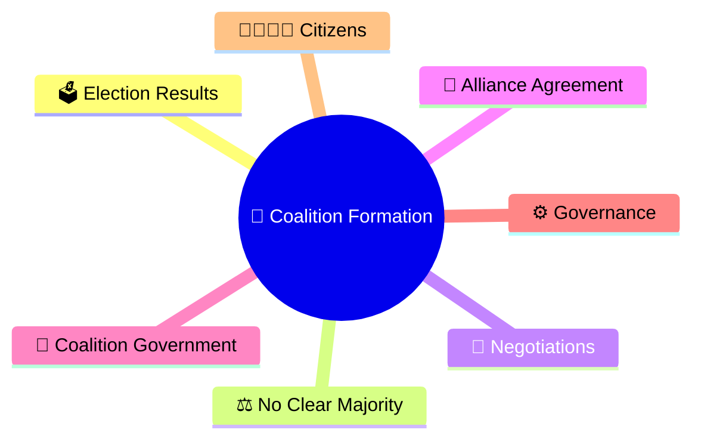
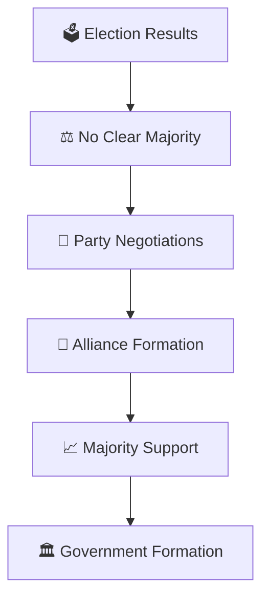
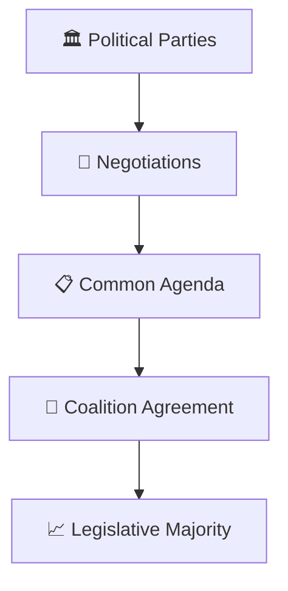
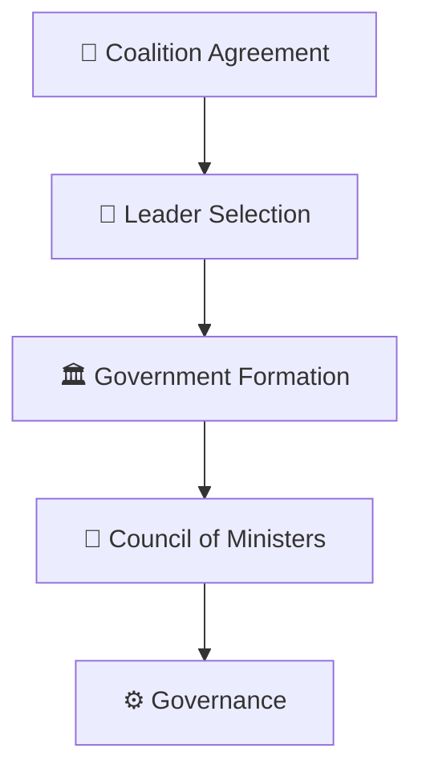
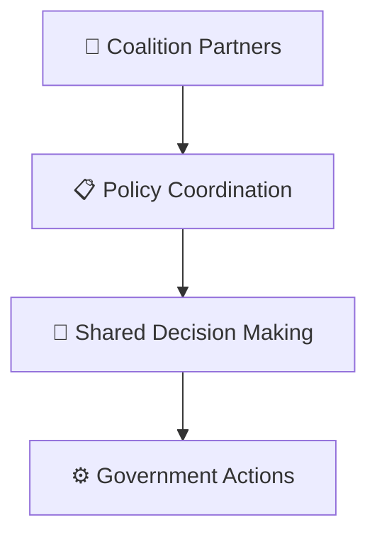
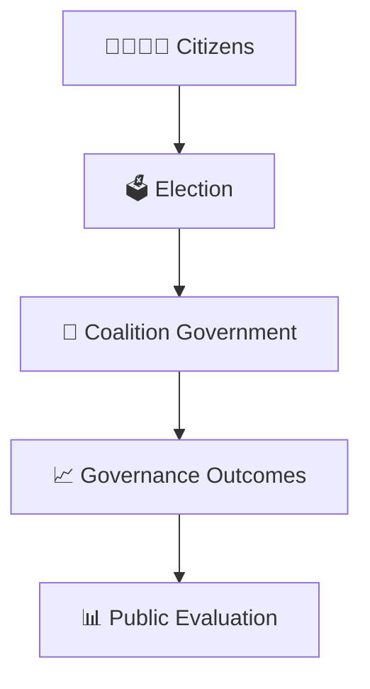
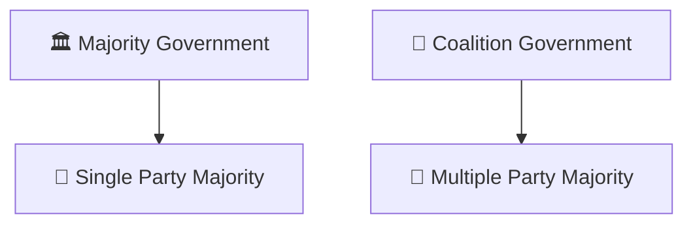
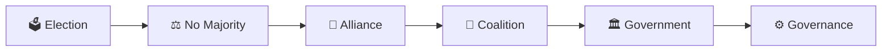

# Coalition Formation Model

## Overview

This diagram explains how coalition governments are formed when no single political party secures a legislative majority.

It helps visualize negotiations, alliances, majority building, government formation, and coalition governance.

---

## Why It Matters

Understanding coalition formation helps explain:

- How governments are formed without a clear majority
- How political alliances work
- How coalition governance functions
- How parliamentary majorities are built
- How democratic representation is maintained

---

## Coalition Formation Framework

---

## Coalition Building Process

### Outcome

- Multiple parties cooperate.
- Majority support is achieved.
- Government can be formed.

---

## Government Formation Flow

---

## Coalition Governance Model

### Purpose

- Maintain coalition stability.
- Coordinate governance priorities.
- Preserve legislative support.

---

## Coalition Accountability Framework

---

## Coalition vs Majority Government

---

## Quick Revision

---

## Related Topics

- political-party-ecosystem.md
- party-to-government-journey.md
- government-vs-opposition-framework.md
- election-process-flow.md
- government-formation-process.md
- parliamentary-terminology.md