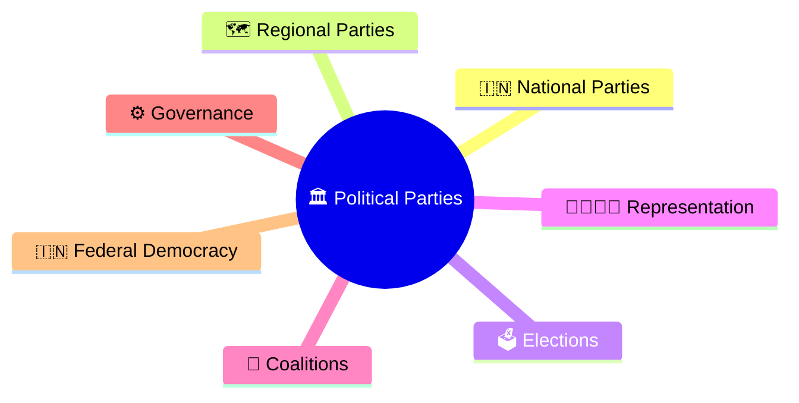
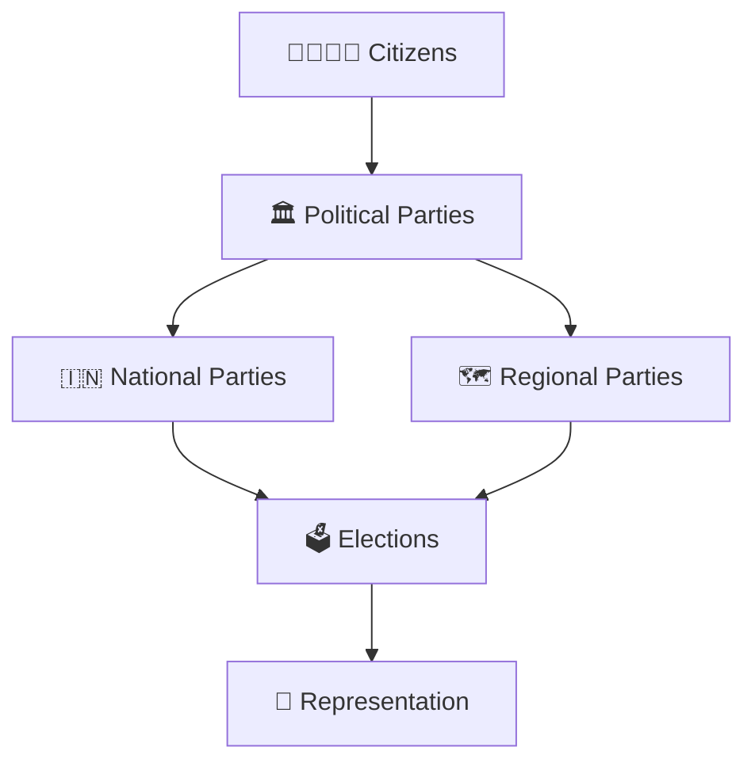
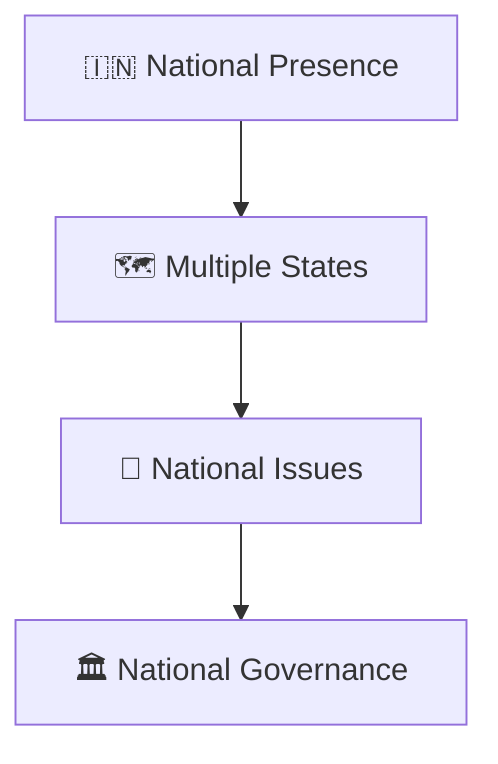
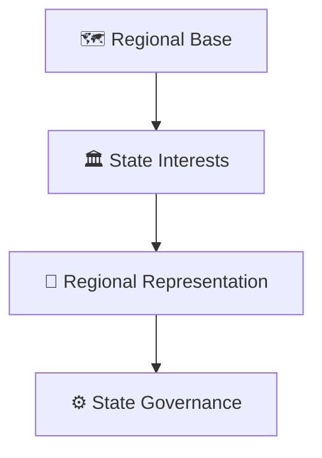
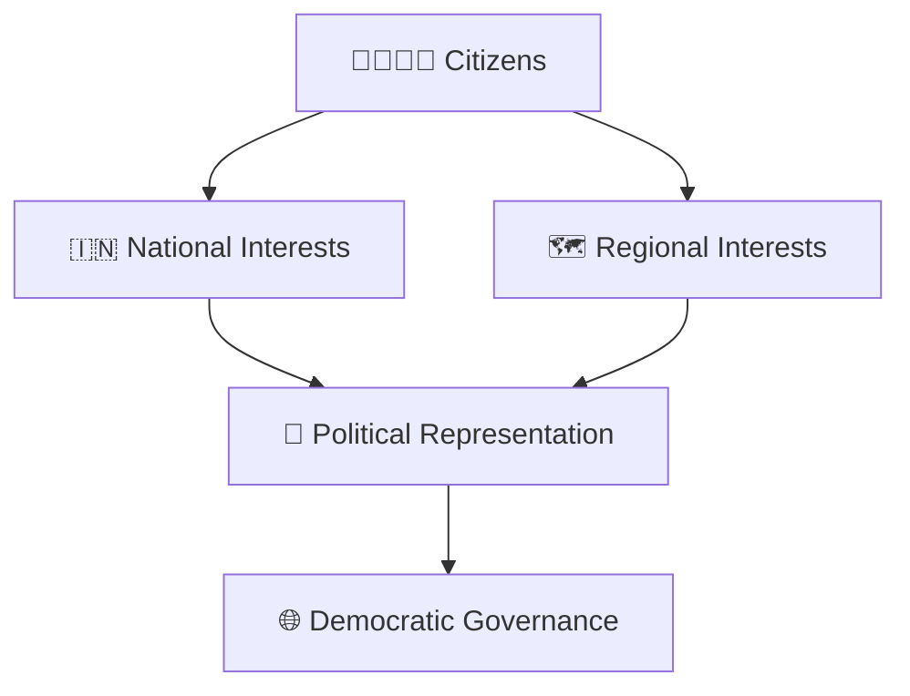
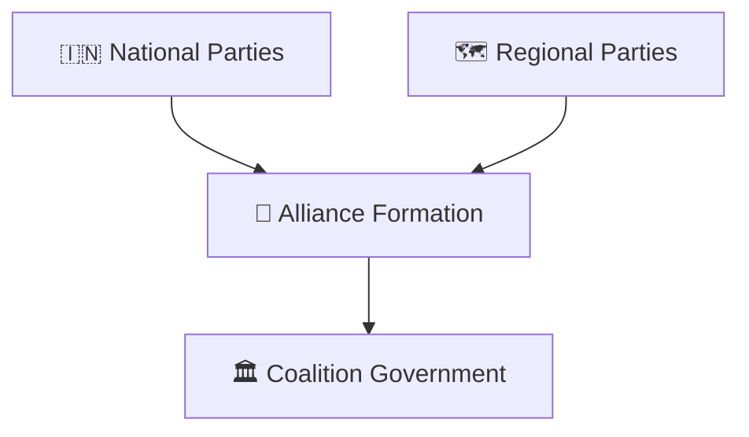
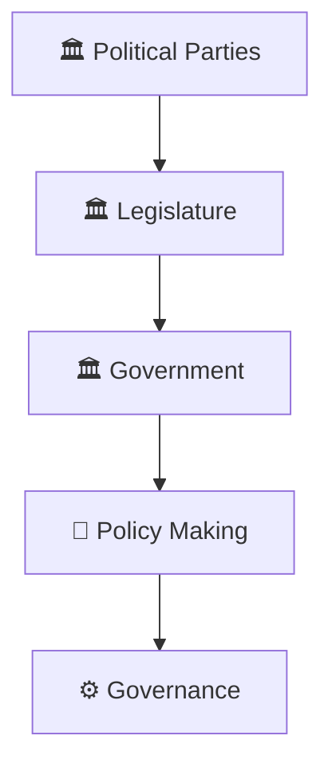
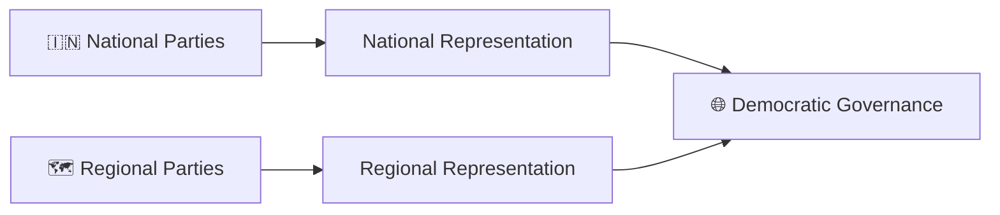

# National vs Regional Parties

## Overview

This diagram explains the difference between national and regional political parties in India and how both contribute to democratic representation, governance, and federal politics.

It helps visualize the role of parties at different levels of the political system.

---

## Why It Matters

Understanding national and regional parties helps explain:

- How India's multi-party democracy functions
- How national and local interests are represented
- How coalition politics develops
- How federal governance operates
- How political competition varies across regions

---

## Political Party Framework

---

## National Party Model

### Characteristics

- Broad national focus
- Presence across multiple states
- National policy agenda
- Participation in Union-level governance

---

## Regional Party Model

### Characteristics

- State or region-focused
- Emphasis on local issues
- Strong regional representation
- Significant role in state politics

---

## Democratic Representation Model

---

## Coalition Politics Framework

### Significance

- Expands representation
- Encourages cooperation
- Supports federal politics

---

## Governance Participation

---

## Quick Revision

---

## Related Topics

- political-party-ecosystem.md
- party-to-government-journey.md
- coalition-formation-model.md
- government-vs-opposition-framework.md
- elections-and-democracy.md
- political-terminology.md