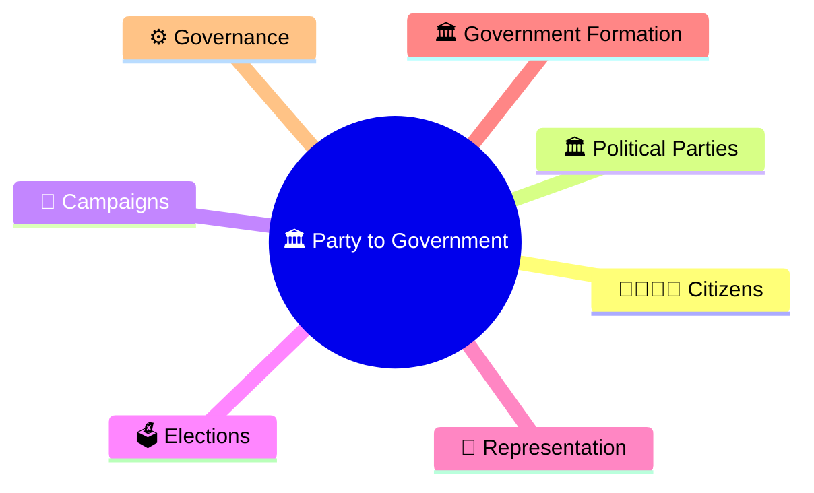
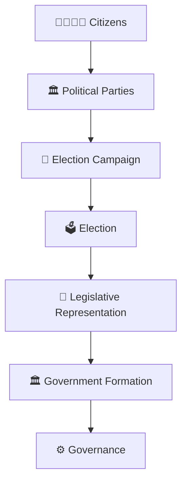
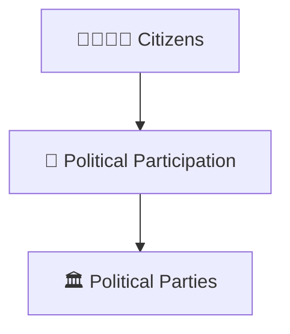
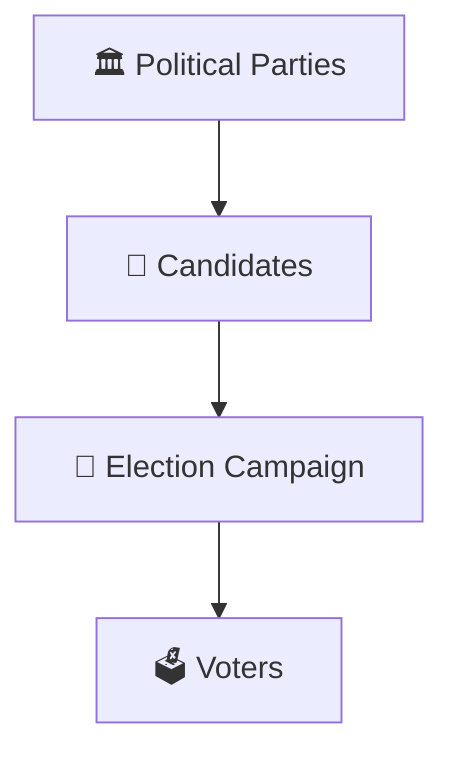
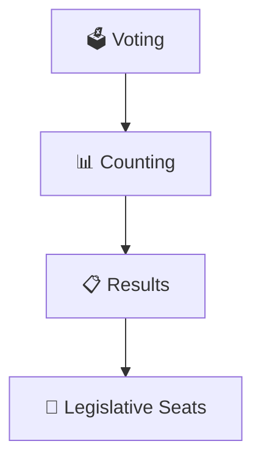
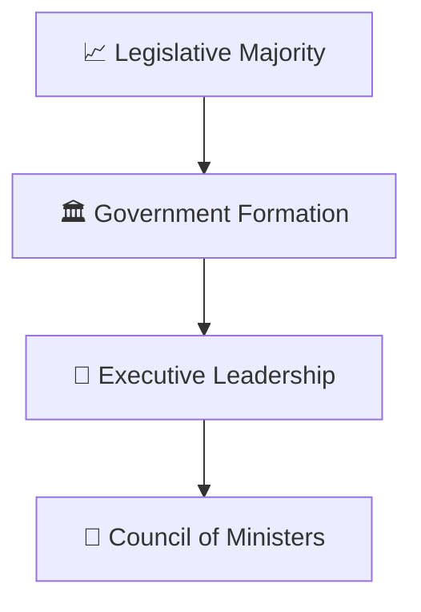
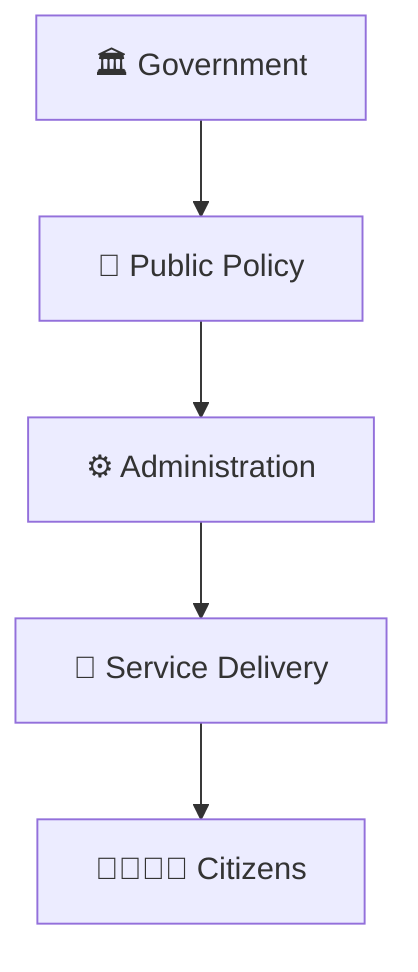
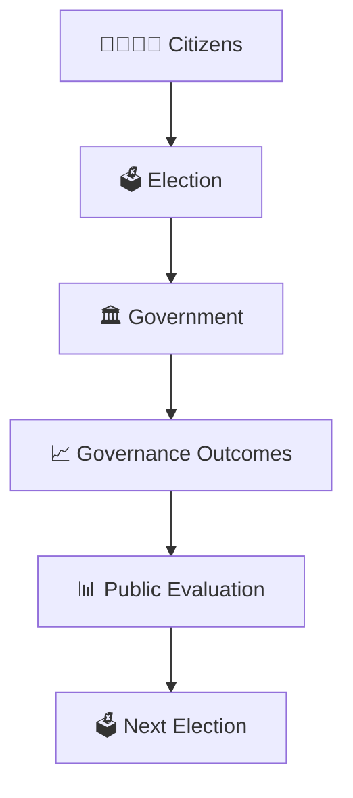

# Party to Government Journey

## Overview

This diagram explains how political parties move from electoral competition to government formation and governance.

It helps visualize the complete democratic journey from political organization to public administration.

---

## Why It Matters

Understanding the party-to-government journey helps explain:

- How political parties compete for power
- How elections determine representation
- How governments are formed
- How policies are implemented
- How democratic accountability operates

---

---

## Complete Journey

---

## Stage 1: Political Organization

### Outcome

- Citizens organize around ideas and policies.
- Political parties represent interests and viewpoints.

---

## Stage 2: Electoral Competition

### Outcome

- Parties seek public support.
- Citizens evaluate competing options.

---

## Stage 3: Election Results

### Outcome

- Representatives are elected.
- Legislative strength is determined.

---

## Stage 4: Government Formation

### Outcome

- Government gains authority to govern.
- Executive decision-making begins.

---

## Stage 5: Governance

### Outcome

- Policies are implemented.
- Public services are delivered.

---

## Accountability Cycle

---

## Quick Revision

---

## Related Topics

- political-party-ecosystem.md
- coalition-formation-model.md
- government-vs-opposition-framework.md
- election-process-flow.md
- government-formation-process.md
- elections-and-democracy.md