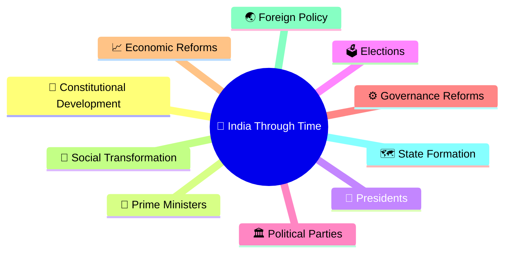
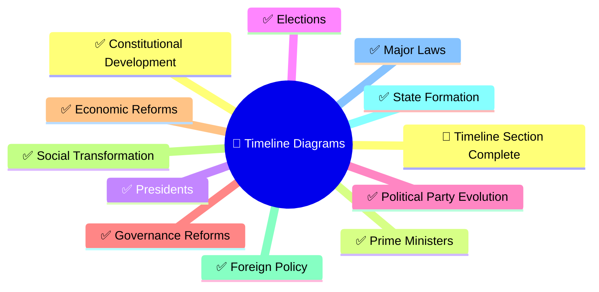
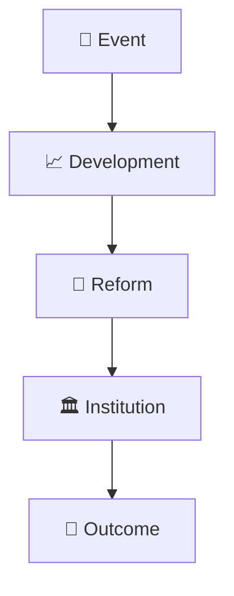
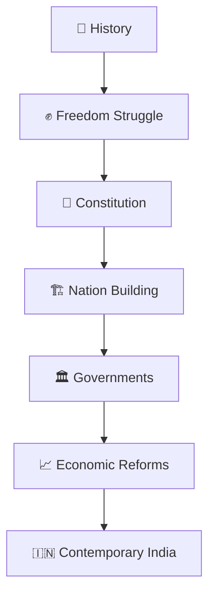

# Timeline Diagrams

## Overview

This section contains timeline-based visual diagrams that help understand the chronological evolution of India's history, politics, governance, institutions, laws, reforms, economy, and society.

The goal is to simplify long historical and governance journeys through easy-to-follow visual timelines.

## Importance

Timelines help connect isolated events into a coherent story.

For Indian politics and governance, understanding chronology is often more important than memorizing individual facts because institutions, laws, reforms, elections, and governments evolve over time.

---

## Why Use Timelines?

Timeline diagrams help:

- Understand chronological developments
- Connect events across different periods
- Visualize cause-and-effect relationships
- Improve long-term retention
- Understand long-term political and governance evolution
- Accelerate revision and conceptual understanding

---

## Learning Priority Order

### P1 (Highest ROI)

- India Through Time Timeline ✓
- Freedom Struggle Timeline ✓
- Nation Building Timeline ✓
- Constitutional Development Timeline ✓
- Prime Ministers Timeline ✓

### P2

- Presidents Timeline ✓
- Economic Reforms Timeline ✓
- Foreign Policy Timeline ✓
- Major Laws Timeline ✓
- Election Timeline ✓
## Progress Status

### P3

- State Formation Timeline ✓
- Social Transformation Timeline ✓
- Governance Reform Timeline ✓
- Political Party Evolution Timeline ✓

---

## Recommended Timeline Structure

---

## Timeline Categories

### Historical Timelines

- India through time
- Civilization evolution
- Major empires
- Freedom struggle
- Nation building

### Political Timelines

- Prime Ministers
- Presidents
- Elections
- Political party evolution
- Leadership evolution timeline
- Government transition timeline
- Coalition politics evolution

### Governance Timelines

- Constitutional development
- Governance reforms
- Administrative evolution
- Institution development
- Constitutional governance evolution
- Republic development timeline
- Federalism evolution

### Economic & Social Timelines

- Economic reforms
- Social transformations
- Development milestones
- Digital transformation
- Economic modernization timeline
- Digital India evolution timeline

---

## Citizen Learning Path

---

## Quick Revision

---

## Related Sections

- Civilization & History
- India Through Time
- Constitution & Nation Building
- Prime Ministers & Governments
- Economic Transformations
- Contemporary India
- History Diagrams