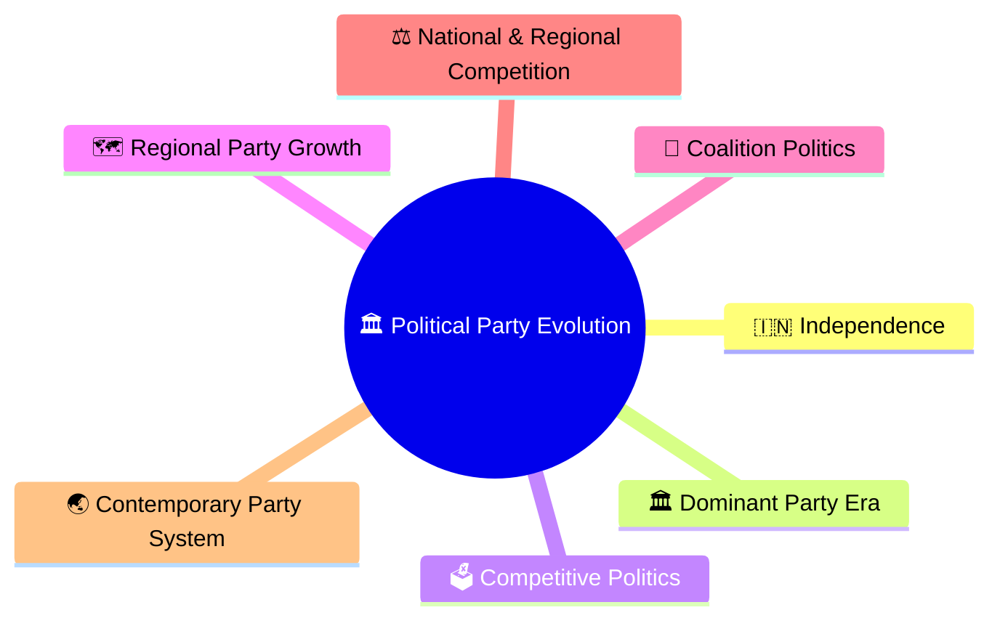
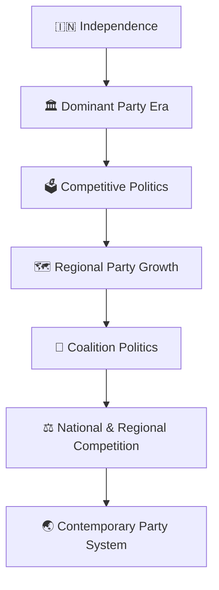
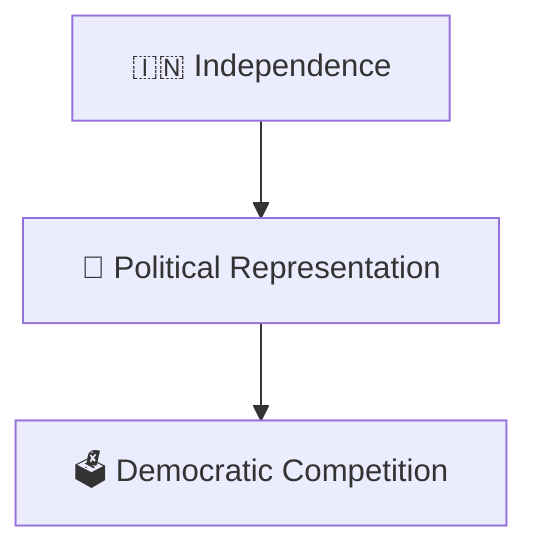
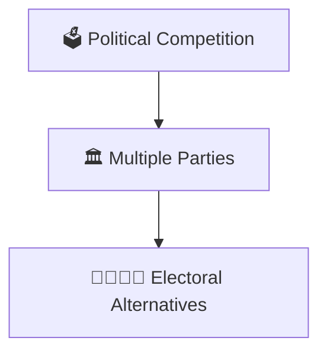
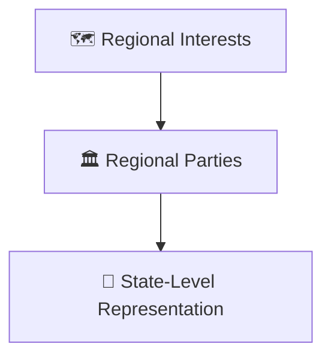
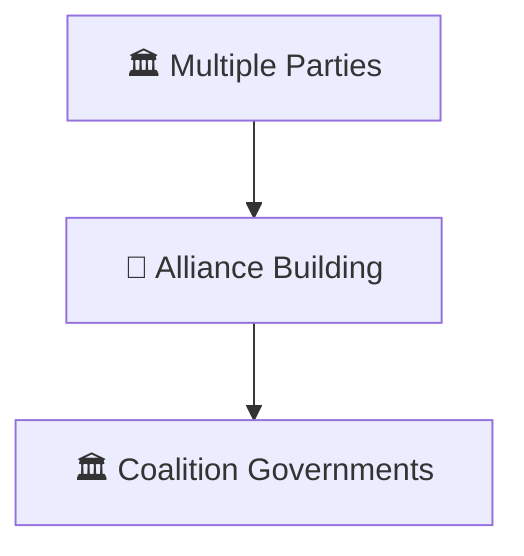
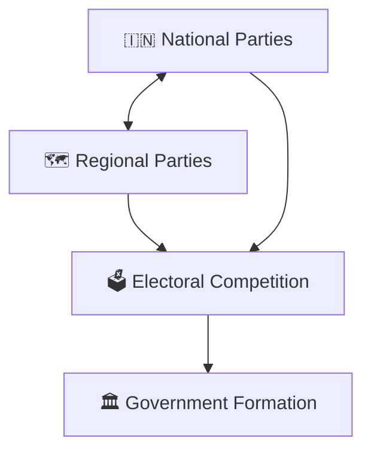
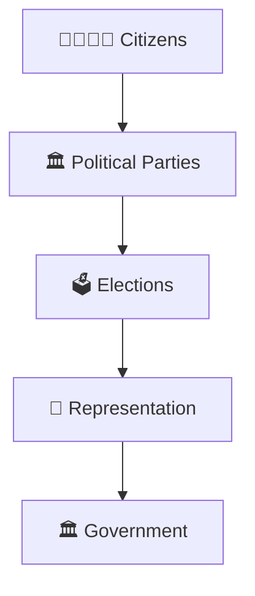

# Political Party Evolution Timeline

## Overview

This timeline explains how India's political party system evolved from independence to contemporary India.

It provides a high-level understanding of how political competition, representation, coalition politics, regional parties, and electoral dynamics developed over time.

---

## Why It Matters

Understanding political party evolution helps explain:

- How democratic competition developed
- How representation expanded
- How regional parties emerged
- How coalition politics evolved
- How contemporary electoral politics functions

---

## 

## Political Party Evolution Timeline

---

## Phase 1: Democratic Foundation

### Significance

- Development of electoral politics
- Growth of representative democracy
- Formation of political institutions

---

## Phase 2: Competitive Politics

### Significance

- Greater voter choice
- Expansion of democratic participation
- Stronger electoral competition

---

## Phase 3: Regional Party Growth

### Significance

- Stronger regional voices
- Diverse political representation
- Federal political balance

---

## Phase 4: Coalition Politics

### Significance

- Shared governance
- Political cooperation
- Broader representation

---

## Phase 5: Contemporary Party System

### Significance

- Multi-level competition
- National and regional influence
- Dynamic democratic politics

---

## Political Representation Framework

---

## Quick Revision

---

## Related Topics

- political-party-ecosystem.md
- national-vs-regional-parties.md
- coalition-formation-model.md
- election-timeline.md
- prime-ministers-timeline.md
- elections-and-democracy.md