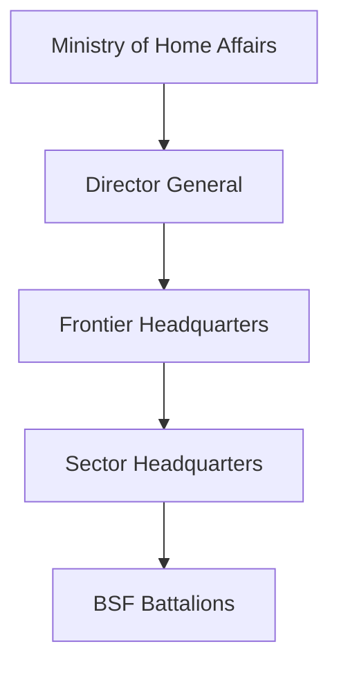
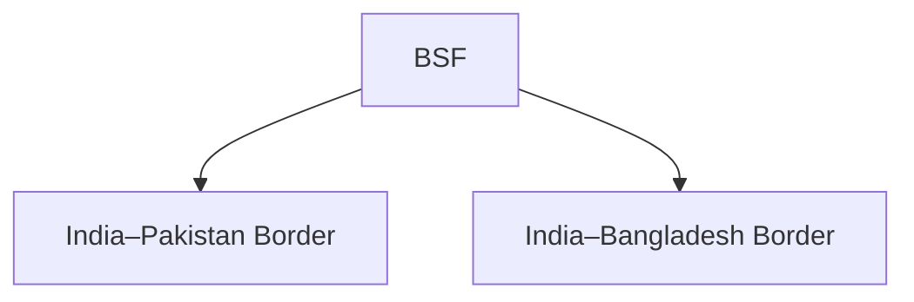

# Border Security Force (BSF)

## Why It Matters

The Border Security Force (BSF) is India's primary border-guarding force responsible for securing large sections of the country's international borders.

Known as the 'First Line of Defence', the BSF plays a critical role in preventing infiltration, smuggling, cross-border crime and hostile activities while supporting national security.

It is one of the largest border-security forces in the world.

---

## Quick Facts

| Item | Details |
|----------|----------|
| Name | Border Security Force (BSF) |
| Established | 1965 |
| Ministry | Ministry of Home Affairs |
| Headquarters | New Delhi |
| Primary Role | Border Security |
| Nickname | First Line of Defence |
| Type | Central Armed Police Force |

---

## Historical Background

The BSF was established after the 1965 India–Pakistan War to create a dedicated force responsible for guarding India's international borders during both peace and conflict.

---

## Organisation Structure

---

## Primary Responsibilities

- Border guarding
- Prevention of illegal infiltration
- Counter-smuggling operations
- Border surveillance
- Internal security duties when required
- Support during elections and emergencies
- Assistance during disasters

---

## Borders Guarded by BSF

The BSF is primarily responsible for guarding the India–Pakistan and India–Bangladesh borders.

---

## Peacetime Role

During peacetime, BSF focuses on:

- Border patrols
- Surveillance operations
- Intelligence collection
- Anti-smuggling operations
- Preventing illegal crossings

---

## Wartime Role

During war or major military operations, BSF supports the Indian Army through:

- Forward-area security
- Border intelligence
- Area domination
- Protection of key border locations

---

## Border Management Activities

---

## Special Units and Capabilities

BSF maintains specialized capabilities for:

- Water-wing operations
- Desert operations
- Riverine border security
- Communication and surveillance
- Special tactical missions

---

## Humanitarian and Civic Role

Apart from security duties, BSF contributes through:

- Disaster relief operations
- Rescue missions
- Medical assistance
- Community engagement programmes

---

## Strategic Importance

BSF helps India:

- Secure international borders
- Prevent infiltration
- Combat smuggling networks
- Support internal security
- Strengthen national security architecture

---

## Challenges

- Cross-border terrorism
- Smuggling networks
- Illegal migration
- Difficult terrain
- Drone-based threats
- Technological challenges

---

## Future Roadmap

- Smart border-management systems
- Advanced surveillance technologies
- Counter-drone capabilities
- Better communication networks
- Greater technology integration

---

## Quick Revision

- BSF was established in 1965.
- It is known as the First Line of Defence.
- Guards the India–Pakistan border.
- Guards the India–Bangladesh border.
- Operates under the Ministry of Home Affairs.
- Plays a major role in border security and national security.

---

## Key Concepts

### What is the BSF?

India's primary border-guarding force.

### Why was the BSF created?

To provide dedicated border security after the 1965 war.

### Which borders does the BSF guard?

The India–Pakistan and India–Bangladesh borders.

### Why is the BSF important?

It protects India's borders and prevents infiltration, smuggling and cross-border threats.

### Why is it called the First Line of Defence?

Because it is the first security force deployed along major international borders.
