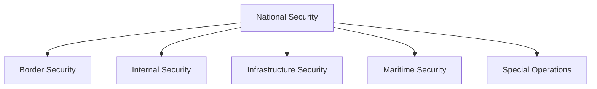
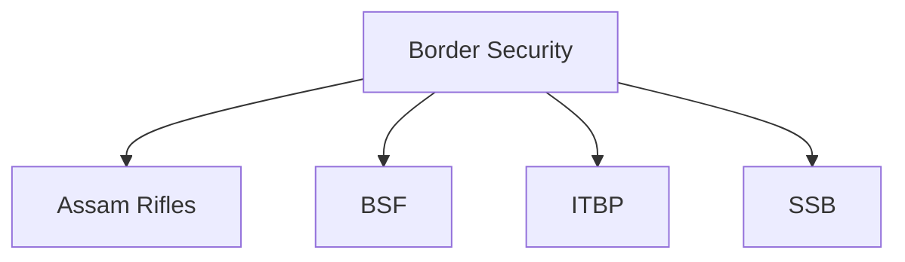
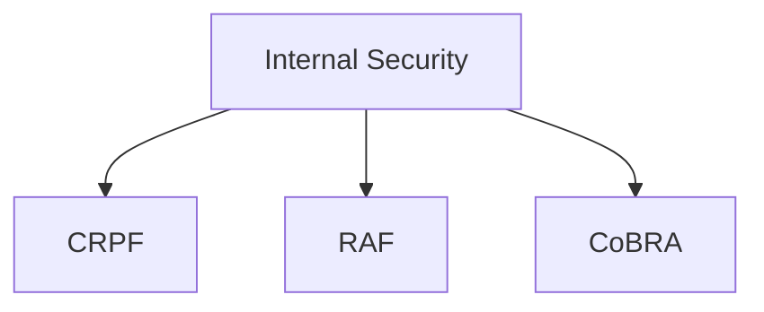
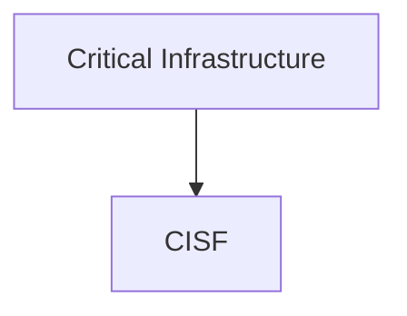
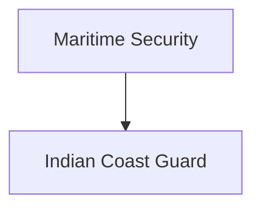
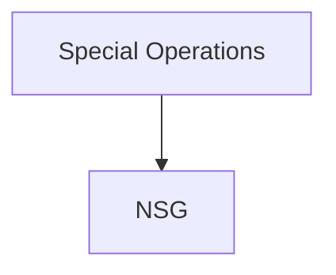

# Paramilitary Forces Overview

## Why It Matters

India's paramilitary forces, officially known as Central Armed Police Forces (CAPFs) and related security organizations, play a critical role in border security, internal security, counter-insurgency operations, infrastructure protection and national security.

They serve as a bridge between the Armed Forces and state police organizations and are deployed across some of the most challenging operational environments in the country.

---

## Quick Facts

| Item | Details |
|----------|----------|
| Domain | Internal and Border Security |
| Administrative Ministry | Ministry of Home Affairs (Most Forces) |
| Coverage | Borders, Internal Security, Infrastructure and Counter-Terrorism |
| Importance | National Security Architecture |
| Operational Areas | Land, Coastline and Critical Infrastructure |

---

## Security Architecture

---

## Major Forces and Responsibilities

| Force | Primary Responsibility |
|----------|----------|
| Assam Rifles | India–Myanmar Border and Counter-Insurgency |
| BSF | India–Pakistan and India–Bangladesh Borders |
| ITBP | India–China Border |
| SSB | India–Nepal and India–Bhutan Borders |
| CRPF | Internal Security |
| RAF | Riot Control and Crowd Management |
| CoBRA | Anti-Naxal Operations |
| CISF | Critical Infrastructure Security |
| NSG | Counter-Terrorism and Hostage Rescue |
| Indian Coast Guard | Maritime Security |

---

## Border Security Forces

These forces secure India's international borders and help prevent infiltration, smuggling and cross-border threats.

---

## Internal Security Forces

These forces help maintain law and order and support counter-insurgency operations.

---

## Infrastructure and Strategic Security

CISF protects airports, metros, industrial facilities, nuclear installations and strategic infrastructure.

---

## Maritime Security

The Indian Coast Guard protects India's coastline, maritime interests and Exclusive Economic Zone.

---

## Special Operations Capability

NSG specializes in counter-terrorism, hostage rescue and high-risk security operations.

---

## Importance to National Security

These forces help India:

- Secure international borders
- Maintain internal stability
- Protect critical infrastructure
- Counter terrorism and insurgency
- Safeguard maritime interests
- Support disaster response operations

---

## Challenges

- Cross-border terrorism
- Illegal migration
- Smuggling networks
- Left-Wing Extremism
- Drone-based threats
- Cyber-enabled security risks
- Expanding infrastructure requirements

---

## Future Roadmap

- Smart border management
- Advanced surveillance technologies
- Counter-drone systems
- AI-assisted monitoring
- Integrated command-and-control systems
- Greater technology-driven security operations

---

## Quick Revision

- BSF guards Pakistan and Bangladesh borders.
- ITBP guards the China border.
- SSB guards Nepal and Bhutan borders.
- Assam Rifles guards the Myanmar border.
- CRPF is India's largest CAPF.
- CISF protects critical infrastructure.
- NSG handles counter-terrorism operations.
- Coast Guard protects maritime interests.

---

## Key Concepts

### Why are paramilitary forces important?

They provide border security, internal security and protection of strategic assets.

### Which force guards the India–China border?

ITBP.

### Which force protects airports and critical infrastructure?

CISF.

### Which force is responsible for internal security?

CRPF.

### Which force handles maritime security?

The Indian Coast Guard.
