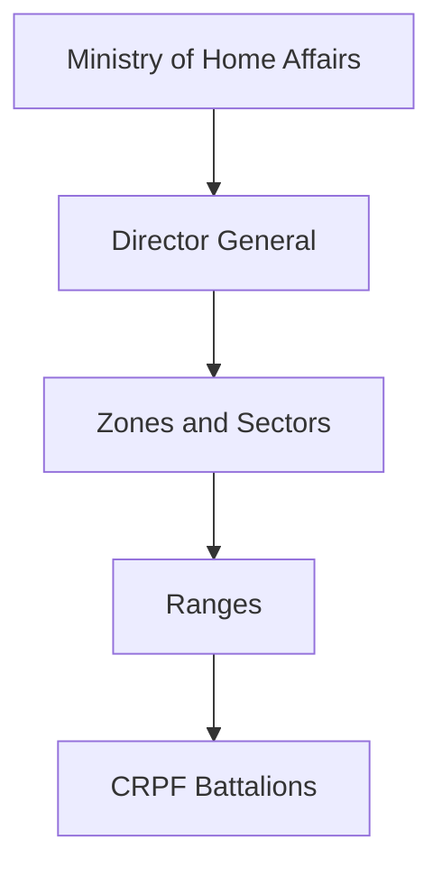
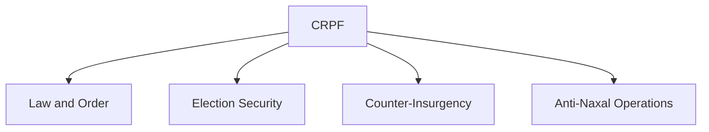
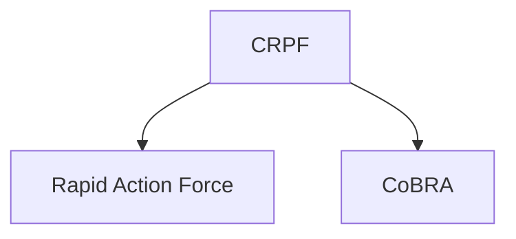

# Central Reserve Police Force (CRPF)

## Why It Matters

The Central Reserve Police Force (CRPF) is India's largest Central Armed Police Force and plays a vital role in maintaining internal security.

The force supports law and order, counter-insurgency operations, anti-Naxal operations, election security and national-security missions across the country.

CRPF is often considered the backbone of India's internal-security architecture.

---

## Quick Facts

| Item | Details |
|----------|----------|
| Name | Central Reserve Police Force (CRPF) |
| Established | 1939 |
| Ministry | Ministry of Home Affairs |
| Headquarters | New Delhi |
| Primary Role | Internal Security |
| Type | Central Armed Police Force |
| Importance | Largest CAPF in India |

---

## Historical Background

The force was established in 1939 as the Crown Representative's Police during British rule.

After independence, it was reorganized and renamed the Central Reserve Police Force.

Over time, it evolved into India's primary force for internal-security operations.

---

## Organisation Structure

---

## Primary Responsibilities

- Internal security
- Law and order support
- Counter-insurgency operations
- Anti-Naxal operations
- Election security
- VIP security support
- Disaster response assistance
- Protection of vital installations when required

---

## Internal Security Role

CRPF is frequently deployed in areas facing internal-security challenges.

---

## Counter-Insurgency Operations

The force conducts operations against:

- Insurgent groups
- Militancy-related threats
- Armed extremist organizations
- Security threats affecting public order

CRPF often works alongside state police and other security agencies.

---

## Anti-Naxal Operations

CRPF is one of the primary forces involved in operations against Left-Wing Extremism.

Its responsibilities include:

- Area domination
- Security operations
- Protection of infrastructure projects
- Support to local administration

---

## Election Security

The force plays a major role during:

- General elections
- State assembly elections
- Sensitive polling operations

CRPF helps ensure free and fair elections across India.

---

## Specialized Units

### Rapid Action Force (RAF)

Specialized for:

- Riot control
- Crowd management
- Communal disturbance response

### CoBRA

Specialized for:

- Anti-Naxal operations
- Jungle warfare
- High-risk security missions

---

## Disaster Response Role

CRPF also assists during:

- Natural disasters
- Flood relief operations
- Rescue missions
- Emergency support activities

---

## Strategic Importance

CRPF helps India:

- Maintain internal stability
- Support state police forces
- Combat insurgency and extremism
- Protect democratic processes
- Strengthen national security

---

## Challenges

- Insurgency threats
- Left-Wing Extremism
- Difficult operational environments
- Large deployment requirements
- Rapidly evolving security challenges

---

## Future Roadmap

- Better surveillance technology
- Improved mobility and communications
- Modern protective equipment
- Enhanced training systems
- Greater use of intelligence-driven operations

---

## Quick Revision

- CRPF is India's largest CAPF.
- Operates under the Ministry of Home Affairs.
- Responsible for internal security.
- Plays a major role in anti-Naxal operations.
- Supports election security.
- Parent organization of RAF and CoBRA units.

---

## Key Concepts

### What is CRPF?

India's largest Central Armed Police Force responsible for internal security.

### Why is CRPF important?

It supports law and order, counter-insurgency and national-security operations.

### What role does CRPF play during elections?

It helps ensure secure and fair electoral processes.

### What are RAF and CoBRA?

Specialized units operating under the CRPF.

### Why is CRPF called the backbone of internal security?

Because of its nationwide deployment and broad range of security responsibilities.
