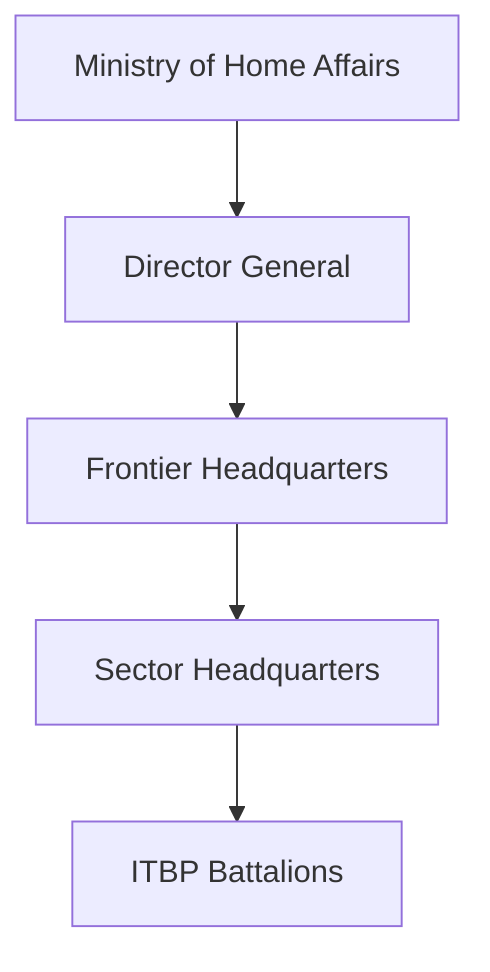
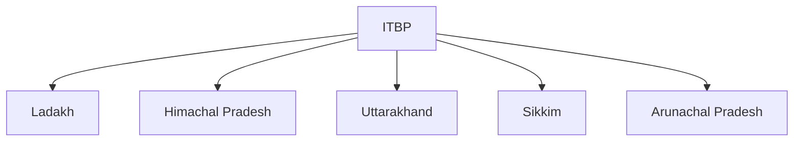

# Indo-Tibetan Border Police (ITBP)

## Why It Matters

The Indo-Tibetan Border Police (ITBP) is India's primary force responsible for guarding the India–China border in some of the world's most challenging high-altitude environments.

Known as the 'Himveers', ITBP plays a critical role in border security, surveillance, disaster response and high-altitude operations.

Its presence helps protect India's territorial integrity and strengthens national security along the Himalayan frontier.

---

## Quick Facts

| Item | Details |
|----------|----------|
| Name | Indo-Tibetan Border Police (ITBP) |
| Established | 1962 |
| Ministry | Ministry of Home Affairs |
| Headquarters | New Delhi |
| Primary Role | India–China Border Security |
| Nickname | Himveers |
| Type | Central Armed Police Force |

---

## Historical Background

The ITBP was established in 1962 following the Sino-Indian War.

Its primary purpose was to strengthen border security and improve India's ability to operate in high-altitude Himalayan regions.

---

## Organisation Structure

---

## Primary Responsibilities

- Guarding the India–China border
- Border surveillance and patrols
- High-altitude security operations
- Intelligence gathering
- Disaster response and rescue missions
- Support to civil administration
- Protection of strategic areas

---

## Border Responsibility

ITBP guards large sections of the India–China border across the Himalayan region.

---

## High-Altitude Operations

ITBP personnel are specially trained for:

- Mountain warfare support
- Extreme-weather operations
- Glacier deployment
- Long-range patrols
- Survival in high-altitude conditions

---

## Border Patrol and Surveillance

Regular patrols help maintain situational awareness and strengthen border security.

---

## Disaster Response Role

ITBP frequently assists during:

- Earthquakes
- Avalanches
- Floods
- Landslides
- Mountain rescue operations

Its expertise in difficult terrain makes it an important disaster-response force.

---

## Mountaineering and Adventure Expertise

The force has developed significant expertise in:

- Mountaineering
- Ice-craft training
- Search-and-rescue operations
- Himalayan expeditions

---

## Strategic Importance

ITBP helps India:

- Protect Himalayan borders
- Strengthen border surveillance
- Improve frontier security
- Maintain presence in remote regions
- Support national security objectives

---

## Challenges

- Extreme weather conditions
- High-altitude deployment
- Difficult logistics
- Remote operational areas
- Infrastructure challenges

---

## Future Roadmap

- Better surveillance systems
- Smart border technologies
- Improved mobility and logistics
- Advanced communication networks
- Enhanced border infrastructure integration

---

## Quick Revision

- ITBP was established in 1962.
- Known as the Himveers.
- Guards the India–China border.
- Specializes in high-altitude operations.
- Operates under the Ministry of Home Affairs.
- Plays a major role in Himalayan security.

---

## Key Concepts

### What is ITBP?

India's primary border-security force for the India–China border.

### Why was ITBP established?

Following the 1962 Sino-Indian War to strengthen Himalayan border security.

### Why is ITBP important?

It protects India's northern frontier and operates in challenging high-altitude environments.

### Why are ITBP personnel called Himveers?

Because of their specialized service in the Himalayan region.

### What makes ITBP unique?

Its expertise in high-altitude border security, mountain operations and disaster response.
