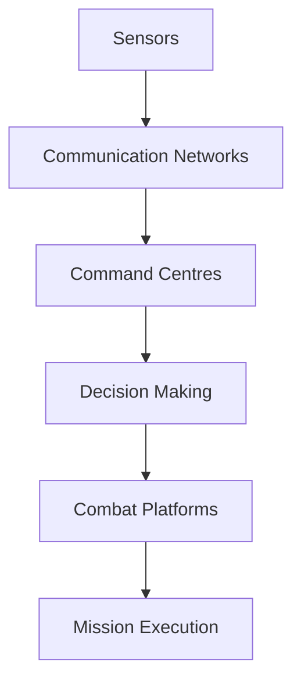

# Network-Centric Warfare

## Why It Matters

Network-Centric Warfare (NCW) is a military doctrine that uses interconnected communication networks, sensors, intelligence systems, command centers, and combat platforms to achieve superior situational awareness and faster decision-making.

Modern warfare increasingly depends on information sharing and real-time connectivity across military forces.

Studying Network-Centric Warfare helps understand:

- Digital battlefield concepts
- Command and control systems
- Military communication networks
- Joint operations
- Modern defence modernization programmes

---

## Quick Facts

| Item | Details |
| -------- | -------- |
| Domain | Military Networking and Command Systems |
| Objective | Information superiority and faster decision-making |
| Key Elements | Sensors, Networks, Commanders, Combat Platforms |
| Benefits | Better coordination and situational awareness |
| Importance | Foundation of modern warfare |

---

## What is Network-Centric Warfare?

Network-Centric Warfare connects military assets through secure digital networks so that information can be shared rapidly among commanders, intelligence agencies, and combat units.

The objective is to create a common operational picture across the battlefield.

---

## Evolution of Warfare

---

## Core Components

### Sensors

Collect information from the battlefield.

Examples:

- Satellites
- Radars
- UAVs
- Surveillance aircraft

### Networks

Transmit information securely and rapidly.

Examples:

- AFNET
- Defence communication networks
- Tactical communication systems

### Decision Makers

Military commanders and operational headquarters that analyze information and make decisions.

### Shooters

Combat systems that execute missions.

Examples:

- Aircraft
- Warships
- Missiles
- Artillery systems

---

## Network-Centric Warfare Architecture

---

## Indian Examples

### IACCS

Integrated Air Command and Control System used by the Indian Air Force for air defence and situational awareness.

### AFNET

Secure digital communication backbone of the Indian Air Force.

### NC3I Network

Naval Command, Control, Communications and Intelligence network supporting maritime domain awareness.

### Defence Communication Network

Tri-service communication infrastructure supporting joint operations.

---

## Advantages

- Faster decision-making
- Improved battlefield awareness
- Better joint operations
- Efficient resource utilization
- Improved mission effectiveness

---

## Challenges

- Cyber security risks
- Electronic warfare threats
- Communication disruptions
- High infrastructure costs
- Interoperability challenges

---

## Future Roadmap

- AI-assisted battlefield awareness
- Greater integration of sensors and platforms
- Multi-domain command networks
- Indigenous defence networking technologies
- Advanced secure communication systems

---

## Quick Revision

- Network-Centric Warfare connects sensors, networks, commanders, and combat systems.
- Information superiority is the primary objective.
- IACCS, AFNET, and NC3I are important Indian examples.
- NCW improves situational awareness and operational efficiency.
- Cyber security and electronic warfare are major challenges.

---

## Key Concepts

### Easy

1. What is Network-Centric Warfare?
2. Why is information superiority important?
3. What are the core components of NCW?
4. What is AFNET?

### Intermediate

1. How does NCW improve military effectiveness?
2. What role do sensors play in NCW?
3. Explain the significance of IACCS.
4. What challenges affect military networks?

### Advanced

1. Analyse the role of Network-Centric Warfare in modern military doctrine.
2. Evaluate India's progress in network-enabled warfare capabilities.
3. Explain how NCW supports multi-domain operations.
