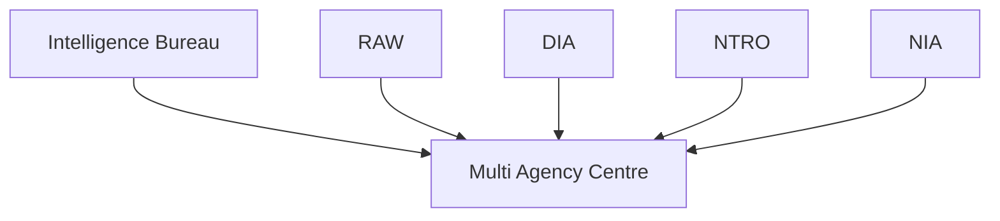

# Multi Agency Centre (MAC)

## Why It Matters

The Multi Agency Centre (MAC) is India's primary intelligence-sharing mechanism. It was created to improve coordination among intelligence, security and law-enforcement agencies by enabling timely sharing of information related to national-security threats.

MAC helps ensure that critical intelligence is available to relevant agencies before threats develop into security incidents.

---

## Quick Facts

| Item | Details |
|----------|----------|
| Full Name | Multi Agency Centre |
| Abbreviation | MAC |
| Established | 2001 |
| Operated By | Intelligence Bureau (IB) |
| Domain | Intelligence Coordination |
| Primary Role | Intelligence Sharing |

---

## What Is MAC?

The Multi Agency Centre is a coordination platform that facilitates intelligence sharing among central and state agencies involved in national security.

Its objective is to ensure that intelligence collected by one agency can be quickly accessed and used by other relevant agencies.

---

## Why MAC Was Created

Major security incidents highlighted the need for:

- Faster intelligence sharing
- Better inter-agency coordination
- Reduced information gaps
- Improved threat assessment

MAC was established to strengthen India's intelligence coordination framework.

---

## Intelligence Sharing Network

---

## Primary Responsibilities

### Intelligence Sharing

- Share security-related intelligence
- Disseminate threat information
- Improve situational awareness
- Reduce intelligence silos

### Threat Monitoring

- Monitor emerging threats
- Track terrorism-related activities
- Support security assessments
- Improve early warning capability

### Coordination Support

- Facilitate inter-agency communication
- Support intelligence integration
- Strengthen national-security coordination

---

## Participating Agencies

| Agency | Role |
|----------|----------|
| Intelligence Bureau (IB) | Internal Intelligence |
| RAW | External Intelligence |
| DIA | Military Intelligence |
| NTRO | Technical Intelligence |
| NIA | Terror Investigation |
| State Police Agencies | Local Security Inputs |

---

## Information Flow

---

## Role in Counter-Terrorism

MAC helps:

- Share terrorism-related intelligence
- Identify threat patterns
- Improve coordination among agencies
- Support preventive security measures
- Enhance response preparedness

---

## Role During Security Crises

During national-security incidents, MAC:

- Consolidates intelligence inputs
- Shares threat assessments
- Supports coordinated response efforts
- Improves information availability

---

## Strategic Importance

MAC strengthens:

- Intelligence coordination
- National-security preparedness
- Threat detection capability
- Counter-terrorism efforts
- Inter-agency cooperation

---

## Challenges

- Large intelligence volumes
- Real-time information requirements
- Multi-agency coordination complexity
- Emerging technology-driven threats
- Cyber-security challenges

---

## Future Roadmap

- Faster intelligence-sharing systems
- AI-assisted threat analysis
- Improved data integration platforms
- Enhanced coordination mechanisms
- Better real-time situational awareness

---

## Quick Revision

- MAC is India's primary intelligence-sharing mechanism.
- It is operated by the Intelligence Bureau.
- It enables intelligence sharing among multiple agencies.
- It supports counter-terrorism and national security.
- It reduces intelligence gaps.
- It improves inter-agency coordination.

---

## Key Concepts

### What is MAC?

The Multi Agency Centre for intelligence sharing and coordination.

### Why was MAC created?

To improve intelligence sharing among security agencies.

### Which agency operates MAC?

The Intelligence Bureau.

### What is MAC's primary role?

Sharing and coordinating intelligence information.

### Why is MAC important?

It improves threat detection and strengthens national-security coordination.
