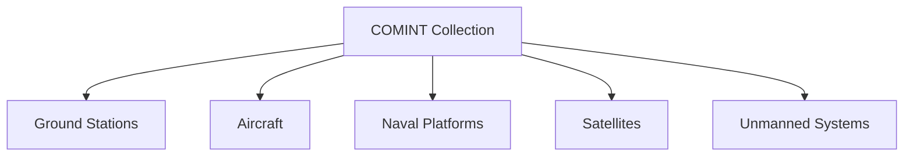

# Communications Intelligence (COMINT)

## Why It Matters

Communications Intelligence (COMINT) is the collection and analysis of communication signals exchanged between individuals, organizations, military units, and governments.

Modern military operations depend heavily on communication networks for command, control, coordination, intelligence sharing, and mission execution.

Monitoring communication signals helps identify threats, understand adversary intentions, and support military and national security decision-making.

---

## Quick Facts

| Item | Details |
| -------- | -------- |
| Full Form | Communications Intelligence |
| Intelligence Category | SIGINT Sub-discipline |
| Focus | Communication signals |
| Sources | Radio, satellite, telephone, data networks |
| Users | Armed Forces and Intelligence Agencies |
| Importance | Threat monitoring and decision support |

---

## What is COMINT?

COMINT focuses on intercepting, processing, and analysing communications exchanged between people, military units, and organizations.

The objective is to obtain useful intelligence regarding:

- Intentions
- Capabilities
- Activities
- Plans
- Operational movements

---

## COMINT Collection Process

---

## Major Sources of COMINT

### Radio Communications

Military and civilian radio transmissions provide valuable operational information.

### Satellite Communications

Satellite-based communications are widely used for strategic and military coordination.

### Voice Communications

Telephone and voice-based communication systems can provide intelligence insights.

### Data Communications

Digital networks, messaging systems, and data transmissions generate intelligence opportunities.

---

## COMINT Collection Platforms

---

## Military Applications

- Monitoring adversary communications
- Early warning and threat detection
- Operational intelligence
- Battlefield awareness
- Strategic decision support
- Mission planning

---

## COMINT vs ELINT

| Feature | COMINT | ELINT |
| -------- | -------- | -------- |
| Focus | Communication signals | Electronic emissions |
| Sources | Voice and data communications | Radars and sensors |
| Objective | Information collection | Technical intelligence |
| Usage | Intent and activity analysis | Capability assessment |

---

## Challenges

- Strong encryption technologies
- Secure communication systems
- Large communication volumes
- Rapid technological change
- Attribution difficulties

---

## India and COMINT

COMINT supports:

- Border security
- Counter-terrorism operations
- Strategic intelligence collection
- Military preparedness
- National security monitoring

COMINT capabilities are used by intelligence agencies, defence organizations, and the armed forces to support security objectives.

---

## Future Roadmap

- AI-assisted communication analysis
- Real-time intelligence processing
- Improved signal interception technologies
- Enhanced intelligence fusion systems
- Better integration with cyber and electronic intelligence

---

## Quick Revision

- COMINT collects communication signals.
- COMINT is a sub-discipline of SIGINT.
- Radio, satellite, voice, and data communications are major sources.
- COMINT helps identify intentions and activities.
- COMINT supports military and national security operations.

---

## Key Concepts

### Easy

1. What is COMINT?
2. What types of communications are monitored under COMINT?
3. How is COMINT different from ELINT?
4. Why is COMINT important?

### Intermediate

1. How does COMINT support military operations?
2. What are the major sources of COMINT?
3. Explain the COMINT collection process.
4. What challenges affect communications intelligence?

### Advanced

1. Analyse the role of COMINT in modern intelligence operations.
2. Evaluate the impact of encryption on communications intelligence.
3. Explain how COMINT contributes to national security.
