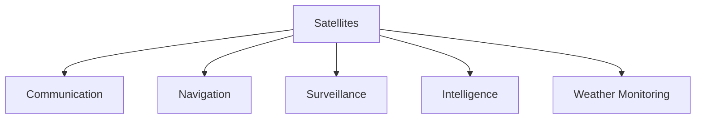
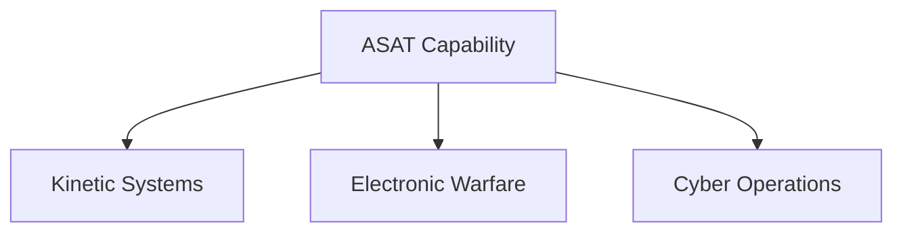

# Anti-Satellite Capability (ASAT)

## Why It Matters

Anti-Satellite (ASAT) capability refers to the ability to detect, track and neutralize satellites in space.

As modern military operations increasingly depend on satellites for communication, navigation, surveillance, intelligence and missile warning, space has become an important strategic domain.

For India, ASAT capability strengthens deterrence, protects national interests and demonstrates advanced technological capability.

---

## Quick Facts

| Item | Details |
|----------|----------|
| Domain | Space Security |
| Capability | Anti-Satellite (ASAT) |
| Demonstrated By India | 2019 |
| Key Operation | Mission Shakti |
| Strategic Importance | Space Deterrence |
| Role | Counter-Space Capability |

---

## What Is Anti-Satellite Capability?

Anti-Satellite capability refers to systems designed to disable, damage or destroy satellites.

These capabilities can be used to counter adversary space assets during a conflict.

---

## Why Satellites Matter

Modern military forces depend heavily on satellites for operations.

---

## Why ASAT Capability Is Important

- Protects national interests in space
- Strengthens strategic deterrence
- Demonstrates advanced technology capability
- Supports space-security objectives
- Enhances national-security preparedness
- Contributes to counter-space capability

---

## Types of ASAT Systems

### Kinetic Systems

Physical interception of a satellite.

### Electronic Methods

Disruption of communications and signals.

### Cyber Methods

Targeting digital systems associated with space assets.

---

## Mission Shakti

Mission Shakti was India's demonstration of anti-satellite capability.

The mission showed India's ability to engage a satellite in low Earth orbit and marked India's entry into a select group of countries possessing demonstrated ASAT capability.

---

## How an ASAT Intercept Works

---

## Military Importance

ASAT capability can influence:

- Intelligence operations
- Communication networks
- Navigation systems
- Surveillance capability
- Space-based military support

---

## Space Deterrence

Space deterrence aims to discourage hostile actions against critical space infrastructure.

---

## Challenges

- Space debris concerns
- Rapid technological evolution
- Increasing satellite dependence
- Complex space environment
- International regulatory discussions

---

## Future Roadmap

- Improved space situational awareness
- Enhanced space surveillance systems
- Better space-security infrastructure
- Stronger counter-space capability
- Greater integration with defence planning

---

## Relationship with Other Space Assets

ASAT capability is closely connected to:

- Defence Space Agency
- Military satellites
- Early-warning systems
- Space surveillance networks
- Strategic deterrence architecture

---

## Quick Revision

- ASAT means Anti-Satellite capability.
- Satellites are critical for modern military operations.
- Mission Shakti demonstrated India's ASAT capability.
- ASAT capability contributes to space deterrence.
- Space security is increasingly important for national security.
- Counter-space capability is a major strategic domain.

---

## Key Concepts

### What is ASAT capability?

The ability to disable or destroy satellites.

### Why are satellites strategically important?

They support communication, navigation, intelligence and surveillance.

### What was Mission Shakti?

India's demonstration of anti-satellite capability in 2019.

### Why is ASAT capability important?

It strengthens space security and strategic deterrence.

### What is space deterrence?

The use of capabilities that discourage hostile actions against space assets.
