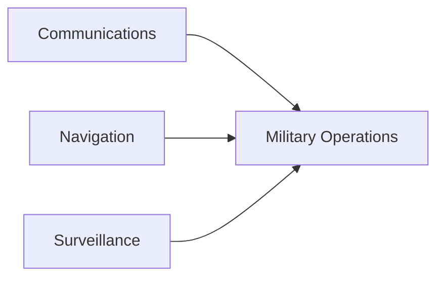
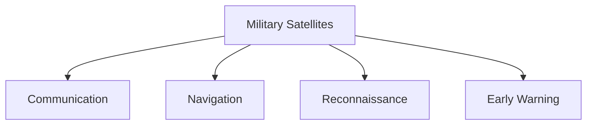

# Military Satellites

## Why It Matters

Military satellites are among the most important components of modern national-security infrastructure.

They support communications, navigation, surveillance, intelligence gathering and military operations across land, sea, air and space domains.

Modern warfare depends heavily on space-based assets for situational awareness and decision-making.

---

## Quick Facts

| Item | Details |
|----------|----------|
| Domain | Space Security |
| Primary Role | Military Support and Strategic Awareness |
| Functions | Communication, Navigation, Surveillance and Reconnaissance |
| Users | Armed Forces and National Security Agencies |
| Strategic Importance | Force Multiplier for Modern Warfare |

---

## What Are Military Satellites?

Military satellites are space-based systems used to support defence, intelligence and security operations.

They provide capabilities that would be difficult or impossible to achieve using only ground-based systems.

---

## Evolution of Military Space Capability

---

## Major Categories

### Communication Satellites

Support:

- Secure military communications
- Strategic command networks
- Joint-force coordination
- Long-distance connectivity

### Navigation Satellites

Support:

- Positioning
- Navigation
- Timing services
- Precision targeting

### Reconnaissance Satellites

Support:

- Intelligence gathering
- Target identification
- Battlefield monitoring
- Strategic surveillance

### Early Warning Satellites

Support:

- Missile detection
- Threat monitoring
- Strategic warning systems

---

## Military Satellite Ecosystem

---

## Importance for Defence Operations

Military satellites help:

- Improve situational awareness
- Enhance command and control
- Support precision operations
- Monitor borders and oceans
- Strengthen national security
- Improve strategic decision-making

---

## Connection with Space Security

Protecting satellites is a critical part of national-security planning.

---

## Challenges

- Anti-satellite threats
- Space debris
- Cyber attacks on space infrastructure
- Increasing space congestion
- Dependence on satellite networks

---

## Future Roadmap

- Advanced surveillance systems
- Improved communications capability
- Better navigation support
- Enhanced resilience against attacks
- Greater integration with defence networks

---

## Quick Revision

- Military satellites support modern warfare.
- They provide communications, navigation and surveillance.
- Reconnaissance satellites support intelligence gathering.
- Satellites improve command and control.
- Space security is essential for protecting satellite infrastructure.
- Military effectiveness increasingly depends on space-based assets.

---

## Key Concepts

### Why are military satellites important?

They provide critical capabilities for communications, navigation, surveillance and intelligence.

### What is a reconnaissance satellite?

A satellite used for observation, intelligence gathering and monitoring activities.

### How do satellites support military operations?

They improve awareness, coordination, navigation and decision-making.

### Why must satellites be protected?

Because modern defence operations depend heavily on them.

### What role do satellites play in national security?

They strengthen intelligence, communications, surveillance and strategic preparedness.
