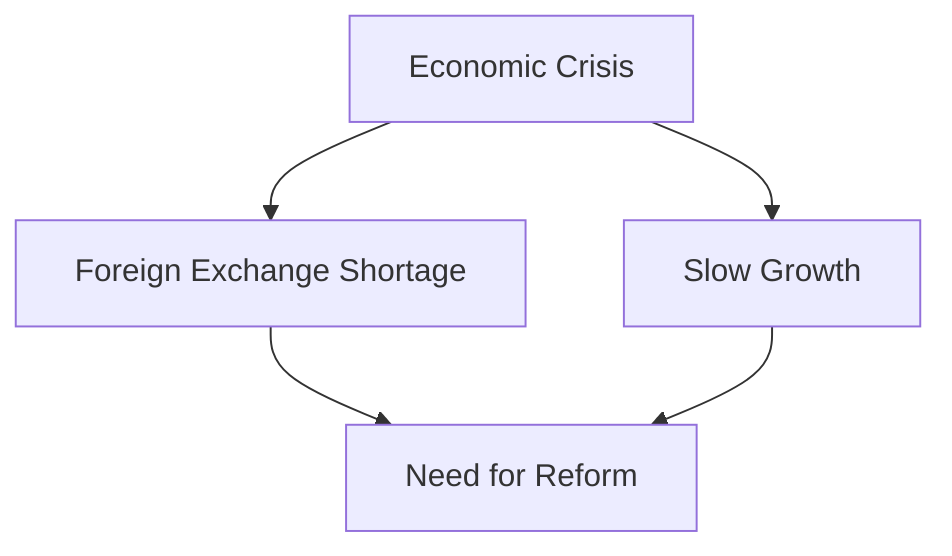
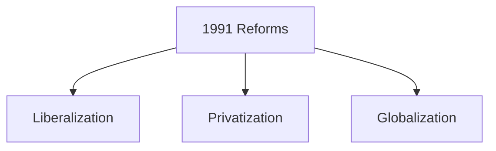
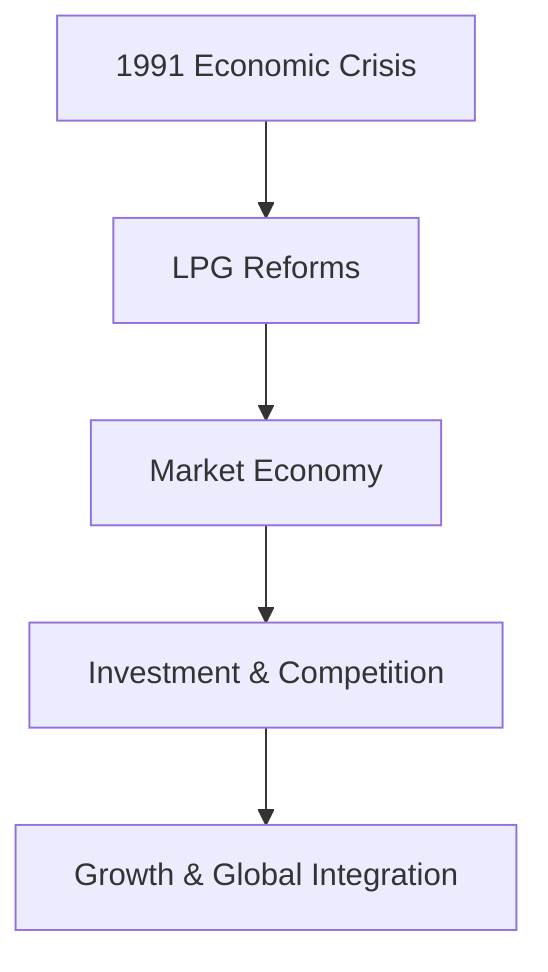

# Economic Liberalization 1991

## Why This Case Study Matters

The 1991 Economic Liberalization reforms are among the most significant policy changes in modern Indian history. The reforms transformed India's economy by reducing state controls, encouraging private sector participation, opening the economy to global markets, and accelerating economic growth.

## Quick Facts

| Item             | Details                                                                 |
| ---------------- | ----------------------------------------------------------------------- |
| Reform           | Economic Liberalization                                                 |
| Year             | 1991                                                                    |
| Governance Theme | Economic Reform                                                         |
| Key Leaders      | Prime Minister P. V. Narasimha Rao, Finance Minister Dr. Manmohan Singh |
| Major Areas      | Trade, Industry, Investment, Finance                                    |
| Objective        | Economic Stabilization and Growth                                       |

## Background

By 1991, India faced a severe economic crisis.

Major challenges included:

- Foreign exchange shortage
- Balance of payments crisis
- High fiscal pressures
- Slow economic growth
- Excessive licensing and regulation

The country required urgent structural reforms to stabilize the economy.

## Problem Statement

## Reform Framework

## Liberalization Measures

- Reduction of industrial licensing
- Easier business operations
- Reduced government controls
- Expansion of private sector participation

## Privatization Measures

- Greater private sector role
- Public sector reforms
- Increased efficiency focus
- Competitive market environment

## Globalization Measures

- Trade reforms
- Foreign investment encouragement
- Global market integration
- Export-oriented growth

## Economic Transformation

## Outcomes

Major outcomes included:

- Higher economic growth
- Expansion of private enterprise
- Increased foreign investment
- Growth of service industries
- Greater global integration

## Challenges and Criticism

### Supporters Highlight

- Faster economic growth
- Increased opportunities
- Global competitiveness
- Investment expansion

### Critics Highlight

- Income inequality concerns
- Regional disparities
- Employment challenges in some sectors
- Dependence on global markets

## Lessons for Governance

| Lesson                                        | Importance |
| --------------------------------------------- | ---------- |
| Economic reforms require political leadership | High       |
| Crisis can drive structural change            | High       |
| Markets and regulation must be balanced       | High       |
| Long-term reforms need continuity             | High       |
| Growth and inclusion should progress together | High       |

## Interview Questions

1. Why were the 1991 reforms introduced?
2. What do Liberalization, Privatization, and Globalization mean?
3. What economic problems existed before the reforms?
4. What were the major outcomes of the reforms?
5. What criticisms are associated with economic liberalization?

## Quick Revision

