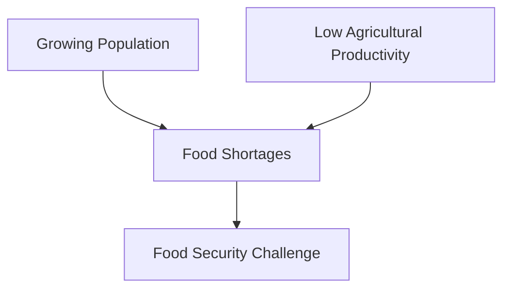
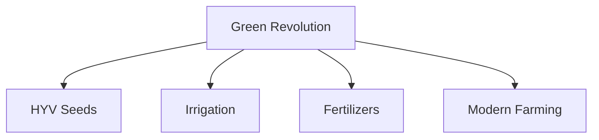
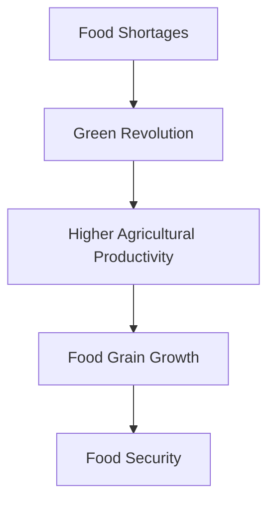

# Green Revolution

## Why This Case Study Matters

The Green Revolution transformed India from a food-deficit country into a major food-producing nation. It is one of the most important agricultural and governance success stories in independent India and demonstrates how policy, science, infrastructure, and farmer participation can work together to solve national challenges.

## Quick Facts

| Item             | Details                                        |
| ---------------- | ---------------------------------------------- |
| Initiative       | Green Revolution                               |
| Period           | Mid-1960s onwards                              |
| Governance Theme | Agricultural Transformation                    |
| Key Objective    | Food Security                                  |
| Major Components | HYV Seeds, Irrigation, Fertilizers, Technology |
| Primary Sector   | Agriculture                                    |

## Background

During the 1950s and 1960s, India faced significant food shortages.

Major challenges included:

- Low agricultural productivity
- Rapid population growth
- Dependence on food imports
- Frequent food shortages
- Limited modern farming techniques

Ensuring food security became a national priority.

## Problem Statement

## Solution Framework

## Key Components

### High-Yield Variety Seeds

- Improved crop productivity
- Better output per hectare
- Scientific farming methods

### Irrigation Expansion

- Increased water availability
- Reduced dependence on rainfall
- Support for multiple crop cycles

### Agricultural Inputs

- Fertilizers
- Pesticides
- Farm machinery
- Modern cultivation practices

## Agricultural Transformation

## Outcomes

Major outcomes included:

- Significant increase in food grain production
- Improved food security
- Reduced dependence on imports
- Growth in agricultural productivity
- Strengthening of rural economies in many regions

## Challenges and Criticism

### Positive Outcomes

- Higher yields
- Greater food availability
- Agricultural modernization
- Improved national self-sufficiency

### Concerns

- Regional inequalities
- Environmental impacts
- Groundwater depletion
- Dependence on chemical inputs
- Uneven benefits across crops and regions

## Lessons for Governance

| Lesson                                       | Importance |
| -------------------------------------------- | ---------- |
| Science can transform public policy outcomes | High       |
| Food security requires long-term planning    | High       |
| Infrastructure is critical for development   | High       |
| Policy and technology must work together     | High       |
| Sustainability should accompany growth       | High       |

## Interview Questions

1. Why was the Green Revolution introduced?
2. What were the major components of the Green Revolution?
3. How did it improve food security?
4. What criticisms are associated with the Green Revolution?
5. What governance lessons emerged from this initiative?

## Quick Revision

