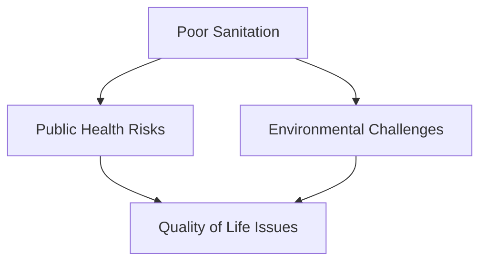
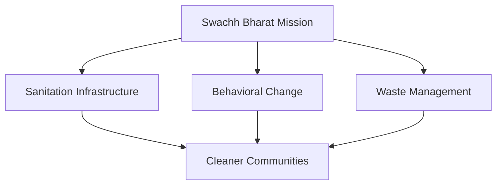
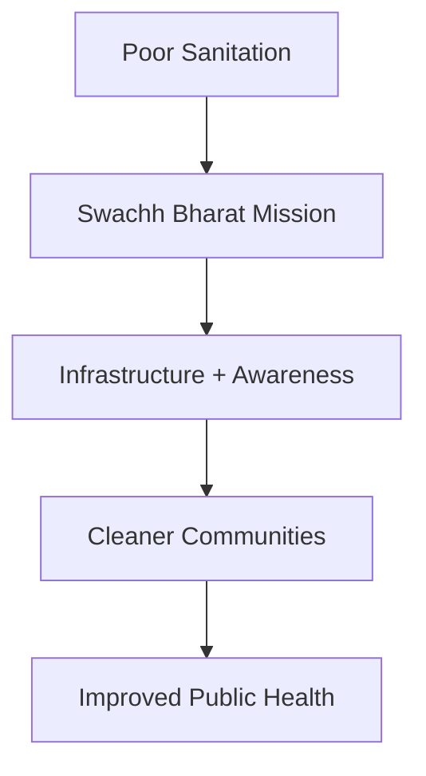

# Swachh Bharat Mission

## Why This Case Study Matters

Swachh Bharat Mission is one of India's largest public sanitation and behavioral change initiatives. The program focused on improving cleanliness, sanitation infrastructure, waste management, and public awareness while addressing long-standing public health challenges.

## Quick Facts

| Item             | Details                                     |
| ---------------- | ------------------------------------------- |
| Initiative       | Swachh Bharat Mission                       |
| Launch Year      | 2014                                        |
| Governance Theme | Public Health & Sanitation                  |
| Objective        | Cleanliness and Improved Sanitation         |
| Coverage         | Urban and Rural India                       |
| Key Areas        | Toilets, Waste Management, Public Awareness |

## Background

For decades, inadequate sanitation remained a major development challenge.

Major concerns included:

- Open defecation
- Poor sanitation infrastructure
- Public health risks
- Environmental pollution
- Limited awareness about hygiene

The mission aimed to improve both infrastructure and public behavior.

## Problem Statement

## Mission Framework

## Key Components

### Sanitation Infrastructure

- Household toilets
- Community sanitation facilities
- Rural sanitation programs
- Urban sanitation improvements

### Behavioral Change

- Public awareness campaigns
- Hygiene education
- Community participation
- Citizen engagement

### Waste Management

- Collection systems
- Segregation initiatives
- Urban cleanliness efforts
- Sustainable waste practices

## Governance Transformation

## Outcomes

Major outcomes included:

- Expansion of sanitation infrastructure
- Increased awareness about hygiene
- Improved cleanliness initiatives
- Greater citizen participation
- Increased focus on waste management

## Challenges and Criticism

### Implementation Challenges

- Maintenance of infrastructure
- Behavioral change sustainability
- Waste processing capacity
- Regional implementation differences

### Policy Discussions

- Long-term sustainability
- Quality of infrastructure
- Monitoring effectiveness
- Continued public participation

## Lessons for Governance

| Lesson                                           | Importance |
| ------------------------------------------------ | ---------- |
| Infrastructure and behavior must evolve together | High       |
| Public participation drives success              | High       |
| Awareness campaigns matter                       | High       |
| Local implementation is critical                 | High       |
| Long-term maintenance is essential               | High       |

## Interview Questions

1. Why was Swachh Bharat Mission launched?
2. What were the major objectives of the mission?
3. Why is behavioral change important in sanitation reforms?
4. What governance lessons emerged from the mission?
5. What implementation challenges remain?

## Quick Revision

