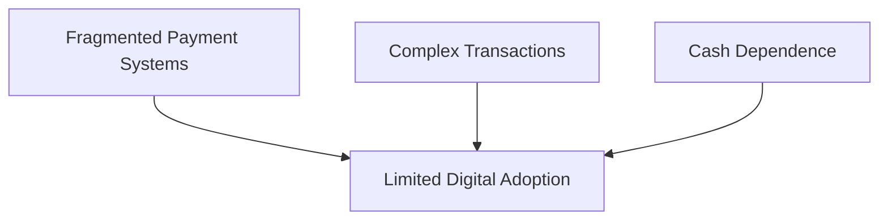
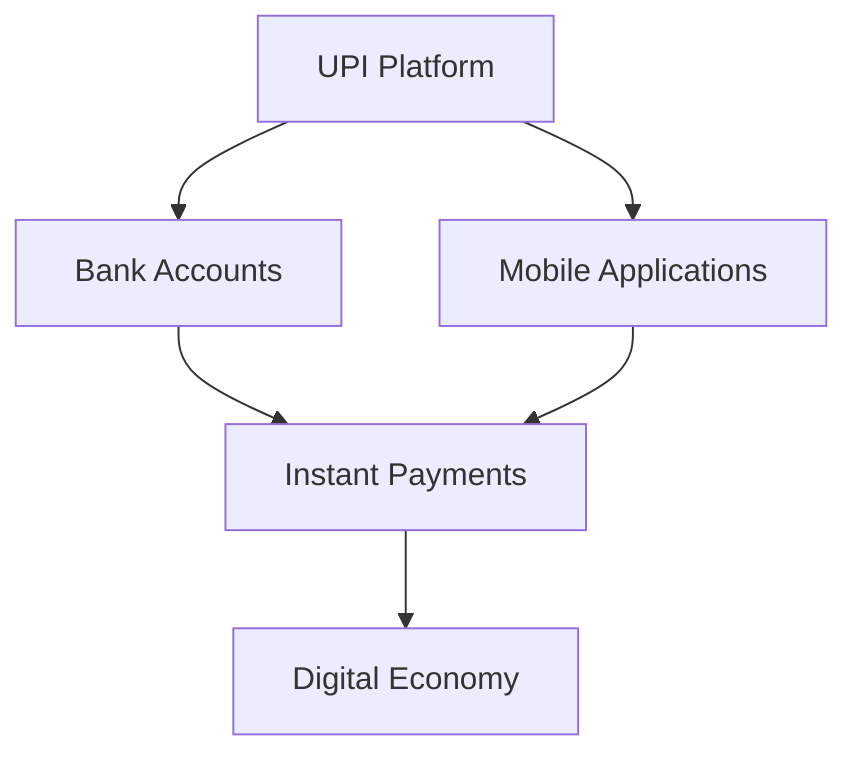
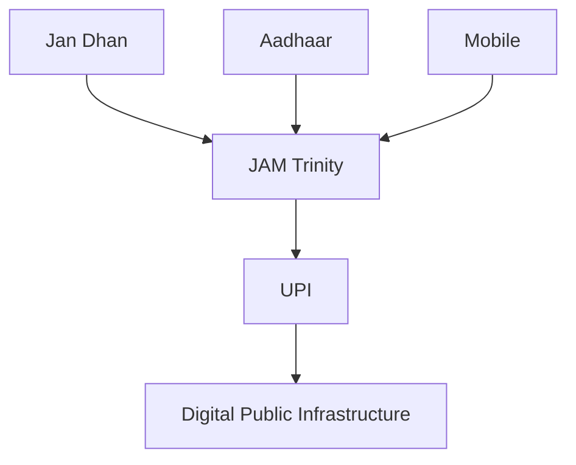
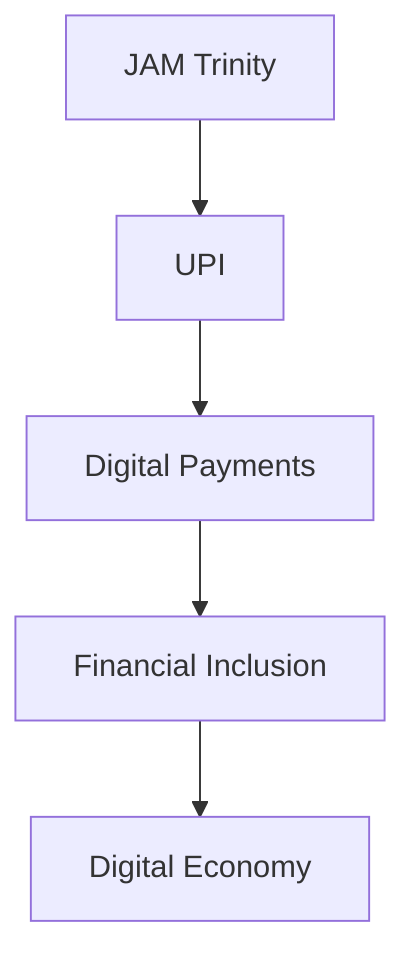

# UPI Digital Payments

## Why This Case Study Matters

Unified Payments Interface (UPI) is one of India's most successful digital public infrastructure initiatives. It transformed digital payments by enabling instant, interoperable, low-cost transactions and has become a globally recognized example of large-scale digital governance innovation.

## Quick Facts

| Item             | Details                                       |
| ---------------- | --------------------------------------------- |
| Initiative       | Unified Payments Interface (UPI)              |
| Launch           | 2016                                          |
| Governance Theme | Digital Public Infrastructure                 |
| Key Institution  | National Payments Corporation of India (NPCI) |
| Objective        | Instant Digital Payments                      |
| Impact Area      | Financial Inclusion and Digital Economy       |

## Background

Before UPI, digital payments often involved multiple platforms, complicated processes, and limited interoperability.

Major challenges included:

- Fragmented payment systems
- Slow digital payment adoption
- Limited interoperability
- Dependence on cash transactions
- Higher transaction friction

A unified payment framework was needed.

## Problem Statement

## UPI Solution Framework

## How UPI Works

## Relationship with Digital Governance

## Major Benefits

### Citizens

- Instant payments
- Convenient transactions
- Reduced cash dependence
- Wider digital access

### Businesses

- Faster payment settlement
- Lower transaction friction
- Digital transaction records
- Greater customer convenience

### Government

- Digital economy growth
- Financial inclusion support
- Improved transparency
- Expansion of digital infrastructure

## Governance Transformation

## Outcomes

Major outcomes include:

- Rapid growth of digital payments
- Increased financial inclusion
- Expansion of digital commerce
- Strengthening of digital public infrastructure
- International interest in India's payment model

## Challenges and Criticism

### Operational Challenges

- Cybersecurity risks
- Fraud attempts
- Digital literacy gaps
- Connectivity limitations

### Policy Challenges

- Data security concerns
- System resilience requirements
- Inclusion of underserved populations

## Lessons for Governance

| Lesson                                             | Importance |
| -------------------------------------------------- | ---------- |
| Public digital infrastructure can scale nationally | High       |
| Interoperability drives adoption                   | High       |
| Simplicity improves citizen usage                  | High       |
| Financial inclusion supports development           | High       |
| Technology requires strong security safeguards     | High       |

## Interview Questions

1. What is UPI and why was it created?
2. How does UPI support digital governance?
3. What role does UPI play in financial inclusion?
4. Why is interoperability important in payment systems?
5. What governance lessons emerge from UPI's success?

## Quick Revision

