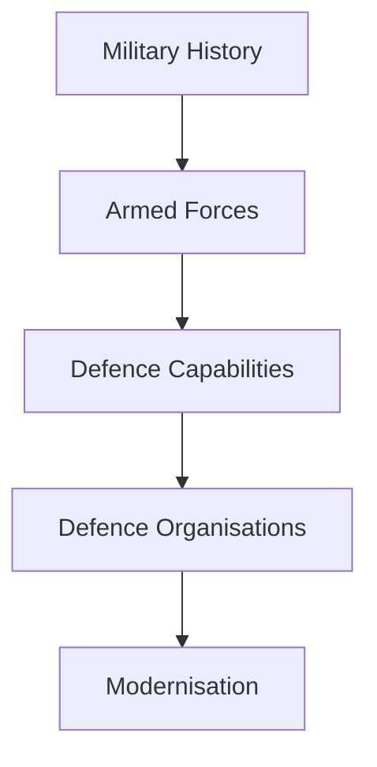
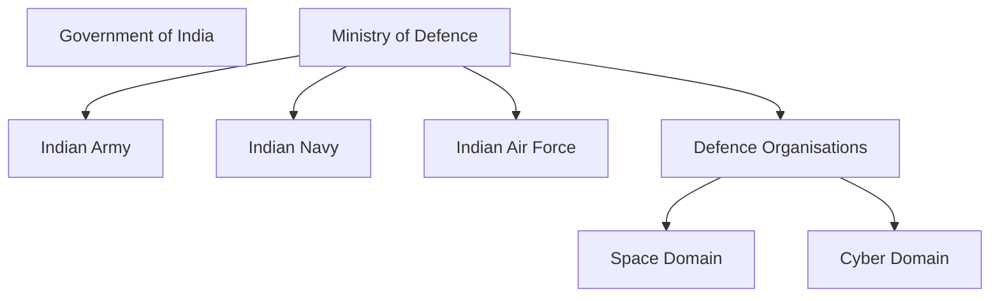

# Defence and National Security

## Why It Matters

Defence and national security are essential for protecting India's sovereignty, territorial integrity, citizens, strategic interests and global influence.

India maintains one of the world's largest military establishments and operates across multiple domains including land, sea, air, space, cyber and strategic deterrence.

This section provides a structured understanding of India's defence ecosystem, military history, organizations, capabilities and modernization efforts.

---

## Quick Facts

| Item | Details |
|----------|----------|
| Domain | Defence and National Security |
| Coverage | Military, Strategic, Space, Cyber and Security Affairs |
| Primary Ministry | Ministry of Defence |
| Importance | National Security and Strategic Stability |
| Learning Focus | Forces, Organisations, Capabilities and Reforms |

---

## Repository Structure

```text
24-defence-and-national-security/
├── README.md
├── military-history/
├── indian-army/
├── indian-navy/
├── indian-air-force/
├── missile-and-space-defence/
├── paramilitary-forces/
├── defence-organisations-and-agencies/
└── defence-budget-and-modernisation/
```

---

## Learning Roadmap



---

## Major Sections

### Military History

Covers:

- Ancient military history
- Medieval military history
- Modern military history
- Wars and operations
- Strategic lessons

### Armed Forces

Covers:

- Indian Army
- Indian Navy
- Indian Air Force

### Missile and Space Defence

Covers:

- Missile systems
- Air defence systems
- Strategic deterrence
- Space-security capabilities

### Paramilitary Forces

Covers:

- Border-security forces
- Internal-security forces
- Counter-terrorism organizations
- Maritime-security forces

### Defence Organisations and Agencies

Covers:

- Ministry of Defence
- CDS and DMA
- Integrated Defence Staff
- DRDO
- Defence Space Agency
- Defence Cyber Agency

### Defence Budget and Modernisation

Covers:

- Defence spending
- Procurement systems
- Defence industry
- Atmanirbhar Bharat initiatives

---

## Defence Architecture



---

## Current Progress

| Section | Status |
|----------|----------|
| Military History | Completed |
| Missile and Space Defence | Completed |
| Paramilitary Forces | Completed |
| Defence Organisations and Agencies | Completed |
| Defence Budget and Modernisation | In Progress |

---

## Quick Revision

- India's defence structure is built around the Army, Navy and Air Force.
- CDS, DMA and IDS support military integration.
- DRDO drives defence research and development.
- DSA and DCA support future warfare domains.
- Missile and space defence strengthen strategic deterrence.
- Paramilitary forces support border and internal security.

---

## Key Concepts

### Why is defence important?

It protects sovereignty, territorial integrity and national interests.

### What are the major components of India's defence system?

Armed Forces, defence organisations, strategic capabilities and security forces.

### What is military jointness?

The ability of the Army, Navy and Air Force to operate together effectively.

### Why is modernization important?

To address evolving threats and future warfare requirements.

### Which organisation develops defence technologies?

DRDO.