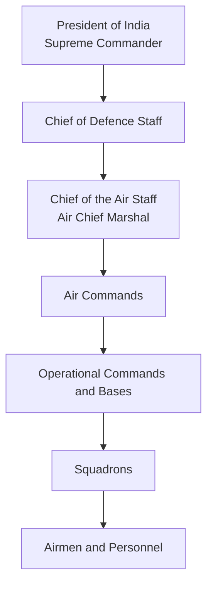
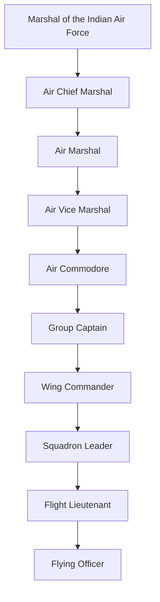
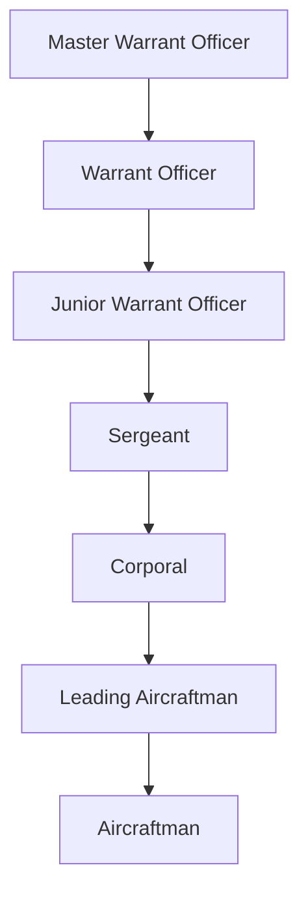

# Indian Air Force Rank Structure

## Why This Matters

Understanding Indian Air Force ranks is important for:

- Defence and security studies
- UPSC and competitive exams
- Understanding military command structure
- Comparing Army, Navy and Air Force hierarchies

---

## Reporting Structure

---

## Commissioned Officer Ranks

| Rank | Equivalent Army Rank | Responsibility |
|--------|--------|--------|
| Marshal of the Indian Air Force | Field Marshal | Five-star ceremonial rank |
| Air Chief Marshal | General | Chief of Air Force |
| Air Marshal | Lieutenant General | Command-level leadership |
| Air Vice Marshal | Major General | Senior command responsibilities |
| Air Commodore | Brigadier | Air base and formation command |
| Group Captain | Colonel | Station or wing command |
| Wing Commander | Lieutenant Colonel | Squadron leadership |
| Squadron Leader | Major | Operational leadership |
| Flight Lieutenant | Captain | Junior officer responsibilities |
| Flying Officer | Lieutenant | Entry-level commissioned officer |

### Officer Rank Hierarchy

---

## Other Ranks (Airmen)

| Rank | Broad Equivalent |
|--------|--------|
| Master Warrant Officer | Senior JCO Equivalent |
| Warrant Officer | JCO Equivalent |
| Junior Warrant Officer | Junior JCO Equivalent |
| Sergeant | Senior Non-Commissioned Rank |
| Corporal | Non-Commissioned Rank |
| Leading Aircraftman | Junior Airman |
| Aircraftman | Entry-Level Airman |

### Airmen Rank Hierarchy

---

## Highest Rank

### Marshal of the Indian Air Force

- Five-star rank
- Equivalent to Field Marshal in the Army
- Highest rank in the Indian Air Force
- Awarded only in exceptional circumstances

### Recipient

| Name | Year |
|--------|--------|
| Arjan Singh | 2002 |

---

## Chief of the Air Staff

The professional head of the Indian Air Force is the:

**Chief of the Air Staff (CAS)**

Rank:

**Air Chief Marshal**

Responsibilities:

- Overall operational readiness
- Air defence of India
- Strategic planning
- Force modernization
- Coordination with Army and Navy

---

## Quick Comparison

| Army | Navy | Air Force |
|--------|--------|--------|
| General | Admiral | Air Chief Marshal |
| Lieutenant General | Vice Admiral | Air Marshal |
| Major General | Rear Admiral | Air Vice Marshal |
| Brigadier | Commodore | Air Commodore |
| Colonel | Captain | Group Captain |
| Lieutenant Colonel | Commander | Wing Commander |
| Major | Lieutenant Commander | Squadron Leader |
| Captain | Lieutenant | Flight Lieutenant |
| Lieutenant | Sub Lieutenant | Flying Officer |

---

## Interview Questions

### Who is the head of the Indian Air Force?
Chief of the Air Staff (Air Chief Marshal).

### What is the highest rank in the Indian Air Force?
Marshal of the Indian Air Force.

### Who is the only Marshal of the Indian Air Force?
Arjan Singh.

### Which Air Force rank is equivalent to a Colonel?
Group Captain.

### Which Air Force rank is equivalent to a Brigadier?
Air Commodore.

---

## Quick Revision

- President = Supreme Commander
- Air Chief Marshal = Head of Indian Air Force
- Group Captain ≈ Colonel
- Wing Commander ≈ Lieutenant Colonel
- Air Commodore ≈ Brigadier
- Highest rank = Marshal of the Indian Air Force
- Only recipient = Arjan Singh