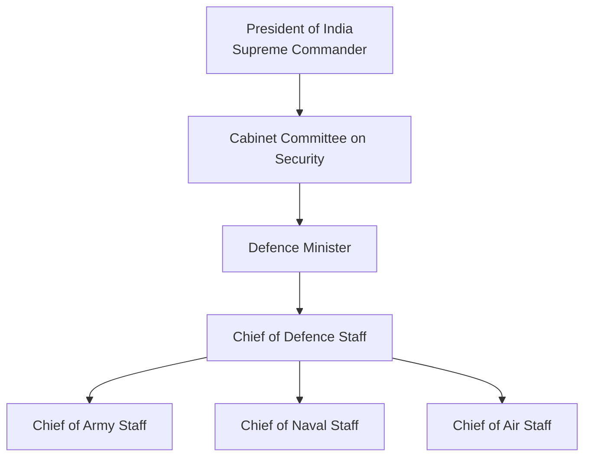

# Chief of Defence Staff (CDS)

## Why This Matters

The Chief of Defence Staff (CDS) is the highest-ranking military officer in India and serves as the principal military adviser to the Government of India.

Understanding the CDS is important for:

- National security studies
- Defence reforms
- Joint military operations
- UPSC and competitive exams
- Understanding military command structure

---

## What is the CDS?

The Chief of Defence Staff is a four-star military officer responsible for improving coordination among:

- Indian Army
- Indian Navy
- Indian Air Force

The CDS promotes jointness, integration and long-term defence planning.

---

## Command Structure

---

## Creation of the CDS Post

| Item | Details |
|--------|--------|
| Announced | 2019 |
| Implemented | 2020 |
| Purpose | Improve joint military functioning |
| Rank | Four-star officer |
| Reports To | Defence Minister and Government of India |

---

## Major Responsibilities

### Principal Military Adviser

Provides military advice to:

- Defence Minister
- Cabinet Committee on Security
- Government of India

### Jointness Among Services

Ensures better coordination among:

- Army
- Navy
- Air Force

### Theatre Commands

Leads efforts to establish:

- Integrated Theatre Commands
- Joint operational planning

### Defence Modernization

Helps prioritize:

- Procurement
- Capability development
- Long-term military planning

---

## Department of Military Affairs (DMA)

The CDS serves as the head of the:

**Department of Military Affairs (DMA)**

under the Ministry of Defence.

### DMA Responsibilities

- Military staffing matters
- Training and jointness
- Promotion of indigenous defence capability
- Military reforms

---

## CDS vs Service Chiefs

| Position | Primary Responsibility |
|--------|--------|
| CDS | Joint military planning and coordination |
| Chief of Army Staff | Indian Army |
| Chief of Naval Staff | Indian Navy |
| Chief of Air Staff | Indian Air Force |

---

## Importance of CDS

### Before CDS

- Services often planned separately
- Coordination challenges existed
- Procurement duplication sometimes occurred

### After CDS

- Improved integration
- Better resource utilization
- Faster joint planning
- Stronger unified military approach

---

## CDS Timeline

| Year | Event |
|--------|--------|
| 1999 | Kargil Review Committee recommended reforms |
| 2019 | CDS position announced |
| 2020 | Position formally created |
| 2020 onward | Theatre command integration efforts |

---

## Interview Questions

### Who is the principal military adviser to the Government of India?
Chief of Defence Staff (CDS).

### When was the CDS position created?
2020.

### Which department is headed by the CDS?
Department of Military Affairs (DMA).

### Is the CDS above the Army, Navy and Air Force chiefs?
The CDS coordinates and advises jointly, while each service chief remains responsible for their own service.

---

## Quick Revision

- CDS = Chief of Defence Staff
- Created in 2020
- Four-star military officer
- Principal military adviser to Government of India
- Head of Department of Military Affairs
- Promotes jointness among Army, Navy and Air Force
- Key driver of integrated theatre commands