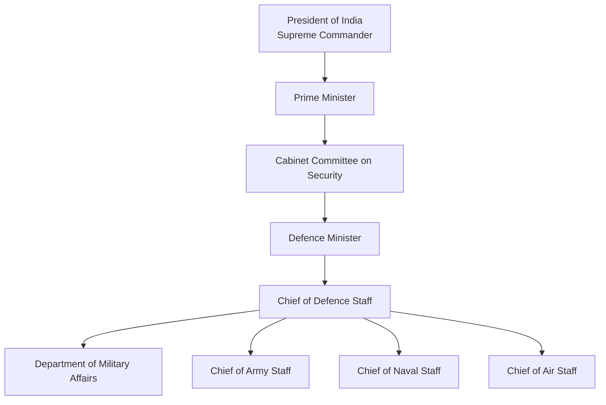

# Chief of Defence Staff (CDS)

## Why This Matters

The Chief of Defence Staff (CDS) is the highest-ranking military officer in India and serves as the principal military adviser to the Government of India.

Understanding the CDS is important for:

- National security studies
- Defence reforms
- Joint military operations
- UPSC and competitive exams
- Understanding military command structure

---

## What is the CDS?

The Chief of Defence Staff is a four-star military officer responsible for improving coordination among:

- Indian Army
- Indian Navy
- Indian Air Force

The CDS promotes jointness, integration and long-term defence planning.

---

## Position in National Security Structure

---

## Creation of the CDS Post

| Item | Details |
|--------|--------|
| Announced | 2019 |
| Implemented | 2020 |
| Purpose | Improve joint military functioning |
| Rank | Four-star officer |
| Reports To | Defence Minister and Government of India |

---

## Why Was CDS Created?

Before the CDS system:

- Army, Navy and Air Force largely planned independently
- Joint operations required additional coordination
- Procurement priorities sometimes overlapped
- Long-term military planning lacked a single military focal point

The CDS position was created to:

- Improve tri-service integration
- Enable joint planning
- Support theatre command reforms
- Improve military modernization
- Create a unified military advisory system
---

## Major Responsibilities

### Principal Military Adviser

Provides military advice to:

- Defence Minister
- Prime Minister
- Cabinet Committee on Security
- Government of India

### Head of Department of Military Affairs

Responsible for:

- Military administration matters
- Joint training initiatives
- Staffing policies
- Military reforms

### Promote Jointness

Improves integration among:

- Army
- Navy
- Air Force

### Theatre Command Reforms

Drives:

- Integrated Theatre Commands
- Joint operational structures
- Multi-domain warfare planning

### Defence Modernization

Supports:

- Capability development
- Indigenous defence production
- Long-term force planning
- Resource prioritization

---

## Department of Military Affairs (DMA)

The CDS serves as the head of the:

**Department of Military Affairs (DMA)**

under the Ministry of Defence.

### DMA Responsibilities

- Military staffing matters
- Training and jointness
- Promotion of indigenous defence capability
- Military reforms

---

## CDS vs Service Chiefs

| Position | Primary Responsibility |
|--------|--------|
| CDS | Joint military planning and coordination |
| Chief of Army Staff | Indian Army |
| Chief of Naval Staff | Indian Navy |
| Chief of Air Staff | Indian Air Force |

---

## Why CDS Is Important

| Before CDS | After CDS |
|------------|------------|
| Service-centric planning | Joint planning approach |
| Separate priorities | Integrated priorities |
| Slower coordination | Faster coordination |
| Limited joint structures | Theatre command focus |
| Fragmented military advice | Unified military advice |

---

## CDS Timeline

| Year | Event |
|--------|--------|
| 1999 | Kargil Review Committee recommended reforms |
| 2019 | CDS position announced |
| 2020 | Position formally created |
| 2020 onward | Theatre command integration efforts |

---

## Important Topics and Answers

### Who is the principal military adviser to the Government of India?
Chief of Defence Staff (CDS).

### When was the CDS position created?
2020.

### Which department is headed by the CDS?
Department of Military Affairs (DMA).

### Is the CDS a five-star officer?
No. The CDS is a four-star officer.

### Does the CDS command the Army, Navy and Air Force?
No. Service chiefs continue to command their respective services.

### Why was the CDS position created?
To improve jointness, integration and military planning.

### Quick Revision

- CDS = Chief of Defence Staff
- Created in 2020
- Four-star military officer
- Principal military adviser to Government of India
- Head of Department of Military Affairs
- Promotes tri-service integration
- Supports Theatre Commands
- Reports to Defence Minister and Government of India