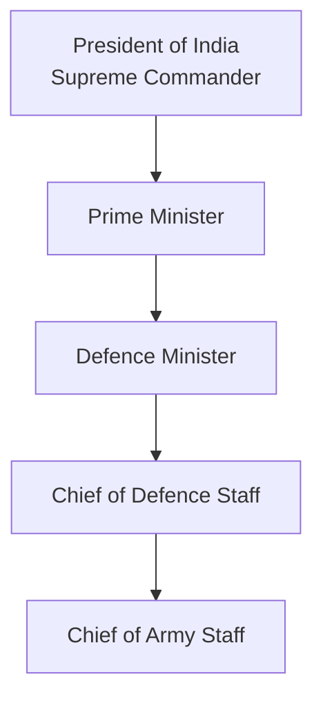
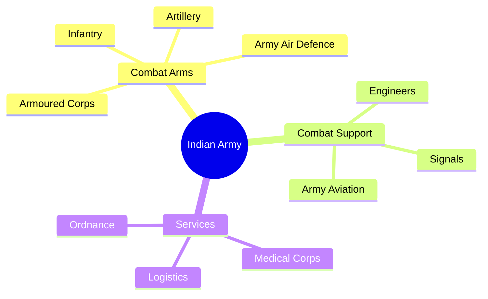

# Indian Army

## Why It Matters

The Indian Army is the land warfare branch of the Indian Armed Forces. It protects India's territorial integrity, safeguards national sovereignty, conducts military operations on land, supports internal security when required, and assists civil authorities during natural disasters and emergencies.

---

## Quick Facts

| Item | Details |
|----------|----------|
| Founded | 1 April 1895 |
| Headquarters | New Delhi |
| Branch | Indian Armed Forces |
| Parent Ministry | Ministry of Defence |
| Supreme Commander | President of India |
| Professional Head | Chief of the Army Staff (COAS) |
| Motto | Service Before Self |
| Primary Domain | Land Warfare |

---

## Organisation Structure

---

## Mission and Responsibilities

### Territorial Defence

Protect India's borders and sovereignty against external aggression.

### Counter-Insurgency Operations

Support national security in regions affected by insurgency and terrorism.

### High-Altitude Warfare

Maintain operational readiness in challenging mountain environments including the Himalayas.

### Humanitarian Assistance and Disaster Relief

Provide support during floods, earthquakes, landslides, cyclones, and other emergencies.

### United Nations Peacekeeping

Contribute troops and expertise to international peacekeeping missions.

---

## Army Commands

| Command | Headquarters |
|----------|----------|
| Northern Command | Udhampur |
| Western Command | Chandimandir |
| Eastern Command | Kolkata |
| Southern Command | Pune |
| South Western Command | Jaipur |
| Central Command | Lucknow |
| Army Training Command (ARTRAC) | Shimla |

### Northern Command

Responsible for Jammu & Kashmir and Ladakh sectors.

### Western Command

Focuses on western borders.

### Eastern Command

Responsible for eastern and northeastern regions.

### Southern Command

Covers peninsular India.

### South Western Command

Protects strategic western sectors.

### Central Command

Supports operations across northern India.

### Army Training Command

Responsible for doctrine, training, and future warfare concepts.

---

## Major Arms and Services

### Infantry

Primary ground combat force.

### Armoured Corps

Operates tanks and armoured fighting vehicles.

### Artillery

Provides long-range firepower support.

### Army Aviation Corps

Operates helicopters and aerial support platforms.

### Corps of Engineers

Responsible for military engineering tasks.

### Corps of Signals

Maintains battlefield communication networks.

### Army Medical Corps

Provides medical support and healthcare services.

---

## Key Operational Environments

- Desert Warfare
- Mountain Warfare
- High-Altitude Warfare
- Jungle Warfare
- Urban Warfare

---

## Major Wars and Operations

### Indo-Pak War (1947–48)

### Indo-Pak War (1965)

### Indo-Pak War (1971)

### Operation Meghdoot

### Kargil War (1999)

### Counter-Insurgency Operations

### United Nations Peacekeeping Missions

---

## Modernisation Initiatives

- Network-centric warfare capabilities
- Indigenous defence equipment adoption
- Future soldier programmes
- Enhanced surveillance systems
- Integration with theatre command concepts

---

## Challenges

- Two-front security environment
- Technology-driven warfare
- High-altitude operational demands
- Rapid force modernisation requirements
- Cyber and information warfare threats

---

## Future Roadmap

- Greater jointness among services
- Increased indigenous defence production
- AI-enabled battlefield systems
- Advanced ISR capabilities
- Integrated theatre command implementation

---

## Quick Revision

| Topic | Key Point |
|----------|----------|
| Professional Head | Chief of Army Staff |
| Headquarters | New Delhi |
| Primary Domain | Land Warfare |
| Commands | 7 |
| Parent Ministry | Ministry of Defence |

---

## Interview Questions

1. What is the primary role of the Indian Army?
2. How many commands does the Indian Army have?
3. What is the difference between CDS and COAS?
4. Why is Northern Command strategically important?
5. What are the major arms of the Indian Army?

---

## Related Topics

- Chief of Defence Staff
- Army Rank Structure
- Integrated Theatre Commands
- Ministry of Defence
- National Security Overview