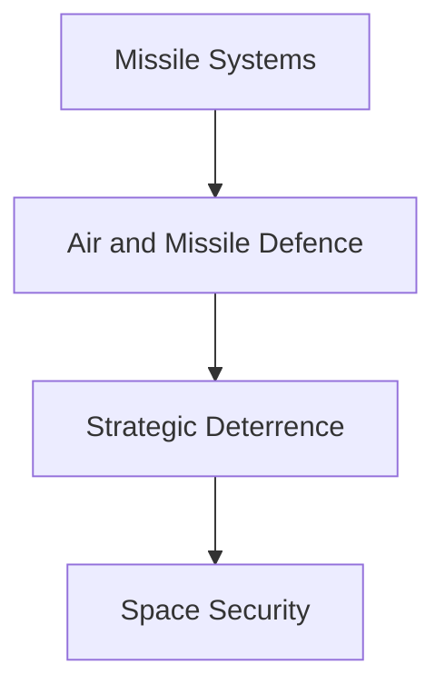
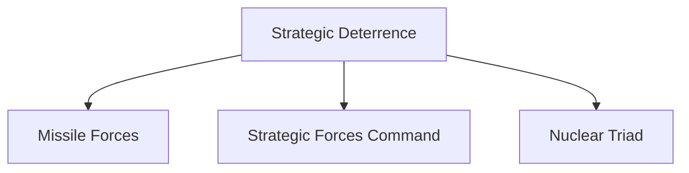

# Missile and Space Defence

## Why It Matters

Missiles, air-defence systems and space-based capabilities form the backbone of modern strategic deterrence and national security.

India has developed an increasingly sophisticated ecosystem that includes offensive missile systems, defensive missile shields, strategic command structures and space-security capabilities.

Understanding these systems is essential for understanding India's deterrence posture, military modernization and future security challenges.

---

## Quick Facts

| Item | Details |
|----------|----------|
| Domain | Missile and Space Defence |
| Coverage | Missiles, Air Defence, Deterrence and Space Security |
| Lead Organisations | DRDO, ISRO, Strategic Forces Command |
| Importance | Strategic Deterrence |
| Operational Domains | Land, Air, Sea and Space |
| Strategic Role | National Security |

---

## Repository Structure

```text
missile-and-space-defence/
├── README.md
├── missile-programmes-overview.md
├── prithvi-series.md
├── agni-series.md
├── brahmos.md
├── akash.md
├── s400.md
├── ballistic-missile-defence.md
├── strategic-forces-command.md
├── nuclear-triad.md
├── anti-satellite-capability.md
├── mission-shakti.md
└── early-warning-systems.md
```

---

## Evolution of Missile and Space Defence


---

## Learning Roadmap



---

## Offensive Missile Systems

### Strategic Missiles

- Prithvi Series
- Agni Series

### Precision Strike Systems

- BrahMos

These systems provide conventional and strategic strike capability.

---

## Air and Missile Defence

### Air Defence Systems

- Akash
- S-400

### Missile Defence Systems

- Ballistic Missile Defence (BMD)

These systems help protect military and civilian infrastructure from aerial threats.

---

## Strategic Deterrence Architecture



Strategic deterrence combines missile capability, command structures and survivable response mechanisms.

---

## Space Security

### Counter-Space Capability

- Anti-Satellite Capability (ASAT)
- Mission Shakti

### Supporting Systems

- Early Warning Systems
- Space Surveillance

Space has emerged as a critical military and strategic domain.

---

## Key Themes

- Strategic Deterrence
- Missile Technology
- Air Defence
- Missile Defence
- Nuclear Command and Control
- Space Security
- Counter-Space Capability
- National Security

---

## Quick Revision

- Prithvi was India's first indigenous ballistic missile family.
- Agni forms the backbone of strategic deterrence.
- BrahMos provides precision-strike capability.
- Akash and S-400 strengthen air defence.
- BMD protects against ballistic missile threats.
- SFC manages strategic missile forces.
- Nuclear Triad strengthens deterrence credibility.
- Mission Shakti demonstrated ASAT capability.
- Space security is increasingly important for modern warfare.

---

## Key Concepts

### Why are missile systems important?

They provide deterrence, defence and precision-strike capability.

### What is Ballistic Missile Defence?

A system designed to detect and intercept incoming ballistic missiles.

### What is Strategic Forces Command?

The organisation responsible for managing India's strategic missile forces.

### What is the Nuclear Triad?

The combination of land-based, air-based and sea-based nuclear delivery systems.

### Why is space security important?

Modern military operations depend heavily on satellites, communications, navigation and surveillance systems.