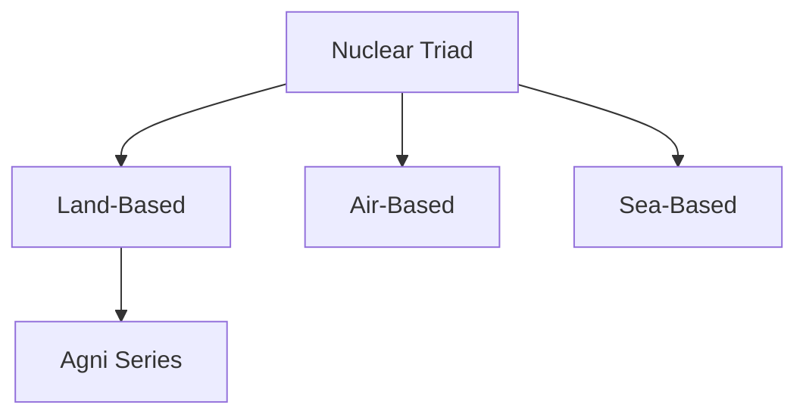

# Agni Series

## Why It Matters

The Agni Series is the backbone of India's strategic missile force and one of the most important pillars of the country's deterrence capability.

The missile family provides India with the ability to respond to strategic threats and forms the land-based component of India's nuclear triad.

The evolution of the Agni programme reflects India's growing indigenous missile-development capability and strategic maturity.

---

## Quick Facts

| Item | Details |
|----------|----------|
| Name | Agni Series |
| Type | Ballistic Missile Family |
| Developed By | DRDO |
| Programme | IGMDP |
| Primary Role | Strategic Deterrence |
| Component | Land-Based Nuclear Deterrent |
| Importance | Backbone of Strategic Missile Force |

---

## What Is the Agni Series?

The Agni Series is a family of ballistic missiles developed by India for strategic deterrence.

Over time, the Agni programme evolved from shorter-range systems into advanced long-range strategic missile platforms.

---

## Development Journey

---

## Why Agni Is Important

- Strategic deterrence
- National security
- Credible retaliatory capability
- Indigenous missile technology development
- Strengthening of the nuclear triad
- Long-term strategic stability

---

## Agni Missile Family

### Agni-I

- Strategic strike capability
- Mobile deployment
- Quick-response role

### Agni-II

- Enhanced range
- Improved deterrence capability
- Greater operational flexibility

### Agni-III

- Longer-range strategic missions
- Enhanced payload capability

### Agni-IV

- Improved accuracy
- Advanced guidance systems

### Agni-V

- Long-range strategic deterrence
- Advanced navigation systems
- Major milestone in India's missile programme

### Agni Prime (Agni-P)

- New-generation missile design
- Improved mobility
- Enhanced survivability
- Modern guidance technologies

---

## Ballistic Missile Concept

---

## Nuclear Triad Connection

The Agni Series forms the land-based component of India's nuclear triad.

---

## Strategic Deterrence

The Agni programme supports:

- Credible minimum deterrence
- National security
- Strategic stability
- Assured retaliatory capability

Deterrence aims to prevent conflict by maintaining the ability to respond effectively to aggression.

---

## Role in National Security

Agni helps India:

- Protect national interests
- Maintain strategic balance
- Strengthen deterrence credibility
- Improve military preparedness
- Enhance long-term security

---

## Challenges

- Evolving missile-defence systems
- Emerging hypersonic technologies
- Technological competition
- Future deterrence requirements
- Strategic stability concerns

---

## Future Roadmap

- Continued modernization
- Improved guidance systems
- Enhanced survivability
- Greater mobility
- Integration of future technologies
- Stronger strategic capability

---

## Quick Revision

- Agni is India's primary strategic missile family.
- Developed under the IGMDP.
- Agni-I to Agni-V represent increasing capability.
- Agni Prime is the latest generation.
- Agni forms the land-based leg of the nuclear triad.
- It is central to India's deterrence posture.

---

## Key Concepts

### What is the Agni Series?

India's primary family of strategic ballistic missiles.

### Why is Agni important?

It provides strategic deterrence and supports national security.

### What role does Agni play in the nuclear triad?

It forms the land-based component.

### What is Agni Prime?

A next-generation missile in the Agni family.

### Why is the Agni programme strategically significant?

It strengthens India's deterrence capability and strategic stability.