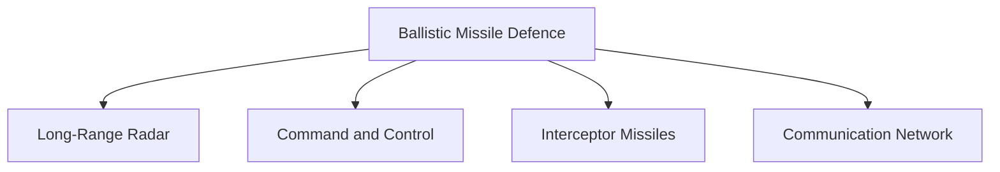
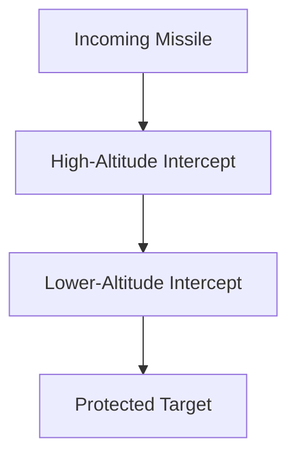

# Ballistic Missile Defence (BMD)

## Why It Matters

Ballistic Missile Defence (BMD) is designed to detect, track and intercept incoming ballistic missiles before they reach their targets.

As ballistic missiles become faster, more accurate and more sophisticated, missile-defence systems play an increasingly important role in protecting cities, military installations, strategic infrastructure and national command structures.

For India, BMD adds a defensive layer to national security and strengthens strategic deterrence.

---

## Quick Facts

| Item | Details |
|----------|----------|
| Name | Ballistic Missile Defence (BMD) |
| Type | Missile Defence System |
| Developed By | DRDO |
| Primary Role | Intercept Ballistic Missiles |
| Strategic Importance | National Missile Defence |
| Domain | Strategic Defence |

---

## What Is Ballistic Missile Defence?

Ballistic Missile Defence refers to systems designed to detect, track and destroy hostile ballistic missiles during different stages of flight.

Unlike offensive missile systems such as Agni, BMD focuses on protecting targets from missile attacks.

---

## Why Missile Defence Is Important

- Protects strategic assets
- Enhances national security
- Improves survivability
- Strengthens deterrence
- Reduces vulnerability to missile attacks
- Supports strategic stability

---

## How Ballistic Missiles Fly

BMD systems attempt to intercept hostile missiles before they reach the target.

---

## Missile Defence Process

---

## Components of BMD

### Radar Systems

Responsible for:

- Early warning
- Target detection
- Missile tracking

### Command and Control

Responsible for:

- Threat assessment
- Engagement decisions
- Battle management

### Interceptor Missiles

Responsible for:

- Intercepting hostile missiles
- Neutralizing threats

---

## Indian BMD Programme

India has developed a multi-layered missile-defence architecture designed to counter ballistic missile threats.

The programme focuses on:

- Early detection
- Tracking capability
- Target discrimination
- Missile interception
- Layered defence

---

## PAD (Prithvi Air Defence)

### Role

- High-altitude interception
- Strategic missile defence
- Early engagement capability

PAD was designed to engage ballistic missiles at higher altitudes.

---

## AAD (Advanced Air Defence)

### Role

- Lower-altitude interception
- Terminal-phase engagement
- Additional defensive layer

AAD provides a second interception opportunity.

---

## Layered Defence Concept

Layered defence improves interception probability by creating multiple engagement opportunities.

---

## Relationship with Deterrence

BMD does not replace deterrence but complements it by providing a defensive shield against missile attacks.

---

## Strategic Importance for India

BMD helps India:

- Protect critical infrastructure
- Defend strategic locations
- Improve survivability
- Strengthen national security
- Enhance deterrence credibility

---

## Challenges

- Hypersonic weapons
- Decoys and countermeasures
- Multiple simultaneous attacks
- Technological complexity
- High development costs

---

## Future Roadmap

- Advanced interceptor systems
- Better radar networks
- Improved tracking capability
- Enhanced command-and-control systems
- Integration with future defence networks

---

## Quick Revision

- BMD protects against ballistic missile attacks.
- It uses detection, tracking and interception.
- PAD and AAD are major interceptor components.
- India is developing a layered missile-defence architecture.
- BMD complements strategic deterrence.
- It strengthens national security.

---

## Key Concepts

### What is Ballistic Missile Defence?

A system designed to detect and intercept incoming ballistic missiles.

### Why is BMD important?

It protects strategic assets and strengthens national security.

### What are PAD and AAD?

Interceptor systems within India's missile-defence architecture.

### What is layered defence?

Using multiple interception opportunities to improve defence effectiveness.

### Does BMD replace deterrence?

No. It complements deterrence by providing an additional defensive layer.