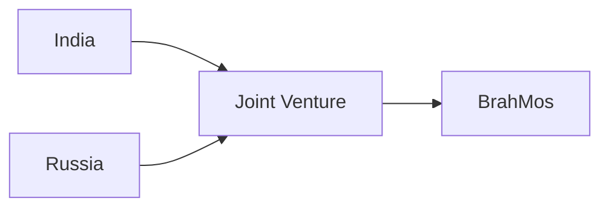
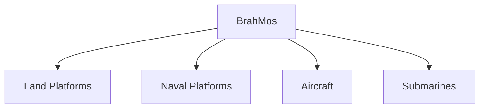

# BrahMos Missile

## Why It Matters

BrahMos is one of the world's most well-known supersonic cruise missile systems and a major component of India's precision-strike capability.

The missile provides the Indian Armed Forces with the ability to rapidly engage high-value targets on land and at sea. Its speed, accuracy and multi-platform deployment capability make it a critical element of India's deterrence and conventional military strength.

---

## Quick Facts

| Item | Details |
|----------|----------|
| Name | BrahMos |
| Type | Supersonic Cruise Missile |
| Developed By | BrahMos Aerospace |
| Joint Venture | India–Russia |
| Primary Role | Precision Strike |
| Launch Platforms | Land, Sea, Air |
| Importance | Strategic Conventional Deterrence |

---

## What Is BrahMos?

BrahMos is a supersonic cruise missile capable of striking targets with high speed and precision.

Unlike ballistic missiles, BrahMos remains powered throughout most of its flight and can follow complex flight paths toward its target.

---

## Why BrahMos Is Important

- High-speed precision strike capability
- Multi-platform deployment
- Strong conventional deterrence
- Indigenous defence manufacturing growth
- Enhanced maritime strike capability
- Rapid response against strategic targets

---

## Development Background

The missile was developed through cooperation between India and Russia under BrahMos Aerospace.

---

## How a Cruise Missile Works

Cruise missiles remain powered during flight and use guidance systems to accurately reach targets.

---

## Major Variants

### Land-Based BrahMos

Used for:

- Precision land attack
- Strategic strike missions
- Rapid response operations

### Ship-Launched BrahMos

Used for:

- Anti-ship warfare
- Maritime deterrence
- Naval strike operations

### Air-Launched BrahMos

Used for:

- Extended strike capability
- High-value target engagement
- Air-power operations

### Submarine-Launched BrahMos

Supports:

- Maritime deterrence
- Underwater launch capability
- Strategic flexibility

---

## Multi-Platform Capability

---

## Role in the Indian Army

- Precision strike missions
- Strategic target engagement
- Battlefield support
- Conventional deterrence

---

## Role in the Indian Navy

- Anti-ship operations
- Maritime strike capability
- Sea-control missions
- Fleet defence support

---

## Role in the Indian Air Force

- Long-range precision strike
- High-value target engagement
- Strategic air operations

---

## Strategic Importance

BrahMos helps India:

- Strengthen deterrence
- Improve strike capability
- Enhance maritime security
- Increase operational flexibility
- Support joint-force operations

---

## BrahMos and Modern Warfare

The missile demonstrates the growing importance of:

- Precision-guided weapons
- Network-centric warfare
- Rapid-response capability
- Joint military operations

---

## Future Roadmap

- Improved variants
- Greater range and flexibility
- Enhanced guidance systems
- Expanded deployment platforms
- Continued modernization

---

## Quick Revision

- BrahMos is a supersonic cruise missile.
- Developed through an India–Russia joint venture.
- Can be launched from land, sea, air and submarines.
- Provides precision strike capability.
- Plays a major role in conventional deterrence.
- One of India's most important missile systems.

---

## Key Concepts

### What is BrahMos?

A supersonic cruise missile used for precision strike missions.

### Why is BrahMos important?

It provides rapid and accurate strike capability against strategic targets.

### What makes BrahMos unique?

Its combination of speed, accuracy and multi-platform deployment.

### Which services use BrahMos?

The Indian Army, Indian Navy and Indian Air Force.

### What role does BrahMos play in national security?

It strengthens conventional deterrence and precision-strike capability.