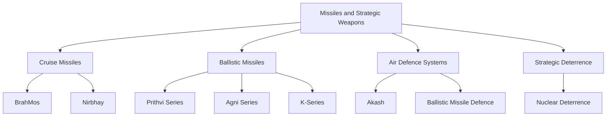
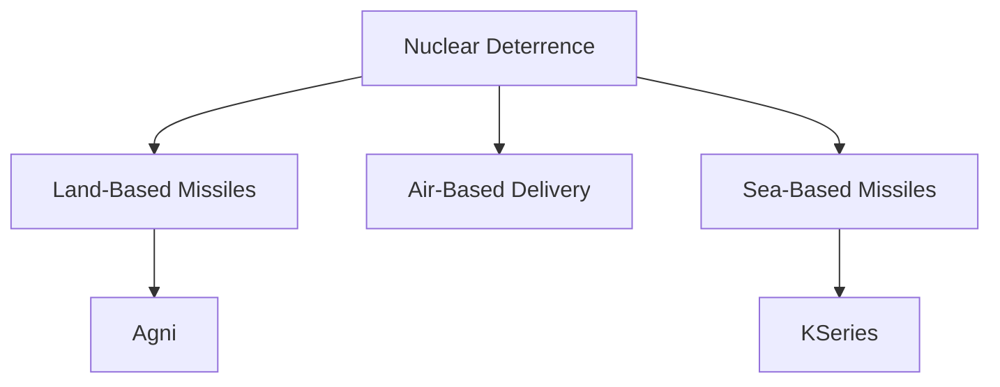

# Missiles and Strategic Weapons

## Why It Matters

Missiles and strategic weapons are among the most important components of national power. They provide deterrence, long-range strike capability, air defence, battlefield support and strategic stability.

For India, missile systems play a vital role in national defence, conventional warfare, nuclear deterrence and protection against external threats.

This section covers India's major missile programmes, strategic weapon systems and missile-defence capabilities.

---

## Quick Facts

| Item | Details |
|----------|----------|
| Domain | Strategic Weapons |
| Primary Purpose | Deterrence and Strike Capability |
| Key Organizations | DRDO, Indian Armed Forces |
| Major Categories | Ballistic, Cruise and Air Defence Missiles |
| Strategic Importance | National Security and Deterrence |
| Operational Scope | Tactical to Strategic |

---

## Missile Ecosystem

---

## Learning Roadmap

---

## Types of Missiles

| Type | Purpose |
|----------|----------|
| Ballistic Missile | Long-Range Strategic Strike |
| Cruise Missile | Precision Strike |
| Air Defence Missile | Airspace Protection |
| Submarine-Launched Missile | Sea-Based Deterrence |
| Tactical Missile | Battlefield Support |

---

## Major Missile Systems

| System | Category | Primary Role |
|----------|----------|----------|
| BrahMos | Cruise Missile | Precision Strike |
| Prithvi Series | Ballistic Missile | Tactical Strike |
| Agni Series | Ballistic Missile | Strategic Deterrence |
| Akash | Air Defence Missile | Air Defence |
| Nirbhay | Cruise Missile | Long-Range Strike |
| K-Series | SLBM | Sea-Based Deterrence |
| BMD | Missile Defence | Interception |

---

## Ballistic vs Cruise Missiles

| Feature | Ballistic Missile | Cruise Missile |
|----------|----------|----------|
| Flight Path | Ballistic Trajectory | Controlled Flight |
| Speed | Very High | Generally Lower |
| Precision | Moderate to High | High |
| Typical Role | Strategic Strike | Precision Attack |
|
---

## Strategic Deterrence Architecture

---

## Role in National Security

Missile systems help India:

- Deter adversaries
- Protect national sovereignty
- Support military operations
- Strengthen strategic stability
- Maintain credible deterrence
- Defend against aerial threats

---

## Challenges

- Rapid technological competition
- Missile-defence developments
- Hypersonic weapon emergence
- Expanding security threats
- Strategic stability concerns

---

## Future Roadmap

- Advanced cruise missiles
- Improved ballistic missile capability
- Expansion of missile-defence systems
- Hypersonic weapon development
- Greater indigenous technology capability
- Stronger strategic deterrence architecture

---

## Quick Revision

- Missiles provide strike and deterrence capability.
- BrahMos is India's premier cruise missile.
- Agni Series forms the backbone of strategic deterrence.
- Prithvi Series provides tactical strike capability.
- Akash is a major air-defence missile system.
- K-Series supports sea-based nuclear deterrence.
- Ballistic Missile Defence protects against missile attacks.

---

## Key Concepts

### What is a ballistic missile?

A missile that follows a ballistic trajectory after launch.

### What is a cruise missile?

A guided missile that flies to its target using powered flight.

### Why is Agni important?

It forms a major part of India's strategic deterrence capability.

### What is the purpose of Akash?

To defend against aerial threats.

### Why are missiles important?

They provide deterrence, defence and long-range strike capability.