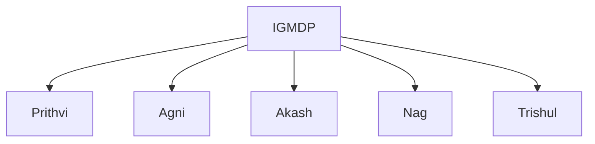
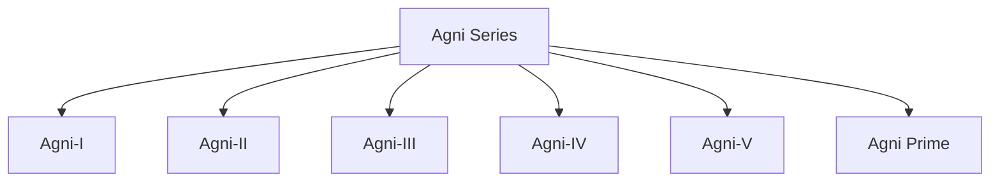
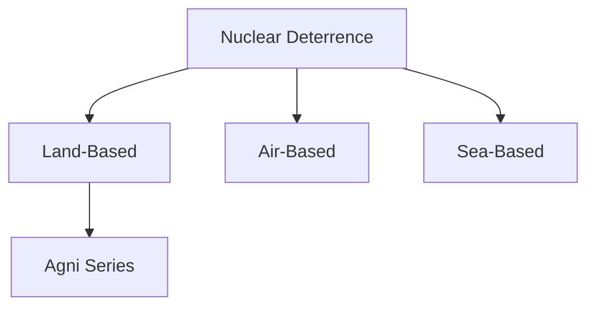

# Agni Series

## Why It Matters

The Agni Series is the backbone of India's strategic missile force and a central pillar of the country's nuclear deterrence architecture.

Developed indigenously by India, the Agni family provides long-range strike capability and supports credible minimum deterrence. It plays a critical role in ensuring national security and strategic stability.

---

## Quick Facts

| Item | Details |
|----------|----------|
| Name | Agni Series |
| Type | Ballistic Missile Family |
| Developed By | DRDO |
| Programme | IGMDP |
| Primary Role | Strategic Deterrence |
| Strategic Importance | Land-Based Nuclear Deterrent |

---

## What Is the Agni Series?

The Agni Series is a family of ballistic missiles developed to provide India with strategic strike capability across varying ranges.

The missile family has evolved from medium-range systems to advanced long-range strategic missiles capable of supporting India's nuclear deterrence requirements.

---

## IGMDP Connection

The Agni programme emerged from the Integrated Guided Missile Development Programme and later became the foundation of India's strategic missile capability.

---

## Agni Missile Family

---

## Agni-I

### Role

- Short to medium-range strategic missile
- Quick-response capability
- Strategic deterrence support

### Importance

Provides operational flexibility within India's strategic missile force.

---

## Agni-II

### Role

- Medium-range ballistic missile
- Strategic strike capability
- Mobile deployment capability

### Importance

Expanded India's strategic reach and deterrence capability.

---

## Agni-III

### Role

- Intermediate-range ballistic missile
- Long-range strategic missions
- Enhanced payload capability

### Importance

Strengthened India's long-range deterrence posture.

---

## Agni-IV

### Role

- Advanced strategic missile
- Improved guidance systems
- Greater operational flexibility

### Importance

Represents significant technological advancement within the Agni programme.

---

## Agni-V

### Role

- Long-range strategic missile
- Advanced navigation and guidance capability
- Credible strategic deterrence

### Importance

One of the most significant milestones in India's missile-development history.

Agni-V substantially enhances India's long-range deterrence capability.

---

## Agni Prime (Agni-P)

### Key Features

- New-generation missile design
- Improved mobility
- Enhanced accuracy
- Modern guidance technologies

### Importance

Represents the future evolution of India's land-based missile force.

---

## How a Ballistic Missile Works

---

## Strategic Deterrence

The Agni Series helps India:

- Maintain credible deterrence
- Strengthen national security
- Support strategic stability
- Ensure retaliatory capability

Strategic deterrence aims to prevent conflict by maintaining the capability to respond effectively to aggression.

---

## Nuclear Doctrine Connection

India follows a doctrine centered on:

- Credible Minimum Deterrence
- No First Use Policy
- Assured Retaliation Capability

The Agni Series is a major component supporting these principles.

---

## Role in Nuclear Triad

The Agni family forms the land-based component of India's nuclear triad.

---

## Strategic Importance for India

The Agni Series helps India:

- Maintain strategic balance
- Strengthen deterrence credibility
- Improve national security preparedness
- Support long-term strategic stability
- Enhance indigenous defence capability

---

## Challenges

- Evolving missile-defence systems
- Technological competition
- Strategic stability concerns
- Emerging hypersonic technologies
- Future deterrence requirements

---

## Future Roadmap

- Continued modernization of the Agni family
- Improved guidance technologies
- Enhanced survivability and mobility
- Greater integration with strategic forces
- Advanced missile technologies for future deterrence needs

---

## Quick Revision

- Agni is India's primary strategic ballistic missile family.
- It was developed under the IGMDP.
- Agni-I to Agni-V represent successive capability improvements.
- Agni Prime is the newest generation in the family.
- Agni supports India's nuclear deterrence posture.
- It forms the land-based component of the nuclear triad.

---

## Key Concepts

### What is the Agni Series?

India's primary family of strategic ballistic missiles.

### Why is Agni important?

It provides long-range strategic deterrence capability.

### What role does Agni play in the nuclear triad?

It forms the land-based component of the triad.

### What is Agni Prime?

A next-generation missile in the Agni family.

### Why is the Agni programme strategically important?

It strengthens India's deterrence capability and national security.