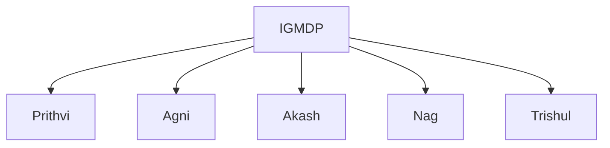
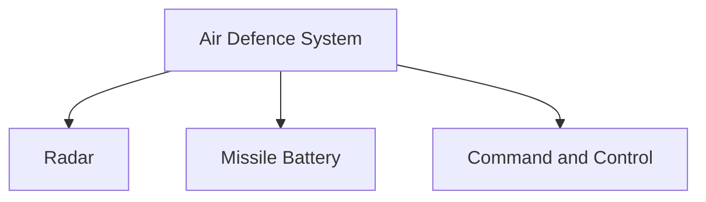

# Akash Missile System

## Why It Matters

The Akash Missile System is one of India's most important indigenous air-defence systems. It is designed to protect military forces, strategic assets and critical infrastructure from aerial threats.

Akash strengthens India's defensive capabilities by providing the ability to detect, track and engage hostile aircraft, helicopters, drones and other airborne threats.

---

## Quick Facts

| Item | Details |
|----------|----------|
| Name | Akash |
| Type | Surface-to-Air Missile (SAM) |
| Developed By | DRDO |
| Programme | IGMDP |
| Primary Role | Air Defence |
| Users | Indian Army and Indian Air Force |

---

## What Is Akash?

Akash is an indigenous medium-range surface-to-air missile system designed to intercept aerial threats before they can reach their targets.

It forms an important component of India's layered air-defence architecture.

---

## IGMDP Connection

Akash was developed under the Integrated Guided Missile Development Programme (IGMDP), which aimed to build indigenous missile capabilities.

---

## Why Akash Is Important

- Protects against aerial threats
- Strengthens national air defence
- Supports battlefield protection
- Improves defence self-reliance
- Enhances military readiness
- Supports layered air-defence networks

---

## How Air Defence Works

---

## Air Defence Architecture

---

## Major Components

### Radar Systems

Responsible for:

- Detecting threats
- Tracking targets
- Providing targeting information

### Command and Control

Responsible for:

- Threat assessment
- Engagement decisions
- Missile guidance support

### Missile Launchers

Responsible for:

- Missile deployment
- Target engagement
- Air-defence operations

---

## Akash Variants

### Akash

The original operational version deployed by the armed forces.

### Akash-1S

Features:

- Improved seeker technology
- Better target engagement capability
- Enhanced operational effectiveness

### Akash-NG (Next Generation)

Features:

- Modern guidance systems
- Improved mobility
- Better interception capability
- Enhanced overall performance

---

## Role in the Indian Army

Akash supports:

- Battlefield air defence
- Protection of military formations
- Defence of strategic assets
- Mobile force protection

---

## Role in the Indian Air Force

Akash supports:

- Air-base defence
- Strategic infrastructure protection
- Airspace security
- National air-defence capability

---

## Threats Countered by Akash

- Fighter aircraft
- Helicopters
- Unmanned aerial vehicles (UAVs)
- Cruise missile-type threats
- Low-altitude aerial targets

---

## Strategic Importance for India

Akash helps India:

- Improve air-defence capability
- Strengthen indigenous defence technology
- Protect critical infrastructure
- Enhance military preparedness
- Support national security objectives

---

## Challenges

- Rapidly evolving aerial threats
- Advanced stealth technologies
- Electronic warfare challenges
- Drone and swarm threats
- Continuous modernization requirements

---

## Future Roadmap

- Expansion of Akash-NG capability
- Advanced radar integration
- Improved interception technologies
- Greater network-centric warfare integration
- Enhanced air-defence architecture

---

## Quick Revision

- Akash is an indigenous surface-to-air missile system.
- It was developed under the IGMDP.
- It is used by the Indian Army and Indian Air Force.
- Akash protects against aerial threats.
- Akash-NG represents the next generation of the system.
- It is an important part of India's air-defence network.

---

## Key Concepts

### What is Akash?

An indigenous surface-to-air missile system.

### What is the primary role of Akash?

Air defence against aerial threats.

### Which services operate Akash?

The Indian Army and Indian Air Force.

### What is Akash-NG?

The next-generation version of the Akash missile system.

### Why is Akash important?

It strengthens India's air-defence and indigenous defence capabilities.