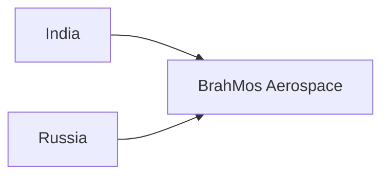
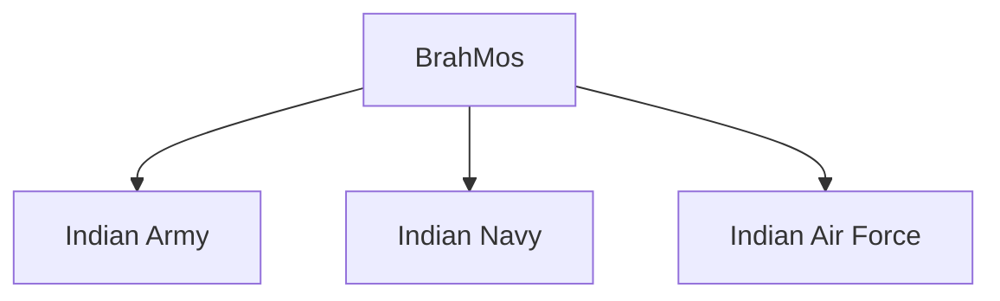

# BrahMos Missile

## Why It Matters

BrahMos is one of the most advanced cruise missile systems in the world and is considered a major pillar of India's conventional strike capability.

Its high speed, precision and multi-platform launch capability make it a critical weapon for the Indian Army, Indian Navy and Indian Air Force.

BrahMos significantly strengthens India's deterrence and rapid-response capability against strategic threats.

---

## Quick Facts

| Item | Details |
|----------|----------|
| Name | BrahMos |
| Type | Supersonic Cruise Missile |
| Developed By | BrahMos Aerospace |
| Joint Venture | India and Russia |
| Speed | Supersonic |
| Launch Platforms | Land, Sea, Air and Submarine |

---

## What Is BrahMos?

BrahMos is a supersonic cruise missile capable of carrying conventional warheads and striking targets with high precision.

The name comes from:

- Brahmaputra River (India)
- Moskva River (Russia)

It represents one of the most successful defence collaborations between India and Russia.

---

## BrahMos Joint Venture

---

## Why BrahMos Is Important

- High-speed precision strike capability
- Difficult to intercept
- Multi-platform deployment
- Strong deterrence value
- Rapid-response capability
- Indigenous manufacturing contribution

---

## How a Cruise Missile Works

---

## Major Variants

### Land-Based BrahMos

Used by the Indian Army for:

- Precision strike missions
- Long-range engagement
- Battlefield support

### Naval BrahMos

Used by the Indian Navy for:

- Anti-ship missions
- Maritime strike operations
- Fleet warfare

### Air-Launched BrahMos

Integrated with combat aircraft.

Provides:

- Stand-off strike capability
- Long-range precision attack
- Strategic flexibility

### Submarine-Launched BrahMos

Designed for underwater launch capability.

Enhances maritime deterrence and survivability.

---

## Multi-Service Deployment

---

## Key Characteristics

| Feature | Advantage |
|----------|----------|
| Supersonic Speed | Reduced reaction time for targets |
| Precision Guidance | High accuracy |
| Multi-Platform Launch | Operational flexibility |
| Low Flight Profile | Increased survivability |
| Rapid Strike Capability | Strong deterrence |

---

## Role in Indian Armed Forces

### Indian Army

- Precision land attacks
- Strategic strike capability
- Rapid battlefield response

### Indian Navy

- Anti-ship warfare
- Maritime deterrence
- Fleet combat operations

### Indian Air Force

- Long-range stand-off attacks
- Strategic strike missions
- High-value target engagement

---

## Export Potential

BrahMos has emerged as one of India's most important defence exports.

Benefits include:

- Strengthening defence partnerships
- Supporting indigenous defence manufacturing
- Expanding India's strategic influence

---

## BrahMos-NG (Next Generation)

### Objectives

- Lighter missile design
- Greater deployment flexibility
- Wider platform compatibility
- Improved operational capability

### Importance

Will expand the future operational role of the BrahMos family.

---

## Strategic Importance for India

BrahMos helps India:

- Maintain credible deterrence
- Improve military readiness
- Strengthen maritime security
- Enhance precision-strike capability
- Support joint-force operations

---

## Challenges

- Evolving air-defence systems
- Technological competition
- Continuous modernization requirements
- Expanding operational demands

---

## Future Roadmap

- BrahMos-NG development
- Greater indigenous content
- Additional launch platforms
- Improved guidance technologies
- Expansion of export opportunities

---

## Quick Revision

- BrahMos is a supersonic cruise missile.
- It is a joint India-Russia programme.
- It can be launched from land, sea, air and submarines.
- It is used by the Army, Navy and Air Force.
- BrahMos is one of India's most important strike weapons.
- BrahMos-NG represents the future evolution of the system.

---

## Key Concepts

### What is BrahMos?

A supersonic cruise missile developed jointly by India and Russia.

### Why is BrahMos important?

It provides rapid and precise strike capability.

### Which services operate BrahMos?

The Indian Army, Indian Navy and Indian Air Force.

### What makes BrahMos difficult to intercept?

Its high speed and advanced flight profile.

### What is BrahMos-NG?

The next-generation version of the BrahMos missile.