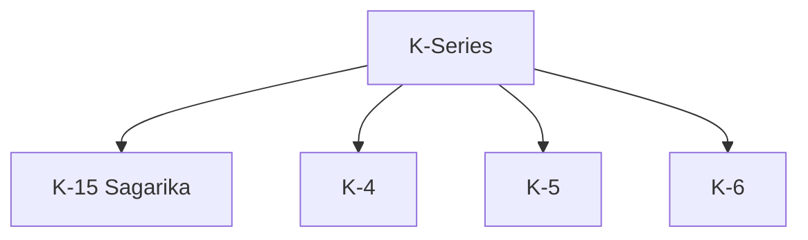
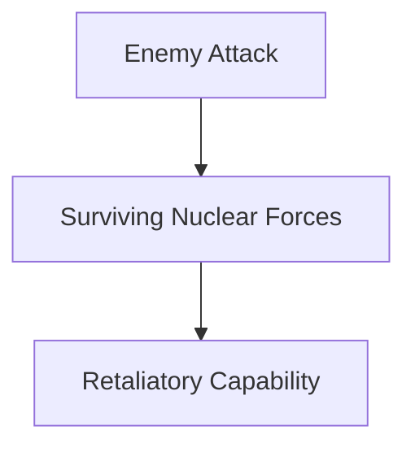
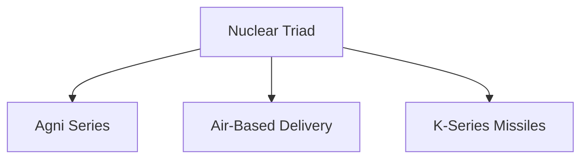

# K-Series Missiles

## Why It Matters

The K-Series is India's family of submarine-launched ballistic missiles (SLBMs) and forms the sea-based component of the country's nuclear deterrence architecture.

These missiles provide India with a survivable second-strike capability, making them a critical pillar of the nuclear triad and long-term strategic stability.

---

## Quick Facts

| Item | Details |
|----------|----------|
| Name | K-Series |
| Type | Submarine-Launched Ballistic Missile (SLBM) |
| Developed By | DRDO |
| Launch Platform | Nuclear-Powered Ballistic Missile Submarines |
| Primary Role | Sea-Based Nuclear Deterrence |
| Strategic Importance | Nuclear Triad |

---

## What Are K-Series Missiles?

The K-Series is a family of ballistic missiles designed to be launched from submarines.

Unlike land-based missiles such as the Agni Series, K-Series missiles operate from underwater platforms, increasing survivability and strengthening deterrence.

---

## Why K-Series Is Important

- Supports sea-based deterrence
- Strengthens second-strike capability
- Enhances strategic stability
- Improves survivability of nuclear forces
- Completes India's nuclear triad
- Strengthens long-term deterrence

---

## K-Series Missile Family

---

## What Is an SLBM?

An SLBM (Submarine-Launched Ballistic Missile) is a ballistic missile launched from a submarine.

SLBMs provide a nation with the ability to maintain a survivable nuclear deterrent even if land-based assets are threatened.

---

## K-15 (Sagarika)

### Role

- Sea-based deterrence
- Strategic strike capability
- Nuclear deterrence support

### Importance

K-15 was India's first operational submarine-launched ballistic missile and marked a major milestone in strategic capability development.

---

## K-4

### Role

- Longer-range strategic deterrence
- Enhanced sea-based strike capability
- Support for nuclear triad operations

### Importance

Provides significantly greater operational flexibility than earlier systems.

---

## K-5 (Development)

### Objectives

- Improved range capability
- Greater strategic reach
- Enhanced deterrence capability

### Importance

Represents the continued evolution of India's sea-based deterrent.

---

## K-6 (Future Programme)

### Objectives

- Advanced strategic capability
- Improved payload and range
- Future deterrence requirements

### Importance

Expected to strengthen India's long-term strategic posture.

---

## Connection with Arihant-Class Submarines

The Arihant-class submarines are the primary launch platforms for India's K-Series missile family.

---

## Sea-Based Nuclear Deterrence

Sea-based deterrence is considered the most survivable component of a nuclear force because submarines can remain hidden underwater for extended periods.

This increases the credibility of deterrence.

---

## Second-Strike Capability

Second-strike capability refers to the ability to respond after suffering a nuclear attack.

K-Series missiles are a major component of India's second-strike capability.

---

## Nuclear Triad Connection

The K-Series forms the sea-based leg of India's nuclear triad.

---

## Strategic Importance for India

The K-Series helps India:

- Maintain credible deterrence
- Strengthen national security
- Improve strategic survivability
- Enhance nuclear stability
- Support long-term deterrence strategy

---

## Challenges

- Complex submarine integration
- Advanced underwater operations
- Technological competition
- Strategic stability concerns
- Long development timelines

---

## Future Roadmap

- Expansion of sea-based deterrent capability
- Advanced SLBM development
- Improved submarine integration
- Stronger second-strike capability
- Greater strategic reach

---

## Quick Revision

- K-Series missiles are submarine-launched ballistic missiles.
- They support India's sea-based nuclear deterrent.
- K-15 was India's first operational SLBM.
- K-4 provides enhanced strategic capability.
- K-Series missiles operate from Arihant-class submarines.
- They form the sea-based component of the nuclear triad.

---

## Key Concepts

### What is the K-Series?

India's family of submarine-launched ballistic missiles.

### What is an SLBM?

A ballistic missile launched from a submarine.

### Why is K-15 important?

It was India's first operational submarine-launched ballistic missile.

### Why are K-Series missiles important?

They provide sea-based nuclear deterrence and second-strike capability.

### What role do K-Series missiles play in the nuclear triad?

They form the sea-based component of India's nuclear deterrence architecture.