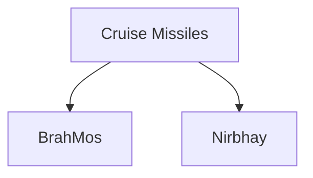

# Nirbhay Missile

## Why It Matters

Nirbhay is India's indigenous long-range cruise missile programme designed to provide precision strike capability against strategic targets.

Unlike ballistic missiles that follow a ballistic trajectory, Nirbhay is designed for sustained powered flight and can follow complex flight paths. It represents an important step in India's effort to develop advanced indigenous cruise missile technology.

---

## Quick Facts

| Item | Details |
|----------|----------|
| Name | Nirbhay |
| Type | Long-Range Cruise Missile |
| Developed By | DRDO |
| Primary Role | Precision Strike |
| Launch Platform | Land-Based (Future Multi-Platform Potential) |
| Strategic Importance | Indigenous Cruise Missile Capability |

---

## What Is Nirbhay?

Nirbhay is a long-range cruise missile designed to strike targets with high precision while flying at low altitude.

It is intended to provide India with an indigenous cruise missile capability for long-range precision engagement.

---

## Why Nirbhay Is Important

- Indigenous cruise missile programme
- Long-range precision strike capability
- Flexible flight profile
- Supports strategic deterrence
- Strengthens defence self-reliance
- Expands indigenous missile technology base

---

## Cruise Missile Concept

---

## Terrain-Hugging Flight

One of the major advantages of cruise missiles is their ability to fly at low altitude while following terrain features.

This helps reduce detection and improves survivability.

---

## Development Programme

The Nirbhay programme was developed to:

- Build indigenous cruise missile capability
- Develop advanced guidance technologies
- Strengthen long-range strike capability
- Support future missile development programmes

The programme has contributed significantly to India's missile technology ecosystem.

---

## Key Characteristics

| Feature | Advantage |
|----------|----------|
| Long Range | Deep Strike Capability |
| Precision Guidance | High Accuracy |
| Low Altitude Flight | Reduced Detection |
| Flexible Flight Path | Operational Flexibility |
| Indigenous Development | Technological Self-Reliance |

---

## Nirbhay vs BrahMos

| Feature | BrahMos | Nirbhay |
|----------|----------|----------|
| Type | Supersonic Cruise Missile | Subsonic Cruise Missile |
| Role | Rapid Strike | Long-Endurance Precision Strike |
| Flight Profile | High-Speed | Terrain-Hugging |
| Focus | Speed | Endurance and Flexibility |
|
---

## Role in India's Missile Ecosystem

BrahMos and Nirbhay complement each other by providing different operational capabilities.

---

## Strategic Importance for India

Nirbhay helps India:

- Strengthen indigenous missile capability
- Improve long-range strike options
- Enhance precision attack capability
- Expand strategic flexibility
- Support future missile development

---

## Challenges

- Complex guidance requirements
- Long development cycles
- Advanced propulsion technologies
- Continuous modernization requirements
- Evolving defence technologies

---

## Future Roadmap

- Improved guidance systems
- Greater operational capability
- Enhanced precision technologies
- Integration of lessons into future missile programmes
- Expansion of indigenous cruise missile capability

---

## Quick Revision

- Nirbhay is an indigenous long-range cruise missile.
- It is designed for precision strike missions.
- It flies using sustained powered flight.
- Terrain-hugging flight improves survivability.
- Nirbhay complements BrahMos within India's cruise missile ecosystem.
- It strengthens India's indigenous missile capability.

---

## Key Concepts

### What is Nirbhay?

An indigenous long-range cruise missile developed by India.

### Why is Nirbhay important?

It strengthens India's indigenous cruise missile capability.

### How is Nirbhay different from BrahMos?

Nirbhay emphasizes long-endurance precision strike, while BrahMos emphasizes high-speed strike capability.

### What is terrain-hugging flight?

A low-altitude flight profile that follows terrain features to reduce detection.

### Why is Nirbhay strategically important?

It improves India's precision strike capability and technological self-reliance.