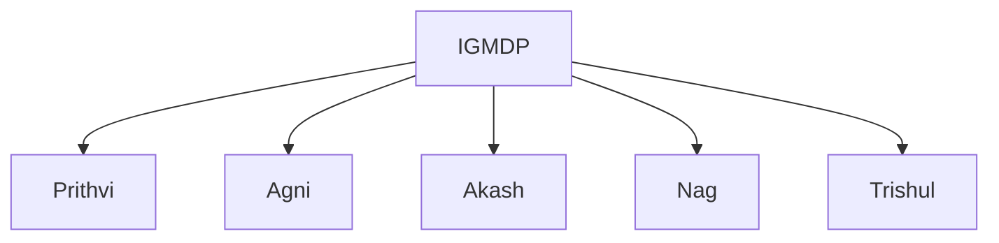
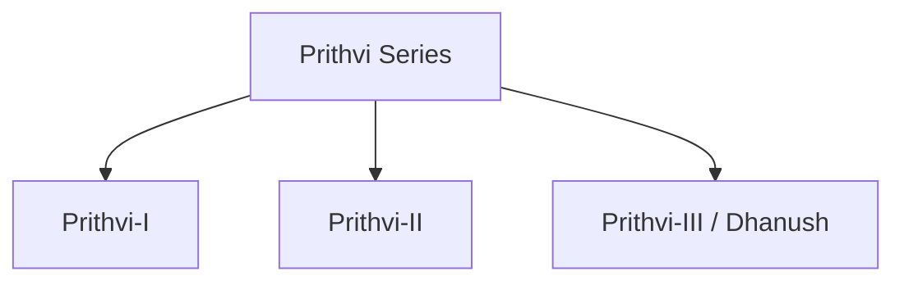

# Prithvi Series

## Why It Matters

The Prithvi Series was India's first indigenous ballistic missile family and played a foundational role in the country's missile-development journey.

It demonstrated India's ability to design, develop and deploy ballistic missiles, laying the groundwork for later programmes such as Agni, Akash and other strategic weapon systems.

Prithvi remains an important milestone in India's defence and technological development.

---

## Quick Facts

| Item | Details |
|----------|----------|
| Name | Prithvi Series |
| Type | Ballistic Missile |
| Developed By | DRDO |
| Programme | IGMDP |
| Primary Role | Tactical Strike Capability |
| Strategic Importance | Foundation of India's Missile Programme |

---

## What Is the Prithvi Series?

The Prithvi Series is a family of short-range ballistic missiles developed by India for tactical and strategic battlefield roles.

It was one of the earliest successful missile programmes developed under India's indigenous missile-development efforts.

---

## Integrated Guided Missile Development Programme (IGMDP)

The Prithvi programme was developed under the Integrated Guided Missile Development Programme (IGMDP), one of India's most important defence technology initiatives.

---

## Why Prithvi Is Important

- First indigenous ballistic missile family
- Demonstrated missile-development capability
- Strengthened defence self-reliance
- Supported battlefield strike operations
- Laid the foundation for future missile programmes

---

## Prithvi Missile Family

---

## Prithvi-I

### Primary User

Indian Army

### Role

- Battlefield support
- Tactical strike missions
- Surface-to-surface attack capability

### Importance

The first operational missile of the Prithvi family.

---

## Prithvi-II

### Primary User

Indian Air Force

### Role

- Surface-to-surface strike missions
- Strategic target engagement
- Enhanced operational flexibility

### Importance

Expanded India's missile capability beyond battlefield support.

---

## Prithvi-III (Dhanush)

### Primary User

Indian Navy

### Role

- Naval strike capability
- Maritime deterrence
- Sea-based launch operations

### Importance

Extended the Prithvi family into the maritime domain.

---

## How a Ballistic Missile Works

Unlike cruise missiles, ballistic missiles follow a ballistic flight path after the boost phase.

---

## Role in Indian Armed Forces

### Indian Army

- Tactical strike capability
- Battlefield support
- Conventional deterrence

### Indian Air Force

- Surface strike missions
- Strategic support capability

### Indian Navy

- Maritime strike operations
- Sea-based deployment experience

---

## Strategic Importance

Prithvi helped India:

- Build indigenous missile expertise
- Develop strategic technologies
- Strengthen defence self-reliance
- Establish future missile programmes
- Improve deterrence capability

---

## Legacy of the Prithvi Programme

The Prithvi programme paved the way for:

- Agni missile series
- Advanced missile technologies
- Strategic deterrence systems
- Indigenous defence research and development

It remains one of the most important milestones in India's missile history.

---

## Challenges

- Technological modernization requirements
- Evolving battlefield needs
- Emergence of newer missile systems
- Expanding strategic requirements

---

## Future Roadmap

- Continued technology upgrades
- Integration of lessons into newer missile programmes
- Support for future indigenous missile development
- Enhanced strategic capabilities

---

## Quick Revision

- Prithvi was India's first indigenous ballistic missile family.
- It was developed under the IGMDP.
- Prithvi-I served the Indian Army.
- Prithvi-II served the Indian Air Force.
- Prithvi-III (Dhanush) supported naval operations.
- The programme laid the foundation for Agni and future missile systems.

---

## Key Concepts

### What is the Prithvi Series?

India's first indigenous ballistic missile family.

### Why is Prithvi important?

It established India's indigenous missile-development capability.

### What is IGMDP?

The Integrated Guided Missile Development Programme.

### How is a ballistic missile different from a cruise missile?

A ballistic missile follows a ballistic trajectory, while a cruise missile uses powered flight throughout much of its journey.

### What is the legacy of the Prithvi programme?

It laid the foundation for India's modern missile and strategic-weapons ecosystem.