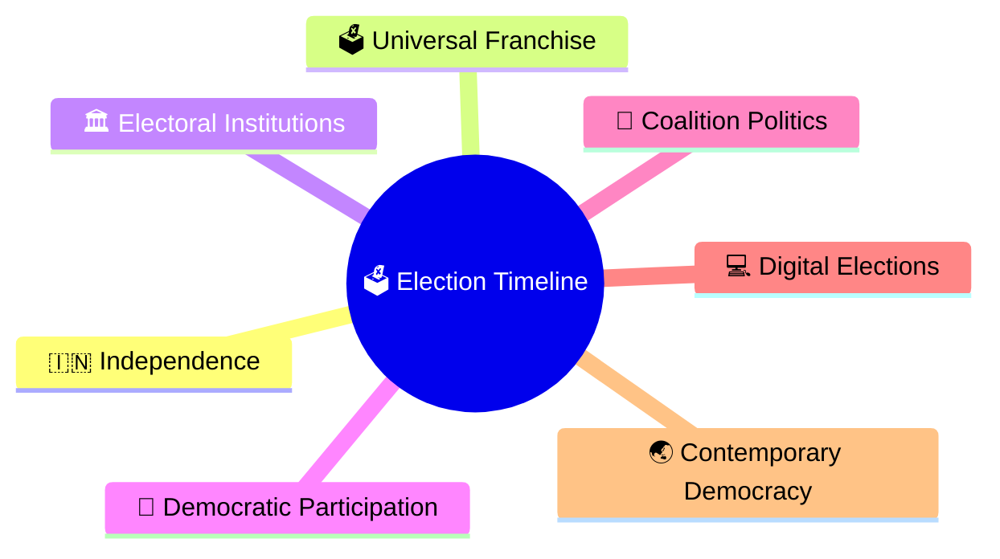
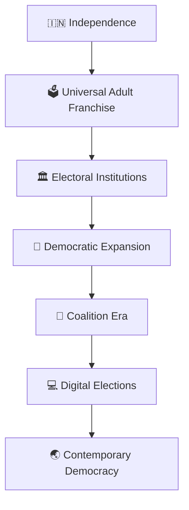
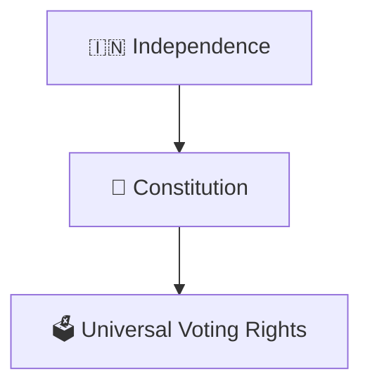
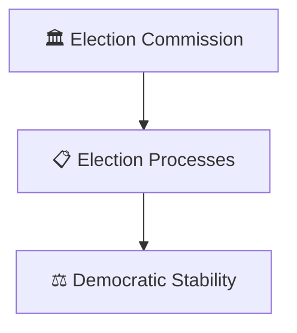
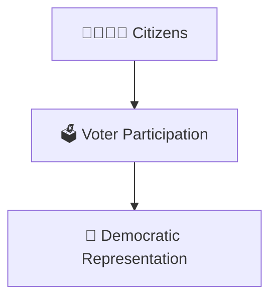
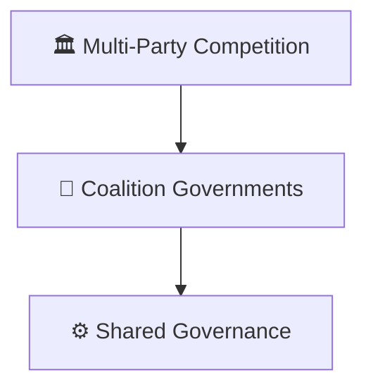
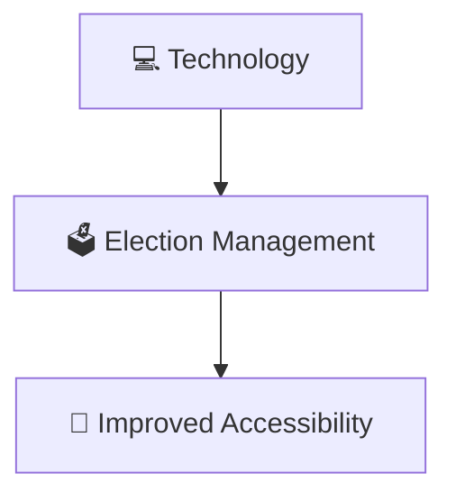
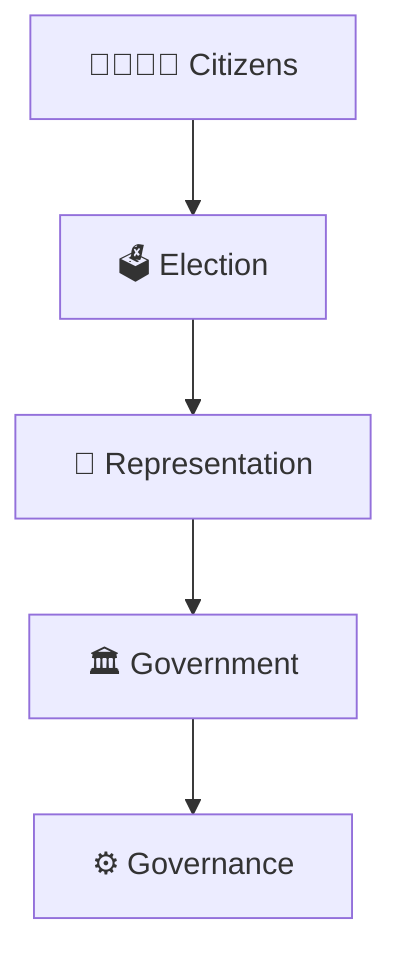

# Election Timeline

## Overview

This timeline explains the evolution of elections and democratic participation in India from independence to contemporary India.

It provides a high-level view of how electoral institutions, voter participation, representation, and democratic processes developed over time.

---

## Why It Matters

Understanding the election timeline helps explain:

- How Indian democracy evolved
- How electoral participation expanded
- How democratic institutions matured
- How representation changed over time
- How elections shape governance

---

## Election Timeline

---

## Phase 1: Democratic Foundation

### Significance

- Equal voting rights
- Democratic participation
- Representative government

---

## Phase 2: Electoral Institution Building

### Significance

- Credible elections
- Institutional development
- Electoral administration

---

## Phase 3: Expansion of Participation

### Significance

- Growing voter engagement
- Broader representation
- Democratic consolidation

---

## Phase 4: Coalition Politics

### Significance

- Political diversity
- Coalition building
- Federal representation

---

## Phase 5: Digital Transformation

### Significance

- Administrative efficiency
- Better voter services
- Stronger electoral processes

---

## Democratic Governance Framework

---

## Quick Revision

---
