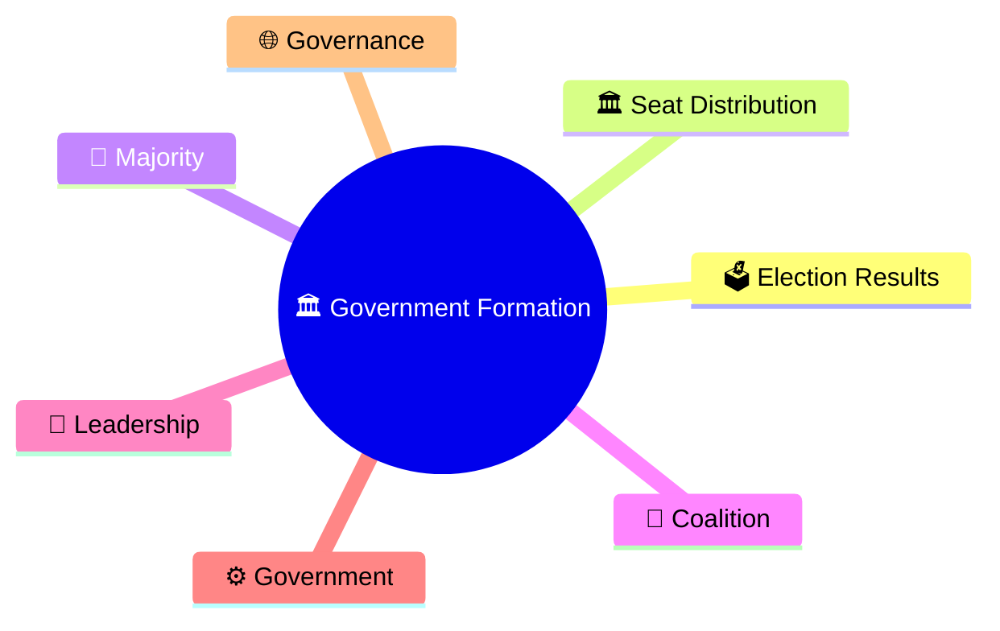
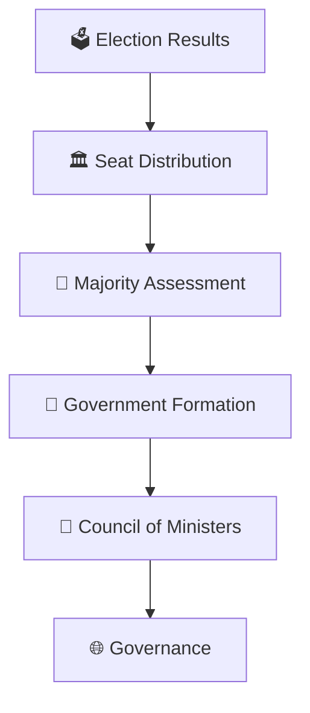
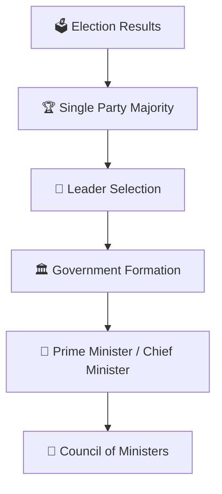
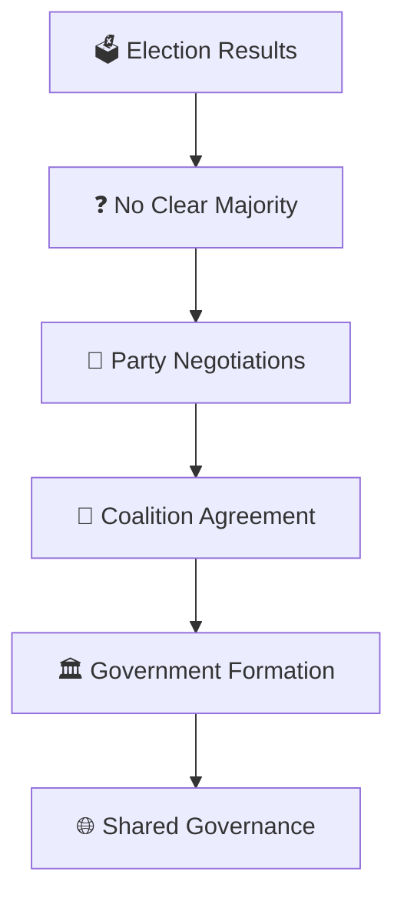
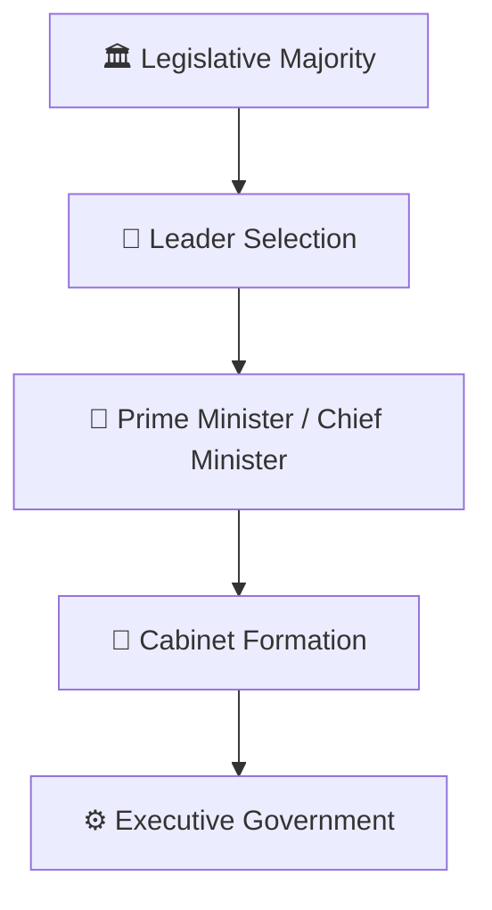
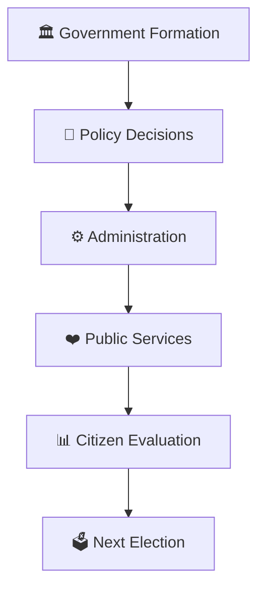
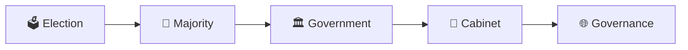

# Government Formation Process

## Overview

This diagram explains how elected representatives form a government after an election and how democratic mandates are converted into executive authority.

It helps visualize the transition from election results to governance.

---

## Why It Matters

Understanding government formation helps explain:

- How election results translate into power
- How majority support is determined
- How governments are formed
- How executive authority is established
- How democratic accountability begins

---

## Overall Government Formation Flow

---

## Majority Government Scenario

### Outcome

- One party forms the government.
- Stable majority in the legislature.

---

## Coalition Government Scenario

### Outcome

- Multiple parties form the government.
- Majority achieved through coalition support.

---

## Parliamentary Leadership Flow

---

## Governance Cycle

---

## Quick Revision

---

## Related Topics

- election-process-flow.md
- voter-to-government-journey.md
- election-commission-structure.md
- constituency-representation-model.md
- elections-and-democracy.md
- parliamentary-terminology.md
